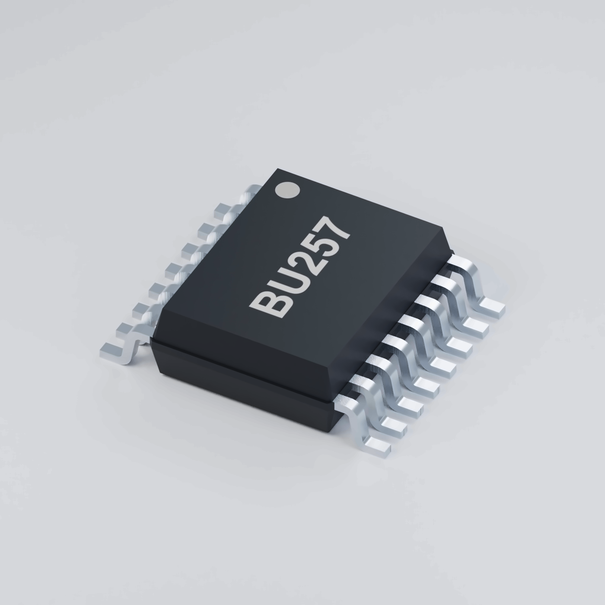
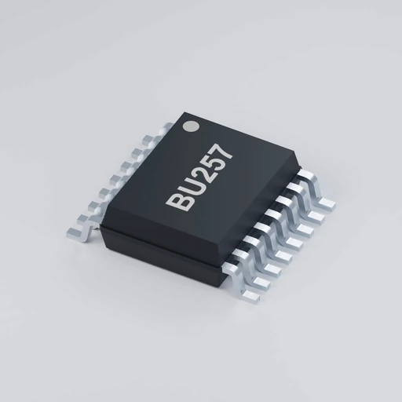
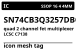

# IC SN74CB3Q3257DBQR SSOP 16 4 4MM

`electronic_ic_logic_quad_2_channel_fet_multiplexer_ssop_16_4_4mm_texas_instruments_sn74cb3q3257dbqr`

IC SN74CB3Q3257DBQR SSOP 16 4 4MM is an OOMP electronic ic definition. It uses the ssop 16 4 4mm package or form factor. Its nominal drawing size is 10.0 &#x00D7; 5.0 mm.

TI identifies DBQ16 with 3.9 x 4.9 mm nominal body and 0.635 mm pitch. KiCad 6.0 x 4.9 x 1.85 mm model is scaled to 1.65 mm height because TI specifies 1.75 mm maximum. Catalogue name says 4.4 mm and its source dimensions 10 x 5 mm conflict with TI. Not a verified mechanical model or footprint. TI lists BU257 as the device marking for SN74CB3Q3257DBQR. Typeface, orientation, placement and variable lot/date details are illustrative.

[Render recipe and provenance](data/display_render/manifest.json) · [KiCad model](https://gitlab.com/kicad/libraries/kicad-packages3D/-/blob/master/Package_SO.3dshapes/SSOP-16_3.9x4.9mm_P0.635mm.step)

Model credit: 2025 KiCAD. CC-BY-SA-4.0 with KiCad library exception; see original STEP header.

## At a glance

| Detail | Value |
| --- | --- |
| OOMP ID | `electronic_ic_logic_quad_2_channel_fet_multiplexer_ssop_16_4_4mm_texas_instruments_sn74cb3q3257dbqr` |
| Type | Ic |
| Package / style | ssop 16 4 4mm |
| Nominal size | 10.0 &#x00D7; 5.0 mm |

## Classification

| Level | Value |
| --- | --- |
| 1 | `electronic` |
| 2 | `ic` |
| 3 | `logic` |
| 4 | `quad_2_channel_fet_multiplexer` |
| 5 | `ssop_16_4_4mm` |
| 14 | `texas_instruments` |
| 15 | `sn74cb3q3257dbqr` |

## Nominal dimensions

| Measurement | Value |
| --- | ---: |
| Length | 10.0 mm |
| Width | 5.0 mm |

## Identifiers

| Identifier | Value |
| --- | --- |
| Manufacturer part number | `SN74CB3Q3257DBQR` |
| LCSC | [`C7138`](https://www.lcsc.com/product-detail/C7138.html) |
| JLCPCB | [`C7138`](https://jlcpcb.com/partdetail/TexasInstruments-SN74CB3Q3257DBQR/C7138) |

## Used in projects

[Browse confirmed project usage](https://oomlout.github.io/oomp_electronic_project_version_5/usage/index.html#electronic_ic_logic_quad_2_channel_fet_multiplexer_ssop_16_4_4mm_texas_instruments_sn74cb3q3257dbqr)

## Files

<!-- oomp-part-file-table -->

| Image type | Image | Link |
| --- | :---: | --- |
| **Studio render** |  | [PNG](data/display_render/render.png) · [Preview](data/display_render/preview.webp) |
| **Studio render sources and recipe** | — | [JSON](data/display_render/manifest.json) |
| **Drawer label data** | — | [YAML](data/label_drawer.yaml) |
| **Small drawer label** |  | [SVG](label_drawer_1_5x1.svg) |
| **Large drawer label** |  | [SVG](label_drawer_3x2.svg) |
| **Web catalogue file index** | — | [YAML](web.yaml) |
| **Part definition and build recipe** | — | [YAML](working.yaml) |

<!-- /oomp-part-file-table -->

[View this part on GitHub](https://github.com/oomlout/oomp_electronic_version_5/tree/main/parts/electronic_ic_logic_quad_2_channel_fet_multiplexer_ssop_16_4_4mm_texas_instruments_sn74cb3q3257dbqr)

[Browse this category](../../navigation/electronic/ic/logic/quad_2_channel_fet_multiplexer/ssop_16_4_4mm/texas_instruments/README.md)

---

This page is generated from the OOMP part definition by a Roboclick Jinja template. Edit the source taxonomy or template rather than this generated file.