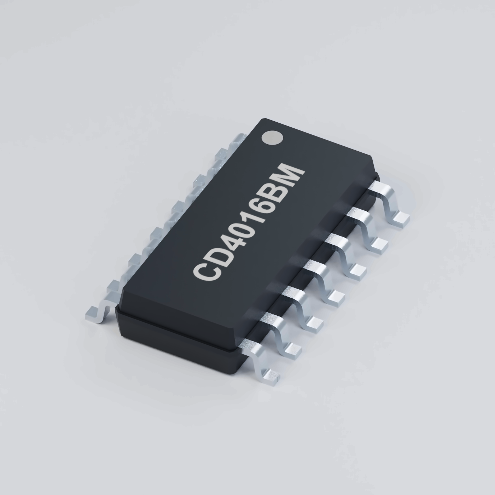
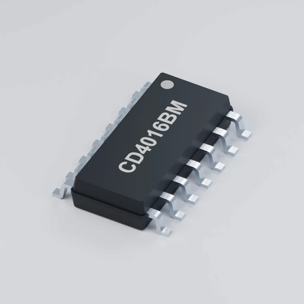
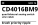
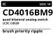

# IC CD4016BM96 SOIC 14

`electronic_ic_logic_quad_bilateral_analog_switch_soic_14_texas_instruments_cd4016bm96`

IC CD4016BM96 SOIC 14 is an OOMP electronic ic definition. It uses the soic 14 package or form factor. Its nominal drawing size is 8.69 &#x00D7; 3.9 mm.

Illustrative KiCad SOIC-14 model. TI D0014A specifies 1.75 mm maximum height; catalogue source does not specify height. Inspect pin-one and text orientation. TI lists CD4016BM as the package marking. Typeface, orientation, placement and variable lot/date details are illustrative. Marking composited in linear light from shared path-traced material passes; indirect reflections are approximate.

[Render recipe and provenance](data/display_render/manifest.json) · [KiCad model](https://gitlab.com/kicad/libraries/kicad-packages3D/-/blob/master/Package_SO.3dshapes/SOIC-14_3.9x8.7mm_P1.27mm.step)

Model credit: 2025 KiCAD. CC-BY-SA-4.0 with KiCad library exception; see original STEP header.

## At a glance

| Detail | Value |
| --- | --- |
| OOMP ID | `electronic_ic_logic_quad_bilateral_analog_switch_soic_14_texas_instruments_cd4016bm96` |
| Type | Ic |
| Package / style | soic 14 |
| Nominal size | 8.69 &#x00D7; 3.9 mm |

## Classification

| Level | Value |
| --- | --- |
| 1 | `electronic` |
| 2 | `ic` |
| 3 | `logic` |
| 4 | `quad_bilateral_analog_switch` |
| 5 | `soic_14` |
| 14 | `texas_instruments` |
| 15 | `cd4016bm96` |

## Nominal dimensions

| Measurement | Value |
| --- | ---: |
| Length | 8.69 mm |
| Width | 3.9 mm |

## Identifiers

| Identifier | Value |
| --- | --- |
| Manufacturer part number | `CD4016BM96` |
| LCSC | [`C6520`](https://www.lcsc.com/product-detail/C6520.html) |
| JLCPCB | [`C6520`](https://jlcpcb.com/partdetail/TexasInstruments-CD4016BM96/C6520) |

## Used in projects

[Browse confirmed project usage](https://oomlout.github.io/oomp_electronic_project_version_5/usage/index.html#electronic_ic_logic_quad_bilateral_analog_switch_soic_14_texas_instruments_cd4016bm96)

## Files

<!-- oomp-part-file-table -->

| Image type | Image | Link |
| --- | :---: | --- |
| **Studio render** |  | [PNG](data/display_render/render.png) · [Preview](data/display_render/preview.webp) |
| **Studio render sources and recipe** | — | [JSON](data/display_render/manifest.json) |
| **Drawer label data** | — | [YAML](data/label_drawer.yaml) |
| **Small drawer label** |  | [SVG](label_drawer_1_5x1.svg) |
| **Large drawer label** |  | [SVG](label_drawer_3x2.svg) |
| **Web catalogue file index** | — | [YAML](web.yaml) |
| **Part definition and build recipe** | — | [YAML](working.yaml) |

<!-- /oomp-part-file-table -->

[View this part on GitHub](https://github.com/oomlout/oomp_electronic_version_5/tree/main/parts/electronic_ic_logic_quad_bilateral_analog_switch_soic_14_texas_instruments_cd4016bm96)

[Browse this category](../../navigation/electronic/ic/logic/quad_bilateral_analog_switch/soic_14/texas_instruments/README.md)

---

This page is generated from the OOMP part definition by a Roboclick Jinja template. Edit the source taxonomy or template rather than this generated file.