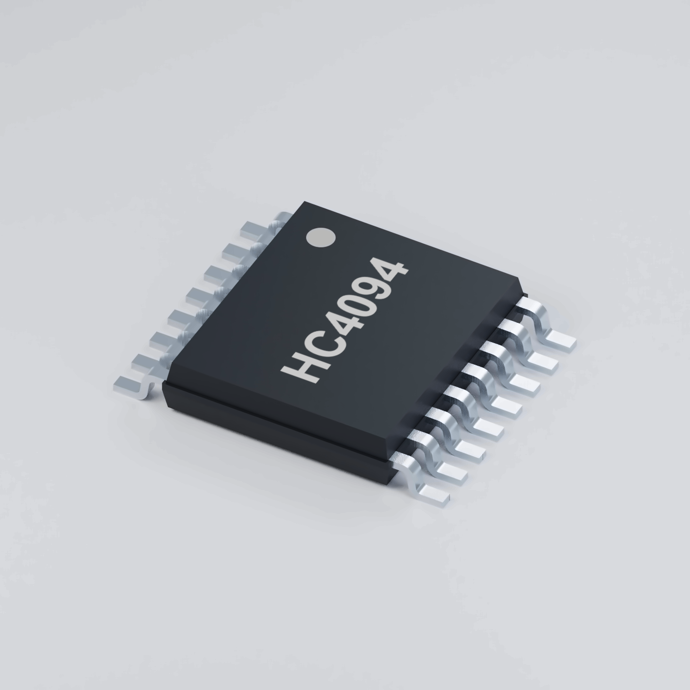
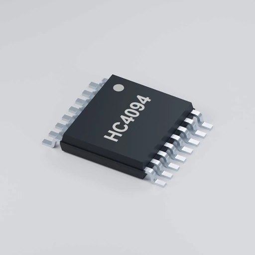
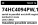

# IC 74HC4094PW,118 TSSOP 16

`electronic_ic_logic_serial_in_parallel_out_shift_register_latched_tri_state_tssop_16_nexperia_74hc4094pw_118`

IC 74HC4094PW,118 TSSOP 16 is an OOMP electronic ic definition. It uses the tssop 16 package or form factor. Its nominal drawing size is 5.0 &#x00D7; 4.4 mm.

Illustrative KiCad TSSOP-16 model is 1.1 mm high; Nexperia SOT403-1 permits up to 1.2 mm. Catalogue source omits height. Nexperia lists HC4094 as the package marking. Typeface, orientation, placement and variable lot/date details are illustrative. Marking composited in linear light from shared path-traced material passes; indirect reflections are approximate.

[Render recipe and provenance](data/display_render/manifest.json) · [KiCad model](https://gitlab.com/kicad/libraries/kicad-packages3D/-/blob/master/Package_SO.3dshapes/TSSOP-16_4.4x5mm_P0.65mm.step)

Model credit: 2025 KiCAD. CC-BY-SA-4.0 with KiCad library exception; see original STEP header.

## At a glance

| Detail | Value |
| --- | --- |
| OOMP ID | `electronic_ic_logic_serial_in_parallel_out_shift_register_latched_tri_state_tssop_16_nexperia_74hc4094pw_118` |
| Type | Ic |
| Package / style | tssop 16 |
| Nominal size | 5.0 &#x00D7; 4.4 mm |

## Classification

| Level | Value |
| --- | --- |
| 1 | `electronic` |
| 2 | `ic` |
| 3 | `logic` |
| 4 | `serial_in_parallel_out_shift_register_latched_tri_state` |
| 5 | `tssop_16` |
| 14 | `nexperia` |
| 15 | `74hc4094pw_118` |

## Nominal dimensions

| Measurement | Value |
| --- | ---: |
| Length | 5.0 mm |
| Width | 4.4 mm |

## Identifiers

| Identifier | Value |
| --- | --- |
| Manufacturer part number | `74HC4094PW,118` |
| LCSC | [`C5652`](https://www.lcsc.com/product-detail/C5652.html) |
| JLCPCB | [`C5652`](https://jlcpcb.com/partdetail/Nexperia-74HC4094PW118/C5652) |

## Used in projects

[Browse confirmed project usage](https://oomlout.github.io/oomp_electronic_project_version_5/usage/index.html#electronic_ic_logic_serial_in_parallel_out_shift_register_latched_tri_state_tssop_16_nexperia_74hc4094pw_118)

## Files

<!-- oomp-part-file-table -->

| Image type | Image | Link |
| --- | :---: | --- |
| **Studio render** |  | [PNG](data/display_render/render.png) · [Preview](data/display_render/preview.webp) |
| **Studio render sources and recipe** | — | [JSON](data/display_render/manifest.json) |
| **Drawer label data** | — | [YAML](data/label_drawer.yaml) |
| **Small drawer label** |  | [SVG](label_drawer_1_5x1.svg) |
| **Large drawer label** |  | [SVG](label_drawer_3x2.svg) |
| **Web catalogue file index** | — | [YAML](web.yaml) |
| **Part definition and build recipe** | — | [YAML](working.yaml) |

<!-- /oomp-part-file-table -->

[View this part on GitHub](https://github.com/oomlout/oomp_electronic_version_5/tree/main/parts/electronic_ic_logic_serial_in_parallel_out_shift_register_latched_tri_state_tssop_16_nexperia_74hc4094pw_118)

[Browse this category](../../navigation/electronic/ic/logic/serial_in_parallel_out_shift_register_latched_tri_state/tssop_16/nexperia/README.md)

---

This page is generated from the OOMP part definition by a Roboclick Jinja template. Edit the source taxonomy or template rather than this generated file.