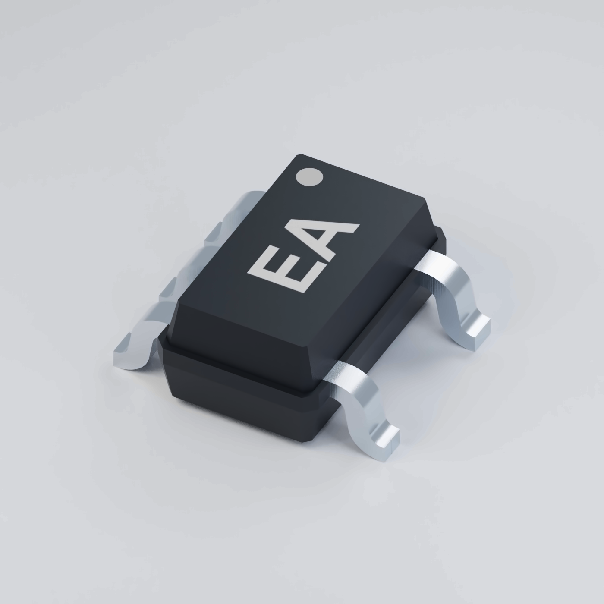
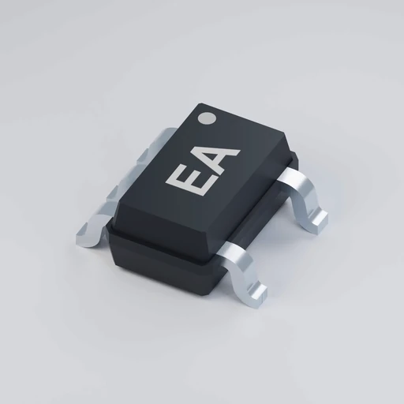
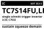

# IC TC7S14FU,LF SOT 353 5

`electronic_ic_logic_single_schmitt_trigger_inverter_sot_353_5_toshiba_tc7s14fu_lf`

IC TC7S14FU,LF SOT 353 5 is an OOMP electronic ic definition. It uses the sot 353 5 package or form factor. Its nominal drawing size is 10.0 &#x00D7; 5.0 mm.

Illustrative KiCad SOT-353 model vertically scaled from 1.1 to 0.9 mm, matching Toshiba listed height. Catalogue 10 x 5 mm conflicts with Toshiba 2.0 x 2.1 mm and omits height and footprint. Not a verified mechanical model or PCB footprint. Toshiba depicts EA in its marking illustration; exact production marking and variation are not established. Typeface, orientation and placement are illustrative.

[Render recipe and provenance](data/display_render/manifest.json) · [KiCad model](https://gitlab.com/kicad/libraries/kicad-packages3D/-/blob/master/Package_TO_SOT_SMD.3dshapes/SOT-353_SC-70-5.step)

Model credit: 2025 KiCAD. CC-BY-SA-4.0 with KiCad library exception; see original STEP header.

## At a glance

| Detail | Value |
| --- | --- |
| OOMP ID | `electronic_ic_logic_single_schmitt_trigger_inverter_sot_353_5_toshiba_tc7s14fu_lf` |
| Type | Ic |
| Package / style | sot 353 5 |
| Nominal size | 10.0 &#x00D7; 5.0 mm |

## Classification

| Level | Value |
| --- | --- |
| 1 | `electronic` |
| 2 | `ic` |
| 3 | `logic` |
| 4 | `single_schmitt_trigger_inverter` |
| 5 | `sot_353_5` |
| 14 | `toshiba` |
| 15 | `tc7s14fu_lf` |

## Nominal dimensions

| Measurement | Value |
| --- | ---: |
| Length | 10.0 mm |
| Width | 5.0 mm |

## Identifiers

| Identifier | Value |
| --- | --- |
| Manufacturer part number | `TC7S14FU,LF` |
| LCSC | [`C7032`](https://www.lcsc.com/product-detail/C7032.html) |
| JLCPCB | [`C7032`](https://jlcpcb.com/partdetail/TOSHIBA-TC7S14FULF/C7032) |

## Used in projects

[Browse confirmed project usage](https://oomlout.github.io/oomp_electronic_project_version_5/usage/index.html#electronic_ic_logic_single_schmitt_trigger_inverter_sot_353_5_toshiba_tc7s14fu_lf)

## Files

<!-- oomp-part-file-table -->

| Image type | Image | Link |
| --- | :---: | --- |
| **Studio render** |  | [PNG](data/display_render/render.png) · [Preview](data/display_render/preview.webp) |
| **Studio render sources and recipe** | — | [JSON](data/display_render/manifest.json) |
| **Drawer label data** | — | [YAML](data/label_drawer.yaml) |
| **Small drawer label** |  | [SVG](label_drawer_1_5x1.svg) |
| **Large drawer label** |  | [SVG](label_drawer_3x2.svg) |
| **Web catalogue file index** | — | [YAML](web.yaml) |
| **Part definition and build recipe** | — | [YAML](working.yaml) |

<!-- /oomp-part-file-table -->

[View this part on GitHub](https://github.com/oomlout/oomp_electronic_version_5/tree/main/parts/electronic_ic_logic_single_schmitt_trigger_inverter_sot_353_5_toshiba_tc7s14fu_lf)

[Browse this category](../../navigation/electronic/ic/logic/single_schmitt_trigger_inverter/sot_353_5/toshiba/README.md)

---

This page is generated from the OOMP part definition by a Roboclick Jinja template. Edit the source taxonomy or template rather than this generated file.