# IC MT29F1G01ABAFDWB UPDFN 8

`electronic_ic_memory_spi_nand_flash_1_gbit_updfn_8_micron_mt29f1g01abafdwb`

IC MT29F1G01ABAFDWB UPDFN 8 is an OOMP electronic ic definition. It uses the updfn 8 package or form factor. Its nominal drawing size is 6.0 &#x00D7; 5.0 mm. The definition includes 8 documented pins.

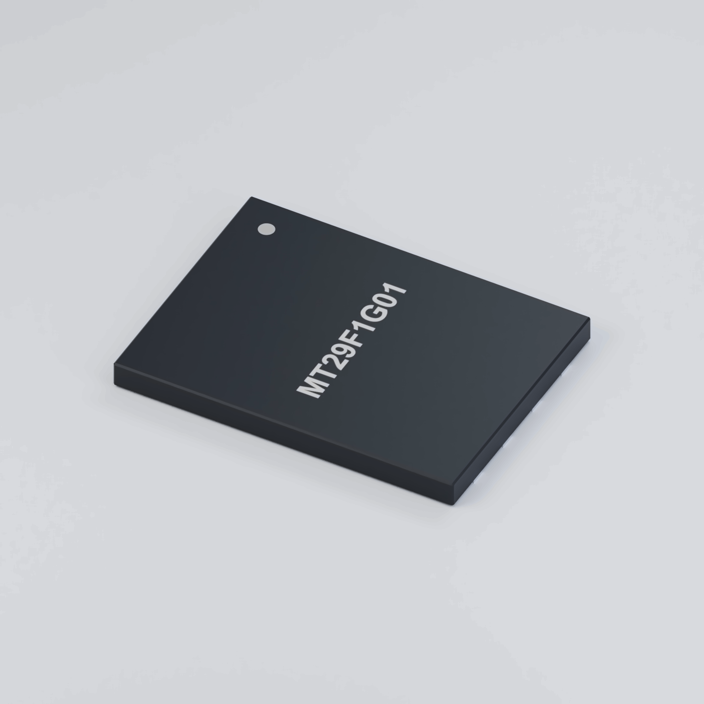

Procedural eight-terminal model has 8 x 6 x 0.65 mm body and 1.27 mm pitch, based on the reviewed Micron WB drawing. Catalogue 6 x 5 mm dimensions conflict; manufacturer Micron is inferred, complete orderable and footprint are missing. Terminal form, marking and pin-one indicator appearance are approximate; not a verified mechanical model or footprint. MT29F1G01 is an illustrative partial family identifier; exact physical marking and complete orderable are unverified. Typeface, orientation, placement and variable lot/date details are illustrative.

[Render recipe and provenance](data/display_render/manifest.json) · [KiCad model](https://github.com/oomlout/oomp_electronic_version_5/blob/main/kicad_agents/display_model_micron_mt29f1g01_udfn8.py)

Model credit: Procedural model generated in this repository. Project source; procedural display geometry.

## At a glance

| Detail | Value |
| --- | --- |
| OOMP ID | `electronic_ic_memory_spi_nand_flash_1_gbit_updfn_8_micron_mt29f1g01abafdwb` |
| Type | Ic |
| Package / style | updfn 8 |
| Nominal size | 6.0 &#x00D7; 5.0 mm |
| Documented pins | 8 |

## Classification

| Level | Value |
| --- | --- |
| 1 | `electronic` |
| 2 | `ic` |
| 3 | `memory` |
| 4 | `spi_nand_flash_1_gbit` |
| 5 | `updfn_8` |
| 14 | `micron` |
| 15 | `mt29f1g01abafdwb` |

## Nominal dimensions

| Measurement | Value |
| --- | ---: |
| Length | 6.0 mm |
| Width | 5.0 mm |

## Identifiers

| Identifier | Value |
| --- | --- |
| Manufacturer part number | `MT29F1G01ABAFDWB` |
| LCSC | [`C2905686`](https://www.lcsc.com/product-detail/C2905686.html) |

## Pins

| Pin | Name | Type |
| ---: | --- | --- |
| 1 | chip_select | signal |
| 2 | data_out_io1 | signal |
| 3 | write_protect_io2 | signal |
| 4 | gnd | signal |
| 5 | data_in_io0 | signal |
| 6 | clock | signal |
| 7 | hold_io3 | signal |
| 8 | vcc | signal |

## Datasheet

[View the datasheet](data/datasheet.pdf)

## Used in projects

[Browse confirmed project usage](https://oomlout.github.io/oomp_electronic_project_version_5/usage/index.html#electronic_ic_memory_spi_nand_flash_1_gbit_updfn_8_micron_mt29f1g01abafdwb)

## Files

<!-- oomp-part-file-table -->

| Image type | Image | Link |
| --- | :---: | --- |
| **Studio render** | 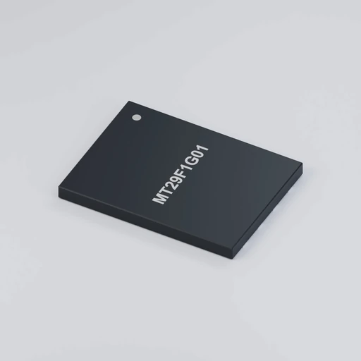 | [PNG](data/display_render/render.png) · [Preview](data/display_render/preview.webp) |
| **Pinout drawing** Pin names and positions on the part. | 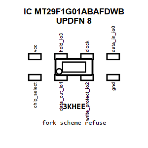 | [SVG](data/working_svg_square_pins.svg) · [PNG](data/working_svg_square_pins.png) · [Preview](data/working_svg_square_pins_300.png) |
| **Assembly** Component placement drawing. | 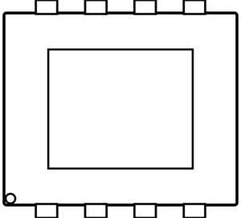 | [SVG](data/working_svg_assembly.svg) · [PNG](data/working_svg_assembly.png) · [Preview](data/working_svg_assembly_300.png) |
| **Assembly pinout** Placement drawing with the pins marked. | 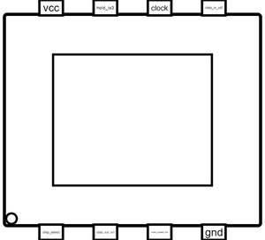 | [SVG](data/working_svg_assembly_pins.svg) · [PNG](data/working_svg_assembly_pins.png) · [Preview](data/working_svg_assembly_pins_300.png) |
| **Outline** External shape of the part. | 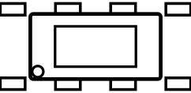 | [SVG](data/working_svg_outline.svg) · [PNG](data/working_svg_outline.png) · [Preview](data/working_svg_outline_300.png) |
| **Dimensions** Package outline with dimension arrows. | 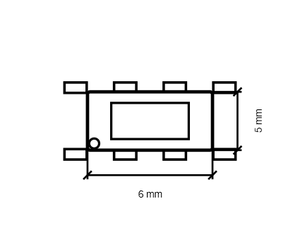 | [SVG](data/working_svg_dimensioned.svg) · [PNG](data/working_svg_dimensioned.png) · [Preview](data/working_svg_dimensioned_300.png) |
| **Dimensions with labels** Labelled package measurements. | 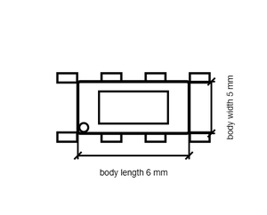 | [SVG](data/working_svg_dimensioned_titles.svg) · [PNG](data/working_svg_dimensioned_titles.png) · [Preview](data/working_svg_dimensioned_titles_300.png) |
| **Square summary** Component identification card. | 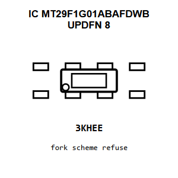 | [SVG](data/working_svg_square.svg) · [PNG](data/working_svg_square.png) · [Preview](data/working_svg_square_300.png) |
| **Square schematic** Schematic symbol on an identification card. | 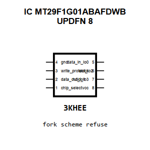 | [SVG](data/working_svg_square_schematic.svg) · [PNG](data/working_svg_square_schematic.png) · [Preview](data/working_svg_square_schematic_300.png) |
| **Part ID** Drawing labelled with the OOMP catalogue ID. | 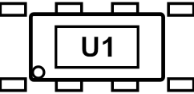 | [SVG](data/working_svg_part_id.svg) · [PNG](data/working_svg_part_id.png) · [Preview](data/working_svg_part_id_300.png) |
| **MD5 alpha** Drawing labelled with the short OOMP code. | 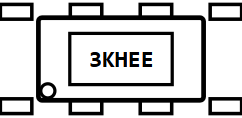 | [SVG](data/working_svg_md5_6_alpha.svg) · [PNG](data/working_svg_md5_6_alpha.png) · [Preview](data/working_svg_md5_6_alpha_300.png) |
| **BIP 39 words** Drawing labelled with the three-word identifier. | 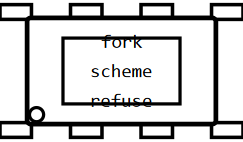 | [SVG](data/working_svg_bip_39_3_word.svg) · [PNG](data/working_svg_bip_39_3_word.png) · [Preview](data/working_svg_bip_39_3_word_300.png) |
| **Schematic** Electrical symbol for the part. | 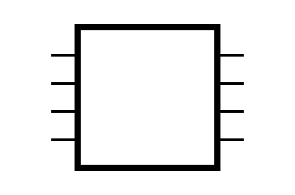 | [SVG](data/working_svg_schematic.svg) · [PNG](data/working_svg_schematic.png) |
| **Schematic pinout** Electrical symbol with pin labels. | 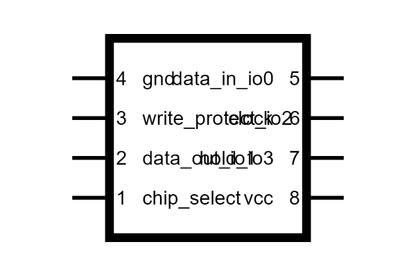 | [SVG](data/working_svg_schematic_pins.svg) · [PNG](data/working_svg_schematic_pins.png) |
| **Schematic with part ID** Symbol labelled with the OOMP catalogue ID. | 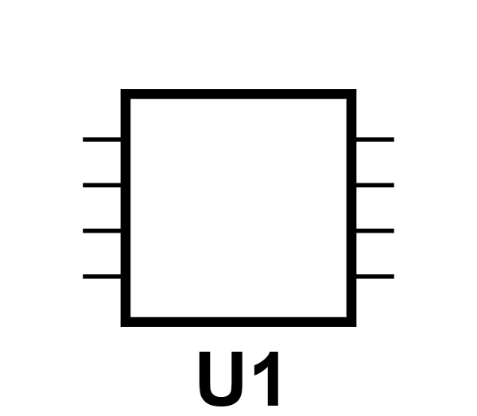 | [SVG](data/working_svg_schematic_part_id.svg) · [PNG](data/working_svg_schematic_part_id.png) |
| **Schematic with MD5 alpha** Symbol labelled with the short OOMP code. | 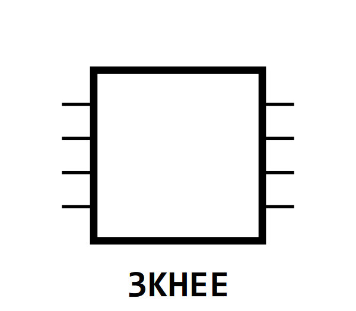 | [SVG](data/working_svg_schematic_md5_6_alpha.svg) · [PNG](data/working_svg_schematic_md5_6_alpha.png) |
| **Schematic with BIP 39 words** Symbol labelled with the three-word identifier. | 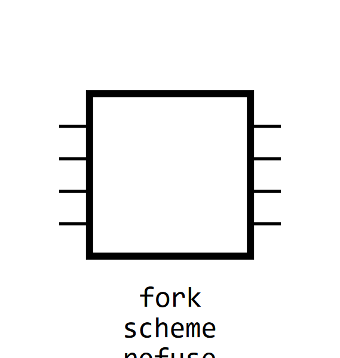 | [SVG](data/working_svg_schematic_bip_39_3_word.svg) · [PNG](data/working_svg_schematic_bip_39_3_word.png) |
| **KiCad asset licence** | — | [MD](data/kicad/LICENSE.md) |
| **KiCad library guide** | — | [MD](data/kicad/README.md) |
| **Hand-solder footprint guide** | — | [MD](data/kicad/hand_solder/README.md) |
| **Machine-solder footprint guide** | — | [MD](data/kicad/machine_solder/README.md) |
| **KiCad availability and source masters** | — | [JSON](data/kicad/manifest.json) · [YAML](data/kicad/manifest.yaml) |
| **Studio render sources and recipe** | — | [JSON](data/display_render/manifest.json) |
| **Manufacturer or supplier datasheet** | — | [PDF](data/datasheet.pdf) |
| **Drawer label data** | — | [YAML](data/label_drawer.yaml) |
| **Generator label** |  | [SVG](generator_label.svg) · [JSON](generator_label.json) |
| **Small drawer label** |  | [SVG](label_drawer_1_5x1.svg) |
| **Large drawer label** | 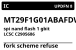 | [SVG](label_drawer_3x2.svg) |
| **Web catalogue file index** | — | [YAML](web.yaml) |
| **Part definition and build recipe** | — | [YAML](working.yaml) |

<!-- /oomp-part-file-table -->

[View this part on GitHub](https://github.com/oomlout/oomp_electronic_version_5/tree/main/parts/electronic_ic_memory_spi_nand_flash_1_gbit_updfn_8_micron_mt29f1g01abafdwb)

[Browse this category](../../navigation/electronic/ic/memory/spi_nand_flash_1_gbit/updfn_8/micron/README.md)

---

This page is generated from the OOMP part definition by a Roboclick Jinja template. Edit the source taxonomy or template rather than this generated file.