# IC Microcontroller STM32 LQFP_48

`electronic_ic_microcontroller_stm32_lqfp_48_st_stm32f103c8tx`

IC Microcontroller STM32 LQFP_48 is an OOMP electronic ic definition. It uses the lqfp 48 package or form factor. Its nominal drawing size is 9.7 &#x00D7; 9.7 mm. The definition includes 48 documented pins.

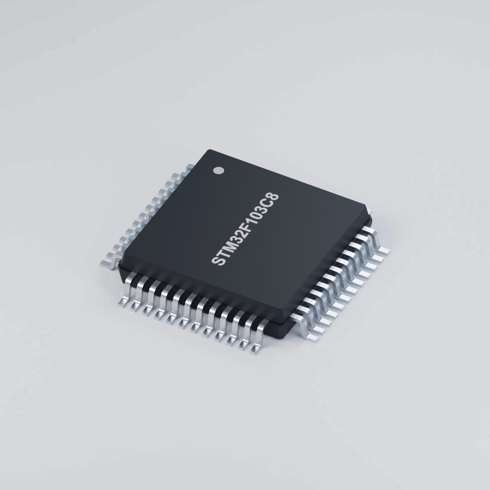

KiCad LQFP-48 model has a 7 x 7 mm body, 9 x 9 mm nominal lead span, 1.5 mm overall height and 0.5 mm pitch. ST and the family are inferred from the catalogue ID; Tx is a wildcard, not a confirmed exact orderable. The source lists 9.7 x 9.7 mm dimensions without a clear reference, which differs from the nominal lead span. Not a verified mechanical model or footprint. STM32F103C8 is an illustrative family identifier; the physical marking is unverified. Typeface, orientation, placement and variable lot/date details are illustrative.

[Render recipe and provenance](data/display_render/manifest.json) · [KiCad model](https://gitlab.com/kicad/libraries/kicad-packages3D/-/blob/master/Package_QFP.3dshapes/LQFP-48_7x7mm_P0.5mm.step)

Model credit: 2025 KiCAD. CC-BY-SA-4.0 with KiCad library exception; see original STEP header.

## At a glance

| Detail | Value |
| --- | --- |
| OOMP ID | `electronic_ic_microcontroller_stm32_lqfp_48_st_stm32f103c8tx` |
| Type | Ic |
| Package / style | lqfp 48 |
| Nominal size | 9.7 &#x00D7; 9.7 mm |
| Documented pins | 48 |

## Classification

| Level | Value |
| --- | --- |
| 1 | `electronic` |
| 2 | `ic` |
| 3 | `microcontroller` |
| 4 | `stm32` |
| 5 | `lqfp_48` |
| 14 | `st` |
| 15 | `stm32f103c8tx` |

## Nominal dimensions

| Measurement | Value |
| --- | ---: |
| Height | 1.6 mm |
| Length | 9.7 mm |
| Width | 9.7 mm |

## Pins

| Pin | Name | Type |
| ---: | --- | --- |
| 1 | VBAT | signal |
| 2 | PC13 | signal |
| 3 | PC14 | signal |
| 4 | PC15 | signal |
| 5 | PD0 | signal |
| 6 | PD1 | signal |
| 7 | NRST | signal |
| 8 | VSSA | gnd |
| 9 | VDDA | power |
| 10 | PA0 | signal |
| 11 | PA1 | signal |
| 12 | PA2 | signal |
| 13 | PA3 | signal |
| 14 | PA4 | signal |
| 15 | PA5 | signal |
| 16 | PA6 | signal |
| 17 | PA7 | signal |
| 18 | PB0 | signal |
| 19 | PB1 | signal |
| 20 | PB2 | signal |
| 21 | PB10 | signal |
| 22 | PB11 | signal |
| 23 | VSS | gnd |
| 24 | VDD | power |
| 25 | PB12 | signal |
| 26 | PB13 | signal |
| 27 | PB14 | signal |
| 28 | PB15 | signal |
| 29 | PA8 | signal |
| 30 | PA9 | signal |
| 31 | PA10 | signal |
| 32 | PA11 | signal |
| 33 | PA12 | signal |
| 34 | PA13 | signal |
| 35 | VSS | gnd |
| 36 | VDD | power |
| 37 | PA14 | signal |
| 38 | PA15 | signal |
| 39 | PB3 | signal |
| 40 | PB4 | signal |
| 41 | PB5 | signal |
| 42 | PB6 | signal |
| 43 | PB7 | signal |
| 44 | BOOT0 | signal |
| 45 | PB8 | signal |
| 46 | PB9 | signal |
| 47 | VSS | gnd |
| 48 | VDD | power |

## Datasheet

[Manufacturer drawing](https://www.st.com/resource/en/datasheet/stm32f103c8.pdf)

A local PDF has not been captured. The linked source is not an offline datasheet.

## Used in projects

[Browse confirmed project usage](https://oomlout.github.io/oomp_electronic_project_version_5/usage/index.html#electronic_ic_microcontroller_stm32_lqfp_48_st_stm32f103c8tx)

## Files

<!-- oomp-part-file-table -->

| Image type | Image | Link |
| --- | :---: | --- |
| **Studio render** | 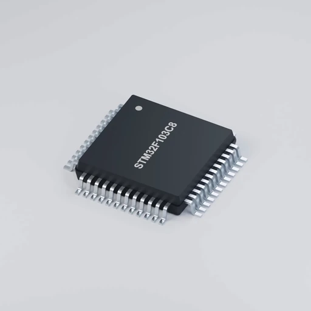 | [PNG](data/display_render/render.png) · [Preview](data/display_render/preview.webp) |
| **Pinout drawing** Pin names and positions on the part. | 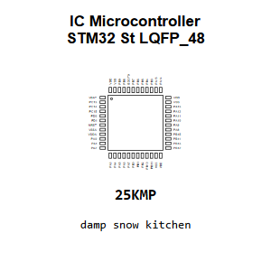 | [SVG](data/working_svg_square_pins.svg) · [PNG](data/working_svg_square_pins.png) · [Preview](data/working_svg_square_pins_300.png) |
| **Assembly** Component placement drawing. | 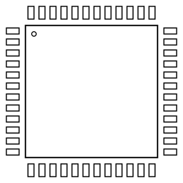 | [SVG](data/working_svg_assembly.svg) · [PNG](data/working_svg_assembly.png) · [Preview](data/working_svg_assembly_300.png) |
| **Assembly pinout** Placement drawing with the pins marked. | 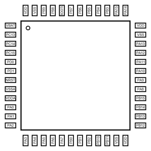 | [SVG](data/working_svg_assembly_pins.svg) · [PNG](data/working_svg_assembly_pins.png) · [Preview](data/working_svg_assembly_pins_300.png) |
| **Outline** External shape of the part. | 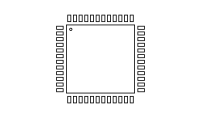 | [SVG](data/working_svg_outline.svg) · [PNG](data/working_svg_outline.png) · [Preview](data/working_svg_outline_300.png) |
| **Dimensions** Package outline with dimension arrows. | 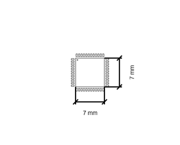 | [SVG](data/working_svg_dimensioned.svg) · [PNG](data/working_svg_dimensioned.png) · [Preview](data/working_svg_dimensioned_300.png) |
| **Dimensions with labels** Labelled package measurements. | 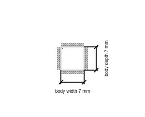 | [SVG](data/working_svg_dimensioned_titles.svg) · [PNG](data/working_svg_dimensioned_titles.png) · [Preview](data/working_svg_dimensioned_titles_300.png) |
| **Square summary** Component identification card. | 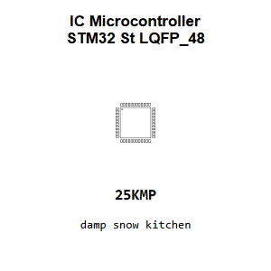 | [SVG](data/working_svg_square.svg) · [PNG](data/working_svg_square.png) · [Preview](data/working_svg_square_300.png) |
| **Square schematic** Schematic symbol on an identification card. | 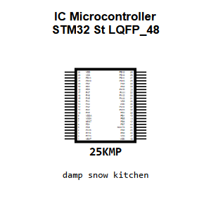 | [SVG](data/working_svg_square_schematic.svg) · [PNG](data/working_svg_square_schematic.png) · [Preview](data/working_svg_square_schematic_300.png) |
| **Part ID** Drawing labelled with the OOMP catalogue ID. | 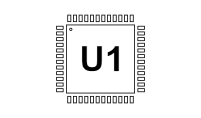 | [SVG](data/working_svg_part_id.svg) · [PNG](data/working_svg_part_id.png) · [Preview](data/working_svg_part_id_300.png) |
| **MD5 alpha** Drawing labelled with the short OOMP code. | 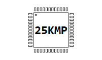 | [SVG](data/working_svg_md5_6_alpha.svg) · [PNG](data/working_svg_md5_6_alpha.png) · [Preview](data/working_svg_md5_6_alpha_300.png) |
| **BIP 39 words** Drawing labelled with the three-word identifier. | 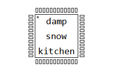 | [SVG](data/working_svg_bip_39_3_word.svg) · [PNG](data/working_svg_bip_39_3_word.png) · [Preview](data/working_svg_bip_39_3_word_300.png) |
| **Schematic** Electrical symbol for the part. | 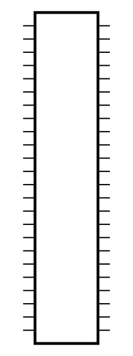 | [SVG](data/working_svg_schematic.svg) · [PNG](data/working_svg_schematic.png) |
| **Schematic pinout** Electrical symbol with pin labels. | 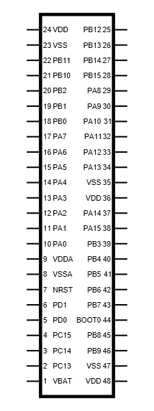 | [SVG](data/working_svg_schematic_pins.svg) · [PNG](data/working_svg_schematic_pins.png) |
| **Schematic with part ID** Symbol labelled with the OOMP catalogue ID. | 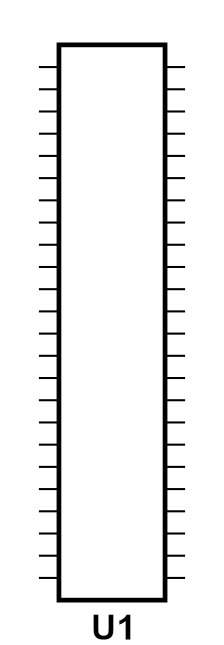 | [SVG](data/working_svg_schematic_part_id.svg) · [PNG](data/working_svg_schematic_part_id.png) |
| **Schematic with MD5 alpha** Symbol labelled with the short OOMP code. | 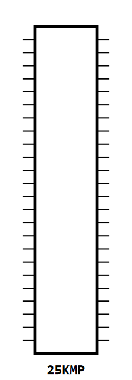 | [SVG](data/working_svg_schematic_md5_6_alpha.svg) · [PNG](data/working_svg_schematic_md5_6_alpha.png) |
| **Schematic with BIP 39 words** Symbol labelled with the three-word identifier. | 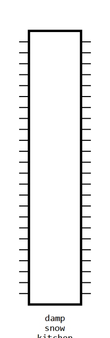 | [SVG](data/working_svg_schematic_bip_39_3_word.svg) · [PNG](data/working_svg_schematic_bip_39_3_word.png) |
| **KiCad asset licence** | — | [MD](data/kicad/LICENSE.md) |
| **KiCad library guide** | — | [MD](data/kicad/README.md) |
| **KiCad symbol and footprint overview** | 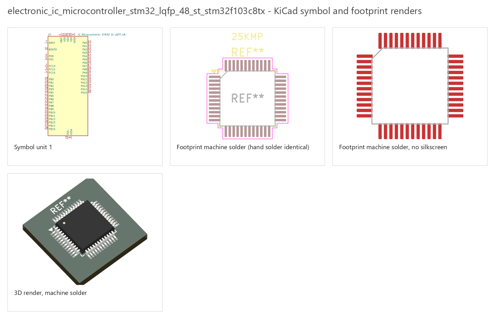 | [PNG](data/kicad/contact_sheet.png) |
| **KiCad symbol library** | — | [KICAD_SYM](data/kicad/electronic_ic_microcontroller_stm32_lqfp_48_st_stm32f103c8tx.kicad_sym) |
| **Hand-solder footprint guide** | — | [MD](data/kicad/hand_solder/README.md) |
| **Hand-solder footprint** | — | [KICAD_MOD](data/kicad/hand_solder/electronic_ic_microcontroller_stm32_lqfp_48_st_stm32f103c8tx.kicad_mod) |
| **Machine-solder footprint drawing** | 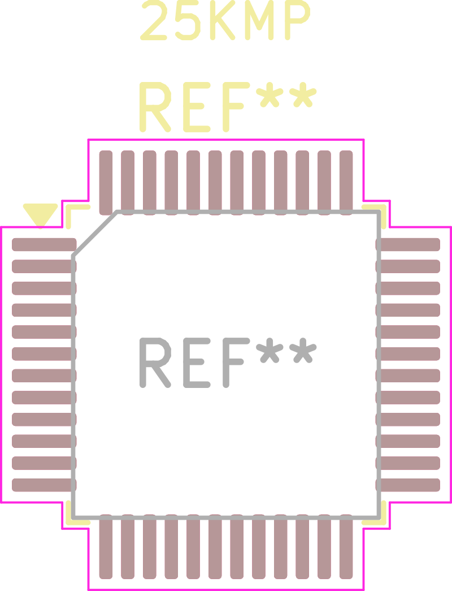 | [SVG](data/kicad/kicad_footprint_machine_solder.svg) · [PNG](data/kicad/kicad_footprint_machine_solder.png) · [STEP](data/kicad/kicad_footprint_machine_solder.step) |
| **Machine-solder footprint (3D view)** | 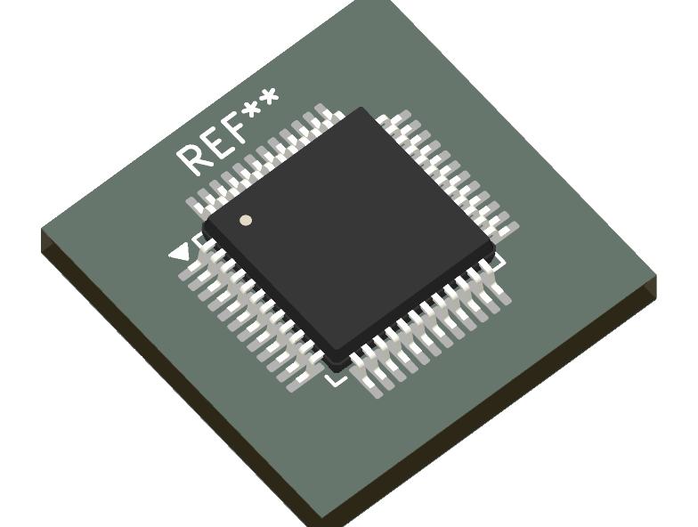 | [PNG](data/kicad/kicad_footprint_machine_solder_3d.png) |
| **Machine-solder footprint (without silkscreen)** | 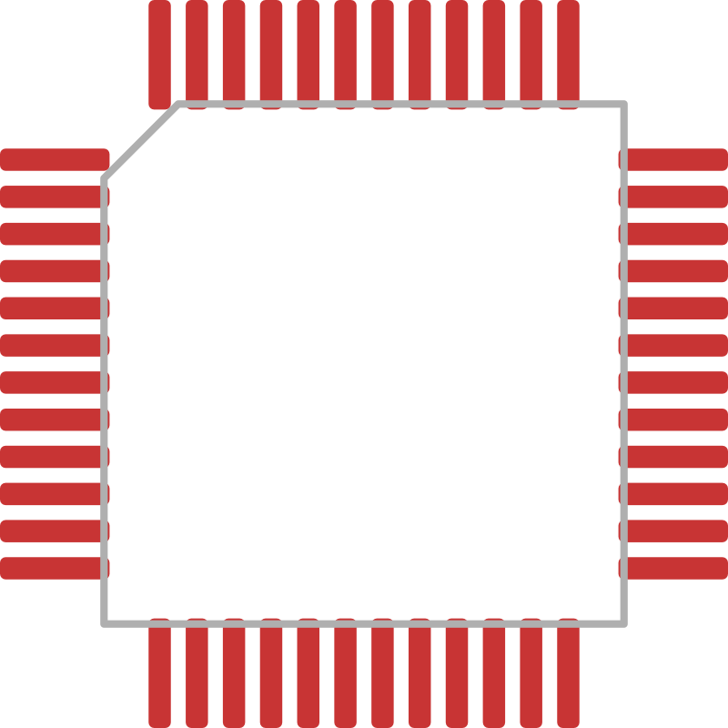 | [SVG](data/kicad/kicad_footprint_machine_solder_bare.svg) · [PNG](data/kicad/kicad_footprint_machine_solder_bare.png) |
| **Machine-solder footprint (without silkscreen, square view)** |  | [SVG](data/kicad/kicad_footprint_machine_solder_bare_square.svg) · [PNG](data/kicad/kicad_footprint_machine_solder_bare_square.png) |
| **Machine-solder footprint (square view)** | 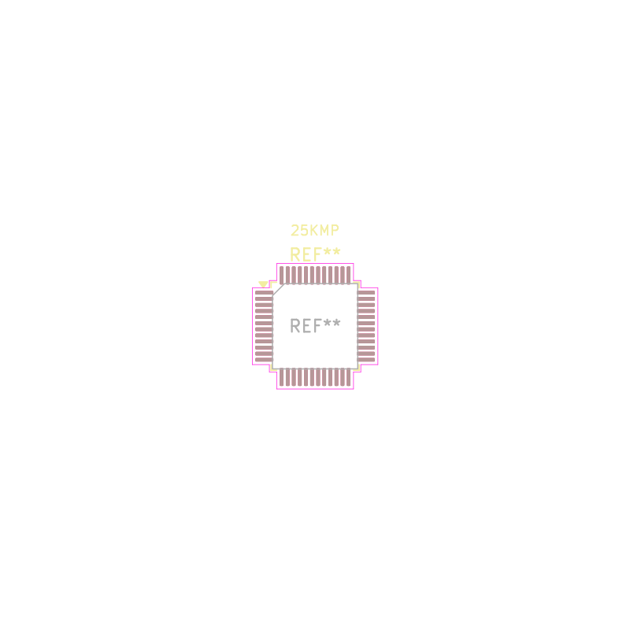 | [SVG](data/kicad/kicad_footprint_machine_solder_square.svg) · [PNG](data/kicad/kicad_footprint_machine_solder_square.png) |
| **KiCad symbol, unit 1** | 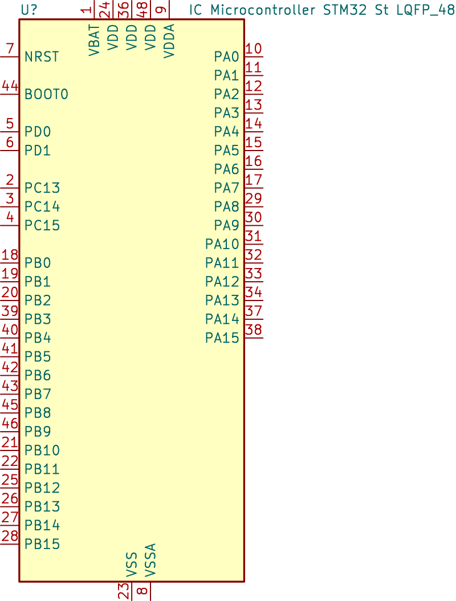 | [SVG](data/kicad/kicad_symbol_unit_1.svg) · [PNG](data/kicad/kicad_symbol_unit_1.png) |
| **KiCad symbol, unit 1 (square view)** | 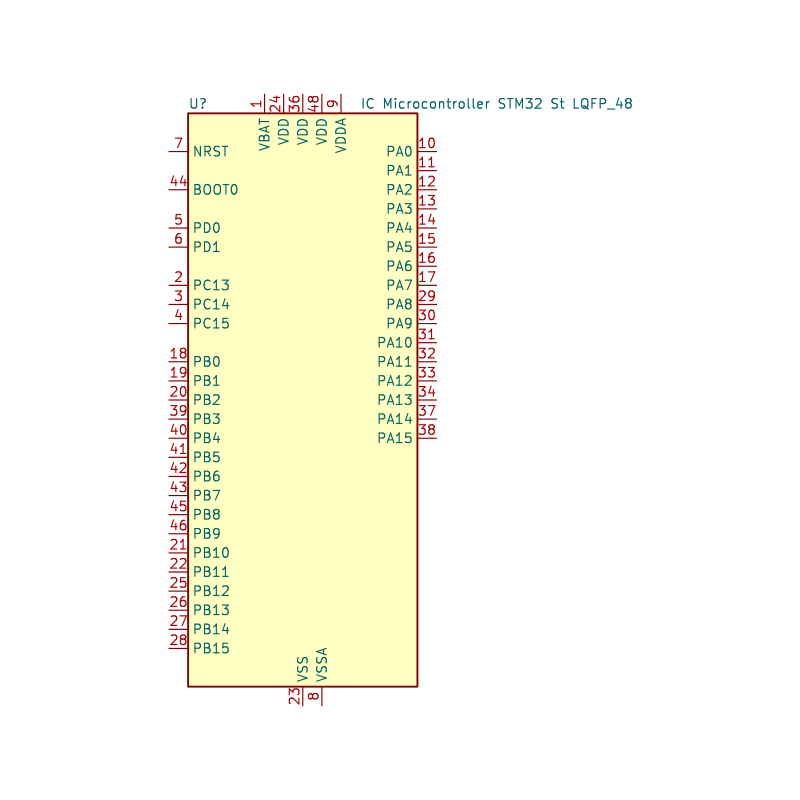 | [SVG](data/kicad/kicad_symbol_unit_1_square.svg) · [PNG](data/kicad/kicad_symbol_unit_1_square.png) |
| **Machine-solder footprint guide** | — | [MD](data/kicad/machine_solder/README.md) |
| **Machine-solder footprint** | — | [KICAD_MOD](data/kicad/machine_solder/electronic_ic_microcontroller_stm32_lqfp_48_st_stm32f103c8tx.kicad_mod) |
| **KiCad availability and source masters** | — | [JSON](data/kicad/manifest.json) · [YAML](data/kicad/manifest.yaml) |
| **Studio render sources and recipe** | — | [JSON](data/display_render/manifest.json) |
| **Drawer label data** | — | [YAML](data/label_drawer.yaml) |
| **Generator label** |  | [SVG](generator_label.svg) · [JSON](generator_label.json) |
| **Small drawer label** |  | [SVG](label_drawer_1_5x1.svg) |
| **Large drawer label** | 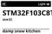 | [SVG](label_drawer_3x2.svg) |
| **Web catalogue file index** | — | [YAML](web.yaml) |
| **Part definition and build recipe** | — | [YAML](working.yaml) |

<!-- /oomp-part-file-table -->

[View this part on GitHub](https://github.com/oomlout/oomp_electronic_version_5/tree/main/parts/electronic_ic_microcontroller_stm32_lqfp_48_st_stm32f103c8tx)

[Browse this category](../../navigation/electronic/ic/microcontroller/stm32/lqfp_48/st/README.md)

---

This page is generated from the OOMP part definition by a Roboclick Jinja template. Edit the source taxonomy or template rather than this generated file.