# IC ESP32-WROOM-32E-N8 ESP32 WROOM 32E

`electronic_ic_microcontroller_wifi_bluetooth_8_mb_flash_esp32_wroom_32e_espressif_esp32_wroom_32e_n8`

IC ESP32-WROOM-32E-N8 ESP32 WROOM 32E is an OOMP electronic ic definition. It uses the esp32 wroom 32e package or form factor. Its nominal drawing size is 18.0 &#x00D7; 25.5 mm. The definition includes 39 documented pins.

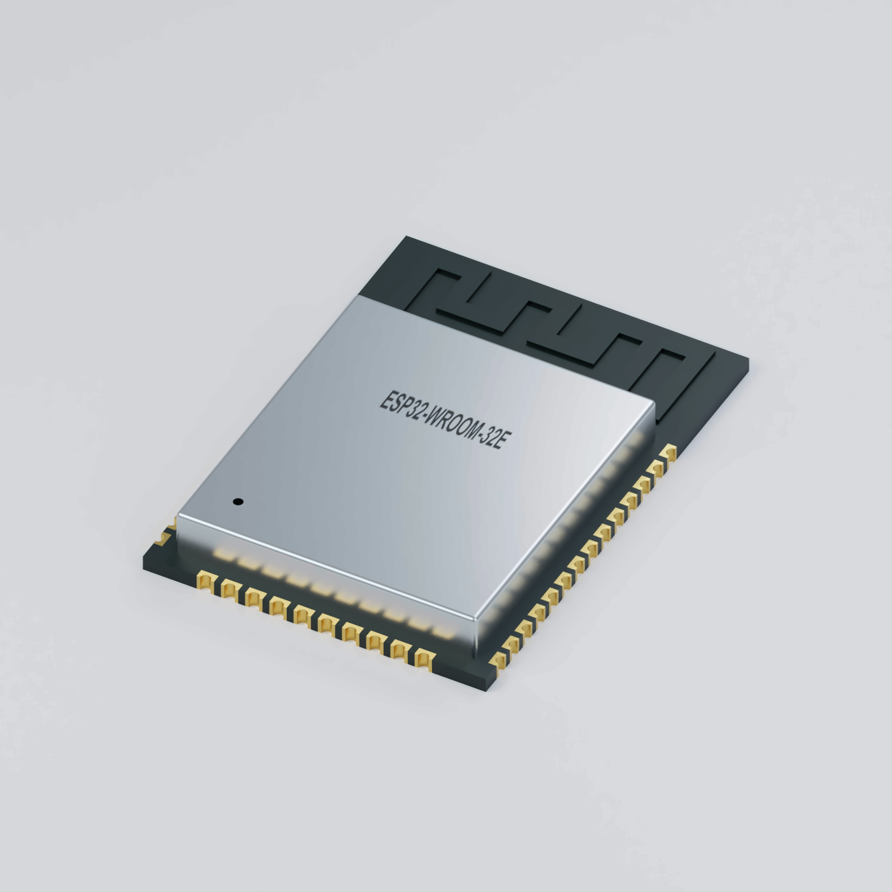

Display-only KiCad RF module with assigned dark PCB, gold contacts and metallic shield; antenna trace detail and shield printing are illustrative. Model and text are not a verified production image or mechanical model. Illustrative family label on shield; actual typography, placement, production marks, logos and certifications are not verified.

[Render recipe and provenance](data/display_render/manifest.json) · [KiCad model](https://gitlab.com/kicad/libraries/kicad-packages3D/-/blob/master/RF_Module.3dshapes/ESP32-WROOM-32E.step)

Model credit: 2025 KiCAD. CC-BY-SA-4.0 with KiCad library exception; see original STEP header.

## At a glance

| Detail | Value |
| --- | --- |
| OOMP ID | `electronic_ic_microcontroller_wifi_bluetooth_8_mb_flash_esp32_wroom_32e_espressif_esp32_wroom_32e_n8` |
| Type | Ic |
| Package / style | esp32 wroom 32e |
| Nominal size | 18.0 &#x00D7; 25.5 mm |
| Documented pins | 39 |

## Classification

| Level | Value |
| --- | --- |
| 1 | `electronic` |
| 2 | `ic` |
| 3 | `microcontroller` |
| 4 | `wifi_bluetooth_8_mb_flash` |
| 5 | `esp32_wroom_32e` |
| 14 | `espressif` |
| 15 | `esp32_wroom_32e_n8` |

## Nominal dimensions

| Measurement | Value |
| --- | ---: |
| Height | 3.1 mm |
| Length | 18.0 mm |
| Width | 25.5 mm |

## Identifiers

| Identifier | Value |
| --- | --- |
| Manufacturer part number | `ESP32-WROOM-32E-N8` |
| LCSC | [`C701342`](https://www.lcsc.com/product-detail/C701342.html) |

## Pins

| Pin | Name | Type |
| ---: | --- | --- |
| 1 | gnd | gnd |
| 2 | 3v3 | power |
| 3 | en | signal |
| 4 | sensor_vp | signal |
| 5 | sensor_vn | signal |
| 6 | io34 | signal |
| 7 | io35 | signal |
| 8 | io32 | signal |
| 9 | io33 | signal |
| 10 | io25 | signal |
| 11 | io26 | signal |
| 12 | io27 | signal |
| 13 | io14 | signal |
| 14 | io12 | signal |
| 15 | gnd | gnd |
| 16 | io13 | signal |
| 17 | nc | no_connect |
| 18 | nc | no_connect |
| 19 | nc | no_connect |
| 20 | nc | no_connect |
| 21 | nc | no_connect |
| 22 | nc | no_connect |
| 23 | io15 | signal |
| 24 | io2 | signal |
| 25 | io0 | signal |
| 26 | io4 | signal |
| 27 | io16 | signal |
| 28 | io17 | signal |
| 29 | io5 | signal |
| 30 | io18 | signal |
| 31 | io19 | signal |
| 32 | nc | no_connect |
| 33 | io21 | signal |
| 34 | rxd0 | signal |
| 35 | txd0 | signal |
| 36 | io22 | signal |
| 37 | io23 | signal |
| 38 | gnd | gnd |
| 39 | gnd_ep | gnd |

## Datasheet

[View the datasheet](data/datasheet.pdf)

## Used in projects

[Browse confirmed project usage](https://oomlout.github.io/oomp_electronic_project_version_5/usage/index.html#electronic_ic_microcontroller_wifi_bluetooth_8_mb_flash_esp32_wroom_32e_espressif_esp32_wroom_32e_n8)

## Files

<!-- oomp-part-file-table -->

| Image type | Image | Link |
| --- | :---: | --- |
| **Studio render** | 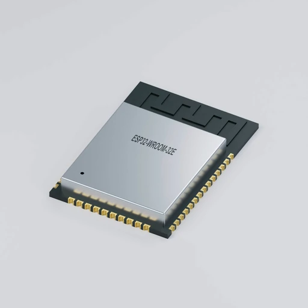 | [PNG](data/display_render/render.png) · [Preview](data/display_render/preview.webp) |
| **Pinout drawing** Pin names and positions on the part. | 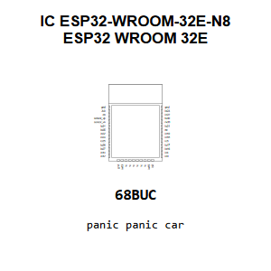 | [SVG](data/working_svg_square_pins.svg) · [PNG](data/working_svg_square_pins.png) · [Preview](data/working_svg_square_pins_300.png) |
| **Assembly** Component placement drawing. | 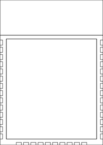 | [SVG](data/working_svg_assembly.svg) · [PNG](data/working_svg_assembly.png) · [Preview](data/working_svg_assembly_300.png) |
| **Assembly pinout** Placement drawing with the pins marked. | 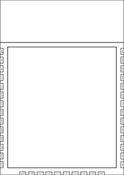 | [SVG](data/working_svg_assembly_pins.svg) · [PNG](data/working_svg_assembly_pins.png) · [Preview](data/working_svg_assembly_pins_300.png) |
| **Outline** External shape of the part. | 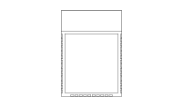 | [SVG](data/working_svg_outline.svg) · [PNG](data/working_svg_outline.png) · [Preview](data/working_svg_outline_300.png) |
| **Dimensions** Package outline with dimension arrows. | 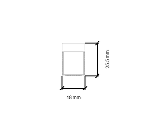 | [SVG](data/working_svg_dimensioned.svg) · [PNG](data/working_svg_dimensioned.png) · [Preview](data/working_svg_dimensioned_300.png) |
| **Dimensions with labels** Labelled package measurements. | 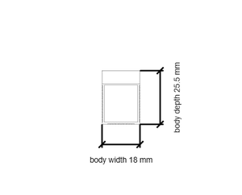 | [SVG](data/working_svg_dimensioned_titles.svg) · [PNG](data/working_svg_dimensioned_titles.png) · [Preview](data/working_svg_dimensioned_titles_300.png) |
| **Square summary** Component identification card. | 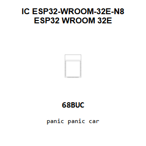 | [SVG](data/working_svg_square.svg) · [PNG](data/working_svg_square.png) · [Preview](data/working_svg_square_300.png) |
| **Square schematic** Schematic symbol on an identification card. | 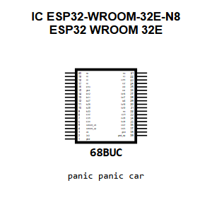 | [SVG](data/working_svg_square_schematic.svg) · [PNG](data/working_svg_square_schematic.png) · [Preview](data/working_svg_square_schematic_300.png) |
| **Part ID** Drawing labelled with the OOMP catalogue ID. | 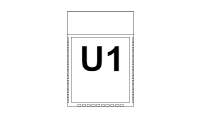 | [SVG](data/working_svg_part_id.svg) · [PNG](data/working_svg_part_id.png) · [Preview](data/working_svg_part_id_300.png) |
| **MD5 alpha** Drawing labelled with the short OOMP code. | 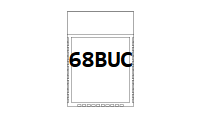 | [SVG](data/working_svg_md5_6_alpha.svg) · [PNG](data/working_svg_md5_6_alpha.png) · [Preview](data/working_svg_md5_6_alpha_300.png) |
| **BIP 39 words** Drawing labelled with the three-word identifier. | 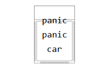 | [SVG](data/working_svg_bip_39_3_word.svg) · [PNG](data/working_svg_bip_39_3_word.png) · [Preview](data/working_svg_bip_39_3_word_300.png) |
| **Schematic** Electrical symbol for the part. | 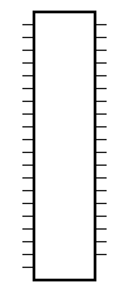 | [SVG](data/working_svg_schematic.svg) · [PNG](data/working_svg_schematic.png) |
| **Schematic pinout** Electrical symbol with pin labels. | 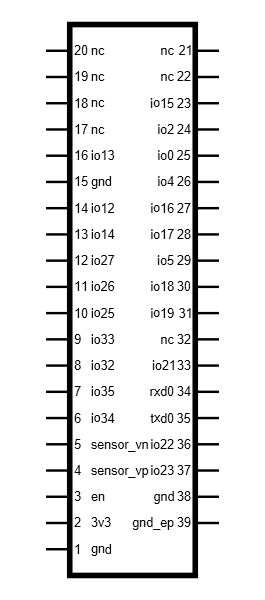 | [SVG](data/working_svg_schematic_pins.svg) · [PNG](data/working_svg_schematic_pins.png) |
| **Schematic with part ID** Symbol labelled with the OOMP catalogue ID. | 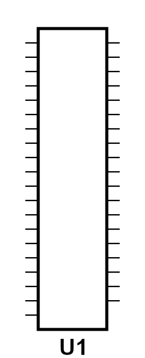 | [SVG](data/working_svg_schematic_part_id.svg) · [PNG](data/working_svg_schematic_part_id.png) |
| **Schematic with MD5 alpha** Symbol labelled with the short OOMP code. | 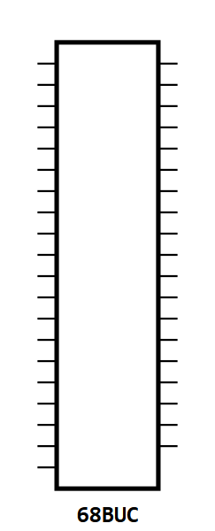 | [SVG](data/working_svg_schematic_md5_6_alpha.svg) · [PNG](data/working_svg_schematic_md5_6_alpha.png) |
| **Schematic with BIP 39 words** Symbol labelled with the three-word identifier. | 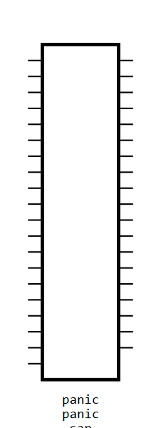 | [SVG](data/working_svg_schematic_bip_39_3_word.svg) · [PNG](data/working_svg_schematic_bip_39_3_word.png) |
| **KiCad asset licence** | — | [MD](data/kicad/LICENSE.md) |
| **KiCad library guide** | — | [MD](data/kicad/README.md) |
| **KiCad symbol and footprint overview** | 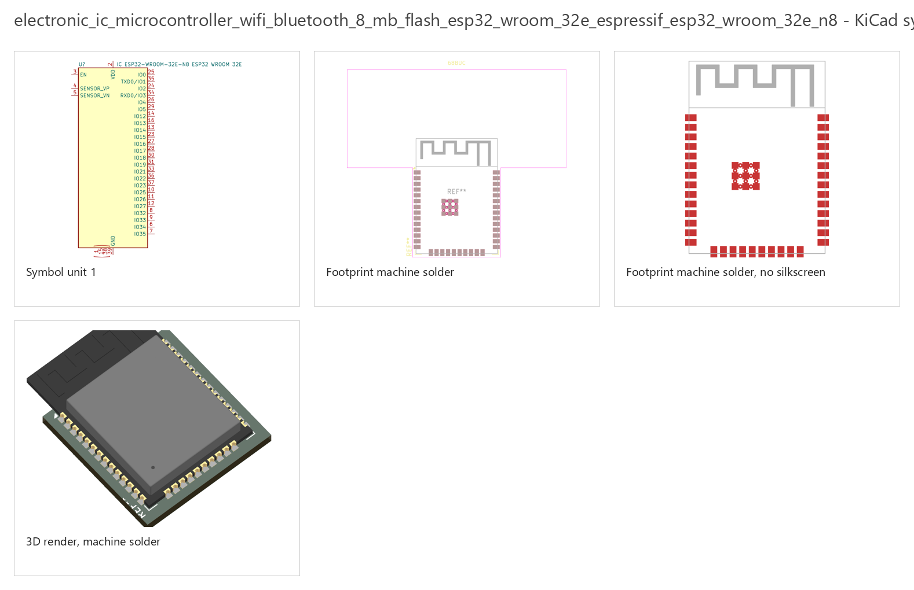 | [PNG](data/kicad/contact_sheet.png) |
| **KiCad symbol library** | — | [KICAD_SYM](data/kicad/electronic_ic_microcontroller_wifi_bluetooth_8_mb_flash_esp32_wroom_32e_espressif_esp32_wroom_32e_n8.kicad_sym) |
| **Hand-solder footprint guide** | — | [MD](data/kicad/hand_solder/README.md) |
| **Machine-solder footprint drawing** | 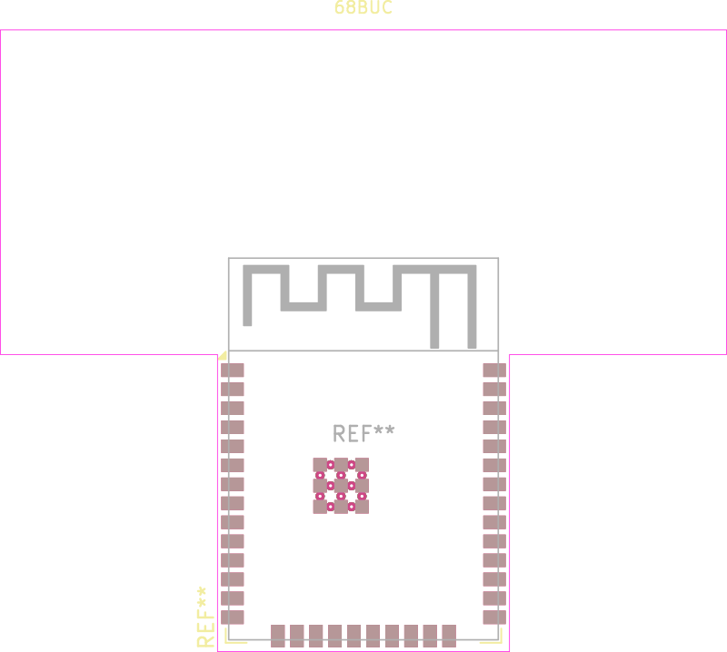 | [SVG](data/kicad/kicad_footprint_machine_solder.svg) · [PNG](data/kicad/kicad_footprint_machine_solder.png) · [STEP](data/kicad/kicad_footprint_machine_solder.step) |
| **Machine-solder footprint (3D view)** | 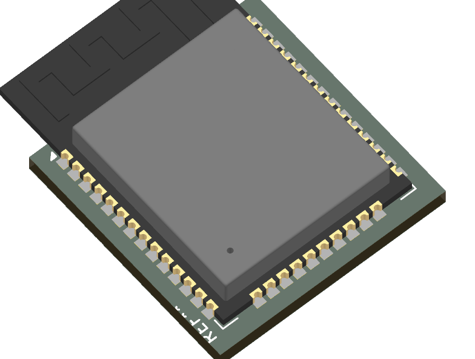 | [PNG](data/kicad/kicad_footprint_machine_solder_3d.png) |
| **Machine-solder footprint (without silkscreen)** | 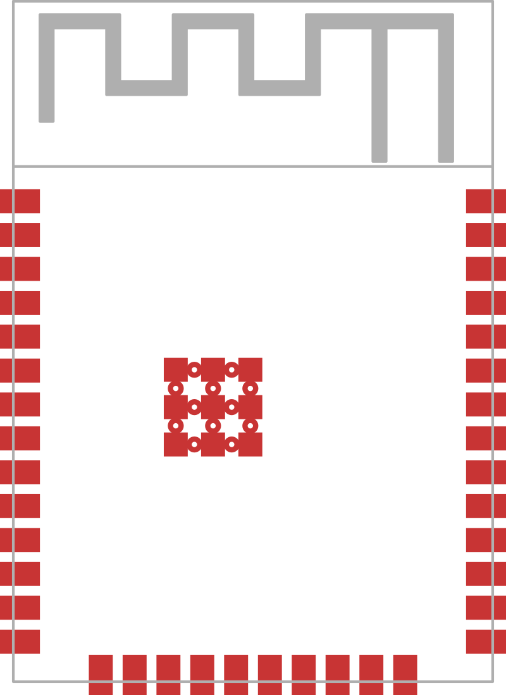 | [SVG](data/kicad/kicad_footprint_machine_solder_bare.svg) · [PNG](data/kicad/kicad_footprint_machine_solder_bare.png) |
| **Machine-solder footprint (without silkscreen, square view)** | 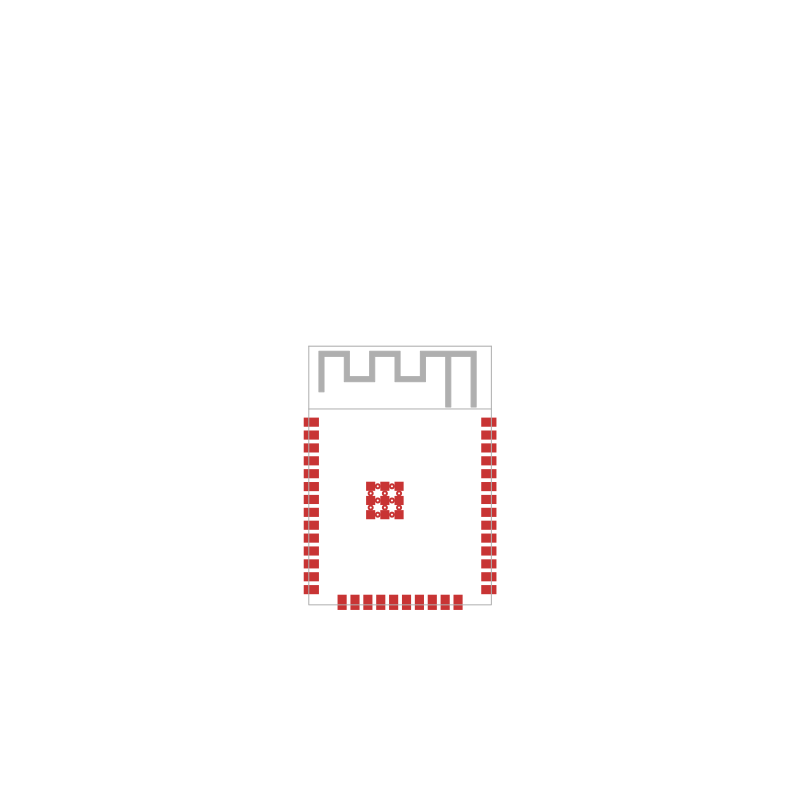 | [SVG](data/kicad/kicad_footprint_machine_solder_bare_square.svg) · [PNG](data/kicad/kicad_footprint_machine_solder_bare_square.png) |
| **Machine-solder footprint (square view)** | 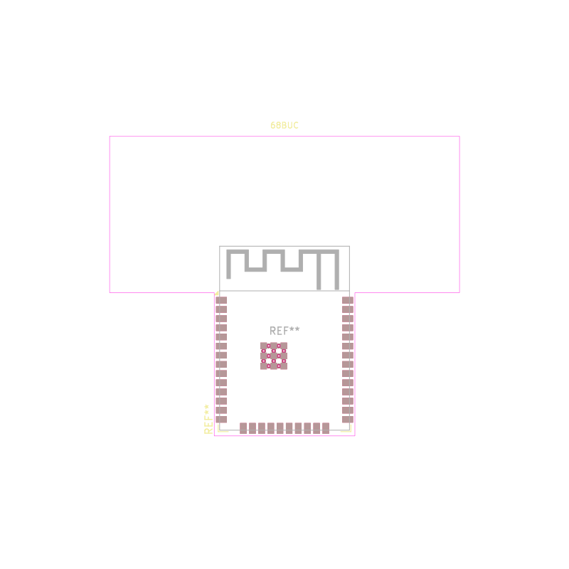 | [SVG](data/kicad/kicad_footprint_machine_solder_square.svg) · [PNG](data/kicad/kicad_footprint_machine_solder_square.png) |
| **KiCad symbol, unit 1** | 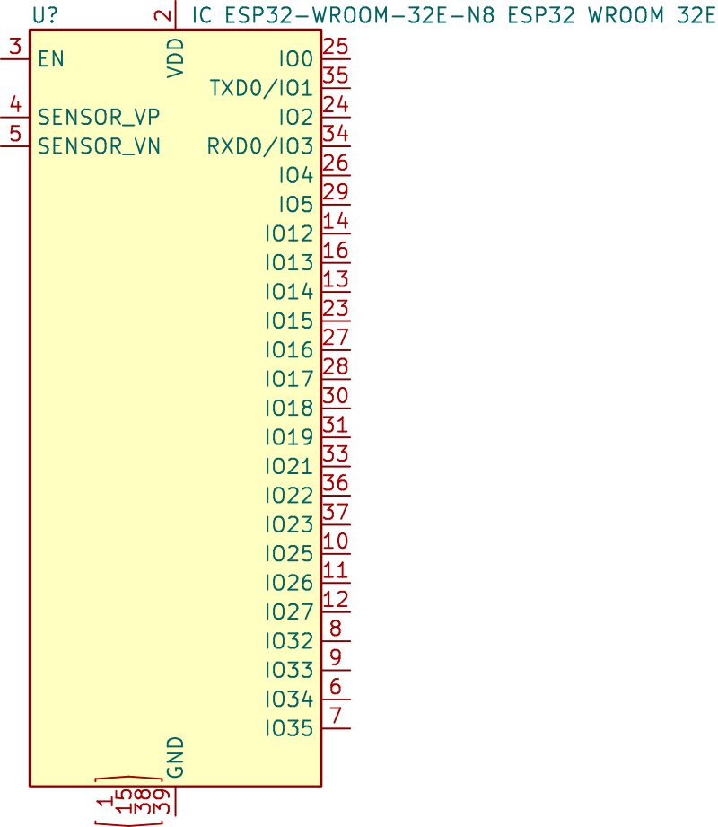 | [SVG](data/kicad/kicad_symbol_unit_1.svg) · [PNG](data/kicad/kicad_symbol_unit_1.png) |
| **KiCad symbol, unit 1 (square view)** | 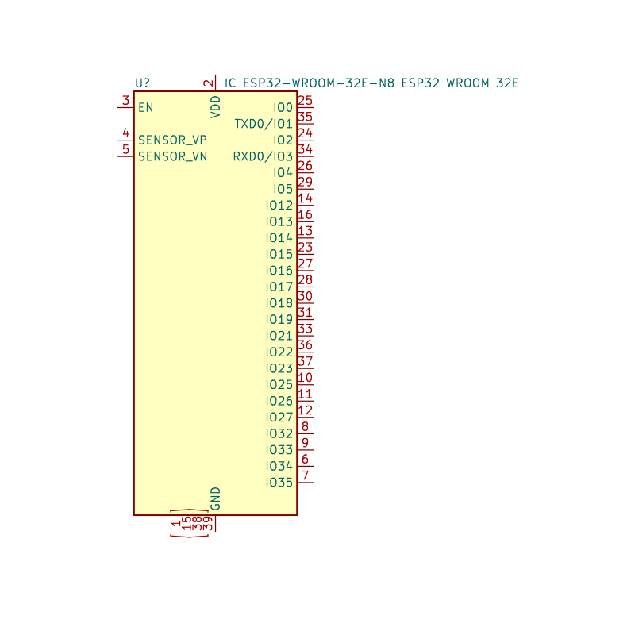 | [SVG](data/kicad/kicad_symbol_unit_1_square.svg) · [PNG](data/kicad/kicad_symbol_unit_1_square.png) |
| **Machine-solder footprint guide** | — | [MD](data/kicad/machine_solder/README.md) |
| **Machine-solder footprint** | — | [KICAD_MOD](data/kicad/machine_solder/electronic_ic_microcontroller_wifi_bluetooth_8_mb_flash_esp32_wroom_32e_espressif_esp32_wroom_32e_n8.kicad_mod) |
| **KiCad availability and source masters** | — | [JSON](data/kicad/manifest.json) · [YAML](data/kicad/manifest.yaml) |
| **Studio render sources and recipe** | — | [JSON](data/display_render/manifest.json) |
| **Manufacturer or supplier datasheet** | — | [PDF](data/datasheet.pdf) |
| **Drawer label data** | — | [YAML](data/label_drawer.yaml) |
| **Generator label** |  | [SVG](generator_label.svg) · [JSON](generator_label.json) |
| **Small drawer label** | 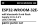 | [SVG](label_drawer_1_5x1.svg) |
| **Large drawer label** | 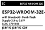 | [SVG](label_drawer_3x2.svg) |
| **Web catalogue file index** | — | [YAML](web.yaml) |
| **Part definition and build recipe** | — | [YAML](working.yaml) |

<!-- /oomp-part-file-table -->

[View this part on GitHub](https://github.com/oomlout/oomp_electronic_version_5/tree/main/parts/electronic_ic_microcontroller_wifi_bluetooth_8_mb_flash_esp32_wroom_32e_espressif_esp32_wroom_32e_n8)

[Browse this category](../../navigation/electronic/ic/microcontroller/wifi_bluetooth_8_mb_flash/esp32_wroom_32e/espressif/README.md)

---

This page is generated from the OOMP part definition by a Roboclick Jinja template. Edit the source taxonomy or template rather than this generated file.