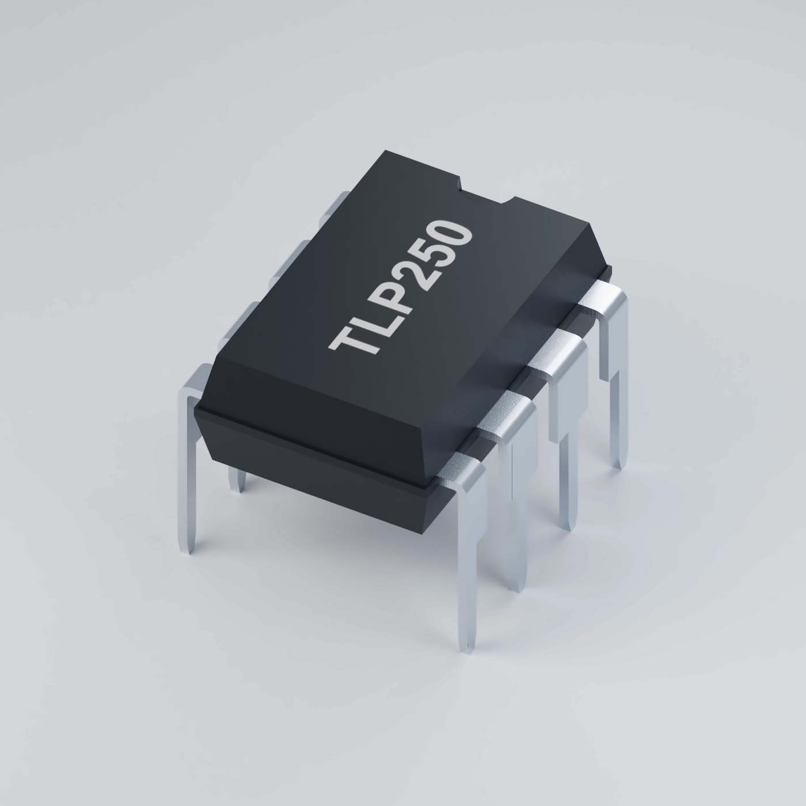
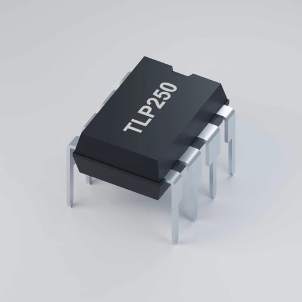
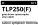
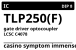

# IC TLP250(F) DIP 8

`electronic_ic_optocoupler_gate_driver_optocoupler_dip_8_toshiba_tlp250_f`

IC TLP250(F) DIP 8 is an OOMP electronic ic definition. It uses the dip 8 package or form factor. Its nominal drawing size is 10.0 &#x00D7; 5.0 mm.

Illustrative KiCad DIP-8 model has 6.98 mm overall height including projecting pins. Catalogue source gives 10 &#x00D7; 5 mm with unspecified width reference, no height or footprint; Toshiba TLP250 body is approximately 9.66 &#x00D7; 6.4 mm; the parenthesized F ordering suffix is not independently explained by the manufacturer, and an F lead form exists with a different span. Not a verified mechanical model or PCB footprint. TLP250 is an illustrative family identifier; exact orderable marking and variable codes are unverified. Typeface, orientation, placement and variable lot/date details are illustrative.

[Render recipe and provenance](data/display_render/manifest.json) · [KiCad model](https://gitlab.com/kicad/libraries/kicad-packages3D/-/blob/master/Package_DIP.3dshapes/DIP-8_W7.62mm.step)

Model credit: 2025 KiCAD. CC-BY-SA-4.0 with KiCad library exception; see original STEP header.

## At a glance

| Detail | Value |
| --- | --- |
| OOMP ID | `electronic_ic_optocoupler_gate_driver_optocoupler_dip_8_toshiba_tlp250_f` |
| Type | Ic |
| Package / style | dip 8 |
| Nominal size | 10.0 &#x00D7; 5.0 mm |

## Classification

| Level | Value |
| --- | --- |
| 1 | `electronic` |
| 2 | `ic` |
| 3 | `optocoupler` |
| 4 | `gate_driver_optocoupler` |
| 5 | `dip_8` |
| 14 | `toshiba` |
| 15 | `tlp250_f` |

## Nominal dimensions

| Measurement | Value |
| --- | ---: |
| Length | 10.0 mm |
| Width | 5.0 mm |

## Identifiers

| Identifier | Value |
| --- | --- |
| Manufacturer part number | `TLP250(F)` |
| LCSC | [`C4078`](https://www.lcsc.com/product-detail/C4078.html) |
| JLCPCB | [`C4078`](https://jlcpcb.com/partdetail/TOSHIBA-TLP250_F/C4078) |

## Used in projects

[Browse confirmed project usage](https://oomlout.github.io/oomp_electronic_project_version_5/usage/index.html#electronic_ic_optocoupler_gate_driver_optocoupler_dip_8_toshiba_tlp250_f)

## Files

<!-- oomp-part-file-table -->

| Image type | Image | Link |
| --- | :---: | --- |
| **Studio render** |  | [PNG](data/display_render/render.png) · [Preview](data/display_render/preview.webp) |
| **Studio render sources and recipe** | — | [JSON](data/display_render/manifest.json) |
| **Drawer label data** | — | [YAML](data/label_drawer.yaml) |
| **Small drawer label** |  | [SVG](label_drawer_1_5x1.svg) |
| **Large drawer label** |  | [SVG](label_drawer_3x2.svg) |
| **Web catalogue file index** | — | [YAML](web.yaml) |
| **Part definition and build recipe** | — | [YAML](working.yaml) |

<!-- /oomp-part-file-table -->

[View this part on GitHub](https://github.com/oomlout/oomp_electronic_version_5/tree/main/parts/electronic_ic_optocoupler_gate_driver_optocoupler_dip_8_toshiba_tlp250_f)

[Browse this category](../../navigation/electronic/ic/optocoupler/gate_driver_optocoupler/dip_8/toshiba/README.md)

---

This page is generated from the OOMP part definition by a Roboclick Jinja template. Edit the source taxonomy or template rather than this generated file.