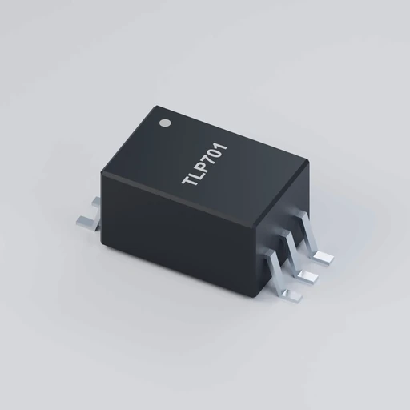
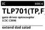

# IC TLP701(TP,F) SOIC 6

`electronic_ic_optocoupler_gate_driver_optocoupler_soic_6_toshiba_tlp701_tp_f`

IC TLP701(TP,F) SOIC 6 is an OOMP electronic ic definition. It uses the soic 6 package or form factor. Its nominal drawing size is 10.0 &#x00D7; 5.0 mm.

Illustrative procedural 6-pin surface-mount SDIP model uses 6.8 x 4.58 mm nominal body, 4.0 mm height and 1.27 mm pitch from Toshiba 11-5J1S. Catalogue lists 10 x 5 mm without height or footprint. Lead shape, placement and pin-one indicator are approximate; not a verified mechanical model or footprint. TLP701 is an illustrative family identifier; exact physical marking is unverified. Typeface, orientation, placement and variable lot/date details are illustrative.

[Render recipe and provenance](data/display_render/manifest.json) · [KiCad model](https://github.com/oomlout/oomp_electronic_version_5/blob/main/kicad_agents/display_model_toshiba_tlp701_sdip6_smd.py)

Model credit: Procedural model generated in this repository. Project source; procedural display geometry.

## At a glance

| Detail | Value |
| --- | --- |
| OOMP ID | `electronic_ic_optocoupler_gate_driver_optocoupler_soic_6_toshiba_tlp701_tp_f` |
| Type | Ic |
| Package / style | soic 6 |
| Nominal size | 10.0 &#x00D7; 5.0 mm |

## Classification

| Level | Value |
| --- | --- |
| 1 | `electronic` |
| 2 | `ic` |
| 3 | `optocoupler` |
| 4 | `gate_driver_optocoupler` |
| 5 | `soic_6` |
| 14 | `toshiba` |
| 15 | `tlp701_tp_f` |

## Nominal dimensions

| Measurement | Value |
| --- | ---: |
| Length | 10.0 mm |
| Width | 5.0 mm |

## Identifiers

| Identifier | Value |
| --- | --- |
| Manufacturer part number | `TLP701(TP,F)` |
| LCSC | [`C5006`](https://www.lcsc.com/product-detail/C5006.html) |
| JLCPCB | [`C5006`](https://jlcpcb.com/partdetail/TOSHIBA-TLP701_TP_F/C5006) |

## Used in projects

[Browse confirmed project usage](https://oomlout.github.io/oomp_electronic_project_version_5/usage/index.html#electronic_ic_optocoupler_gate_driver_optocoupler_soic_6_toshiba_tlp701_tp_f)

## Files

<!-- oomp-part-file-table -->

| Image type | Image | Link |
| --- | :---: | --- |
| **Studio render** |  | [PNG](data/display_render/render.png) · [Preview](data/display_render/preview.webp) |
| **Studio render sources and recipe** | — | [JSON](data/display_render/manifest.json) |
| **Drawer label data** | — | [YAML](data/label_drawer.yaml) |
| **Small drawer label** |  | [SVG](label_drawer_1_5x1.svg) |
| **Large drawer label** |  | [SVG](label_drawer_3x2.svg) |
| **Web catalogue file index** | — | [YAML](web.yaml) |
| **Part definition and build recipe** | — | [YAML](working.yaml) |

<!-- /oomp-part-file-table -->

[View this part on GitHub](https://github.com/oomlout/oomp_electronic_version_5/tree/main/parts/electronic_ic_optocoupler_gate_driver_optocoupler_soic_6_toshiba_tlp701_tp_f)

[Browse this category](../../navigation/electronic/ic/optocoupler/gate_driver_optocoupler/soic_6/toshiba/README.md)

---

This page is generated from the OOMP part definition by a Roboclick Jinja template. Edit the source taxonomy or template rather than this generated file.