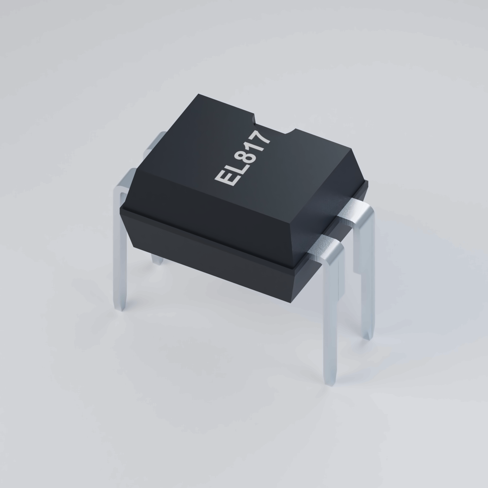
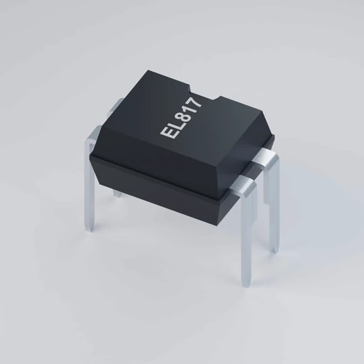
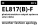
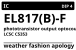

# IC EL817(B)-F DIP 4

`electronic_ic_optocoupler_phototransistor_output_optocoupler_dip_4_everlight_el817_b_f`

IC EL817(B)-F DIP 4 is an OOMP electronic ic definition. It uses the dip 4 package or form factor. Its nominal drawing size is 10.0 &#x00D7; 5.0 mm.

Illustrative KiCad DIP4 model has 6.98 mm total height including projecting pins and a generic end notch; actual EL817(B)-F pin-one mark and geometry are unverified. Catalogue lists 10 x 5 mm with unspecified reference and no height or footprint; related EL817-G body is approximately 6.5 x 4.58 x 3.5 mm. Not a verified mechanical model or PCB footprint. EL817 is an illustrative family identifier; exact physical marking is not confirmed. Typeface, orientation, placement and variable lot/date details are illustrative.

[Render recipe and provenance](data/display_render/manifest.json) · [KiCad model](https://gitlab.com/kicad/libraries/kicad-packages3D/-/blob/master/Package_DIP.3dshapes/DIP-4_W7.62mm.step)

Model credit: 2025 KiCAD. CC-BY-SA-4.0 with KiCad library exception; see original STEP header.

## At a glance

| Detail | Value |
| --- | --- |
| OOMP ID | `electronic_ic_optocoupler_phototransistor_output_optocoupler_dip_4_everlight_el817_b_f` |
| Type | Ic |
| Package / style | dip 4 |
| Nominal size | 10.0 &#x00D7; 5.0 mm |

## Classification

| Level | Value |
| --- | --- |
| 1 | `electronic` |
| 2 | `ic` |
| 3 | `optocoupler` |
| 4 | `phototransistor_output_optocoupler` |
| 5 | `dip_4` |
| 14 | `everlight` |
| 15 | `el817_b_f` |

## Nominal dimensions

| Measurement | Value |
| --- | ---: |
| Length | 10.0 mm |
| Width | 5.0 mm |

## Identifiers

| Identifier | Value |
| --- | --- |
| Manufacturer part number | `EL817(B)-F` |
| LCSC | [`C5353`](https://www.lcsc.com/product-detail/C5353.html) |
| JLCPCB | [`C5353`](https://jlcpcb.com/partdetail/EverlightElec-EL817_B_F/C5353) |

## Used in projects

[Browse confirmed project usage](https://oomlout.github.io/oomp_electronic_project_version_5/usage/index.html#electronic_ic_optocoupler_phototransistor_output_optocoupler_dip_4_everlight_el817_b_f)

## Files

<!-- oomp-part-file-table -->

| Image type | Image | Link |
| --- | :---: | --- |
| **Studio render** |  | [PNG](data/display_render/render.png) · [Preview](data/display_render/preview.webp) |
| **Studio render sources and recipe** | — | [JSON](data/display_render/manifest.json) |
| **Drawer label data** | — | [YAML](data/label_drawer.yaml) |
| **Small drawer label** |  | [SVG](label_drawer_1_5x1.svg) |
| **Large drawer label** |  | [SVG](label_drawer_3x2.svg) |
| **Web catalogue file index** | — | [YAML](web.yaml) |
| **Part definition and build recipe** | — | [YAML](working.yaml) |

<!-- /oomp-part-file-table -->

[View this part on GitHub](https://github.com/oomlout/oomp_electronic_version_5/tree/main/parts/electronic_ic_optocoupler_phototransistor_output_optocoupler_dip_4_everlight_el817_b_f)

[Browse this category](../../navigation/electronic/ic/optocoupler/phototransistor_output_optocoupler/dip_4/everlight/README.md)

---

This page is generated from the OOMP part definition by a Roboclick Jinja template. Edit the source taxonomy or template rather than this generated file.