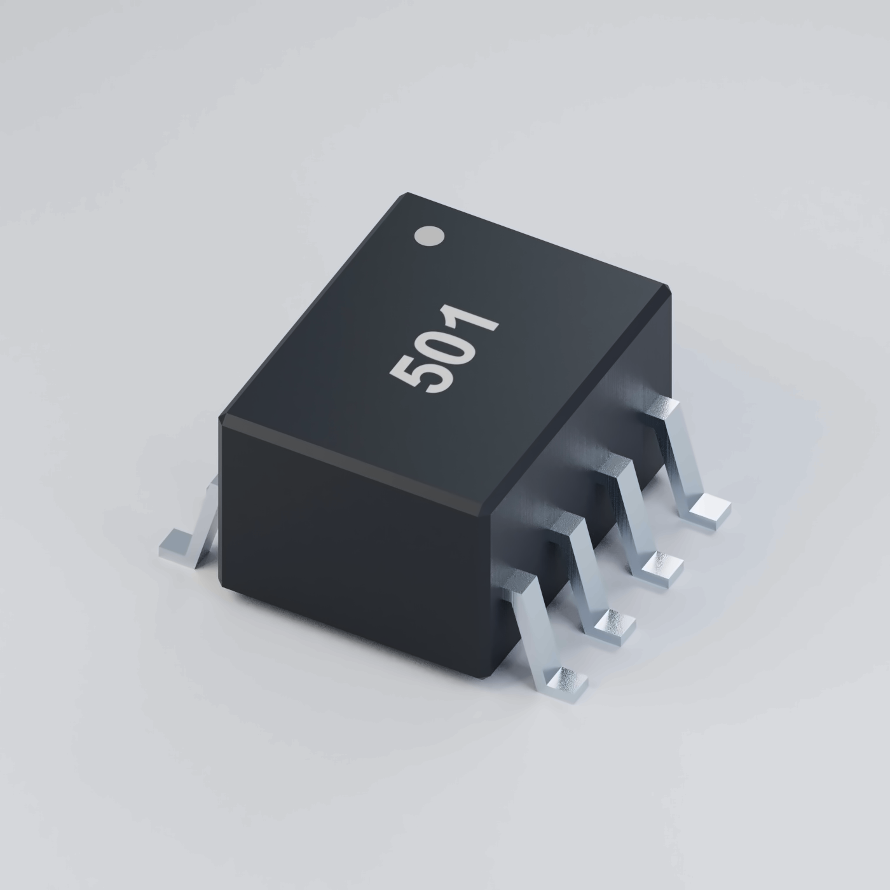
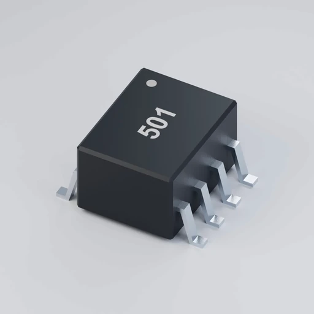

# IC HCPL-0501-500E SOIC 8

`electronic_ic_optocoupler_phototransistor_output_optocoupler_soic_8_broadcom_limited_hcpl_0501_500e`

IC HCPL-0501-500E SOIC 8 is an OOMP electronic ic definition. It uses the soic 8 package or form factor. Its nominal drawing size is 4.9 &#x00D7; 3.9 mm.

Illustrative procedural SO-8 optocoupler model uses 5.080 x 3.937 mm body, 3.175 mm nominal height and 1.27 mm pitch from Broadcom. Catalogue lists 4.9 x 3.9 mm and omits height. Lead profile, chamfers and pin-one dot are approximate; not a verified mechanical model or footprint. Broadcom specifies the last three type digits on its package drawing; 501 represents HCPL-0501. Typeface, orientation, placement and variable lot/date details are illustrative.

[Render recipe and provenance](data/display_render/manifest.json) · [KiCad model](https://github.com/oomlout/oomp_electronic_version_5/blob/main/kicad_agents/display_model_broadcom_so8_optocoupler.py)

Model credit: Procedural model generated in this repository. Project source; procedural display geometry.

## At a glance

| Detail | Value |
| --- | --- |
| OOMP ID | `electronic_ic_optocoupler_phototransistor_output_optocoupler_soic_8_broadcom_limited_hcpl_0501_500e` |
| Type | Ic |
| Package / style | soic 8 |
| Nominal size | 4.9 &#x00D7; 3.9 mm |

## Classification

| Level | Value |
| --- | --- |
| 1 | `electronic` |
| 2 | `ic` |
| 3 | `optocoupler` |
| 4 | `phototransistor_output_optocoupler` |
| 5 | `soic_8` |
| 14 | `broadcom_limited` |
| 15 | `hcpl_0501_500e` |

## Nominal dimensions

| Measurement | Value |
| --- | ---: |
| Length | 4.9 mm |
| Width | 3.9 mm |

## Identifiers

| Identifier | Value |
| --- | --- |
| Manufacturer part number | `HCPL-0501-500E` |
| LCSC | [`C6673`](https://www.lcsc.com/product-detail/C6673.html) |
| JLCPCB | [`C6673`](https://jlcpcb.com/partdetail/BroadcomLimited-HCPL_0501500E/C6673) |

## Used in projects

[Browse confirmed project usage](https://oomlout.github.io/oomp_electronic_project_version_5/usage/index.html#electronic_ic_optocoupler_phototransistor_output_optocoupler_soic_8_broadcom_limited_hcpl_0501_500e)

## Files

<!-- oomp-part-file-table -->

| Image type | Image | Link |
| --- | :---: | --- |
| **Studio render** |  | [PNG](data/display_render/render.png) · [Preview](data/display_render/preview.webp) |
| **Studio render sources and recipe** | — | [JSON](data/display_render/manifest.json) |
| **Drawer label data** | — | [YAML](data/label_drawer.yaml) |
| **Small drawer label** |  | [SVG](label_drawer_1_5x1.svg) |
| **Large drawer label** |  | [SVG](label_drawer_3x2.svg) |
| **Web catalogue file index** | — | [YAML](web.yaml) |
| **Part definition and build recipe** | — | [YAML](working.yaml) |

<!-- /oomp-part-file-table -->

[View this part on GitHub](https://github.com/oomlout/oomp_electronic_version_5/tree/main/parts/electronic_ic_optocoupler_phototransistor_output_optocoupler_soic_8_broadcom_limited_hcpl_0501_500e)

[Browse this category](../../navigation/electronic/ic/optocoupler/phototransistor_output_optocoupler/soic_8/broadcom_limited/README.md)

---

This page is generated from the OOMP part definition by a Roboclick Jinja template. Edit the source taxonomy or template rather than this generated file.