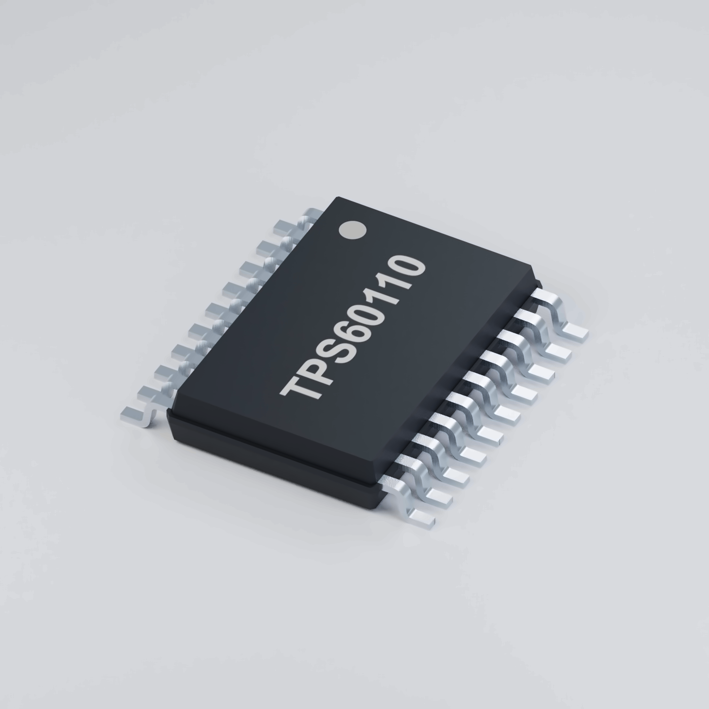
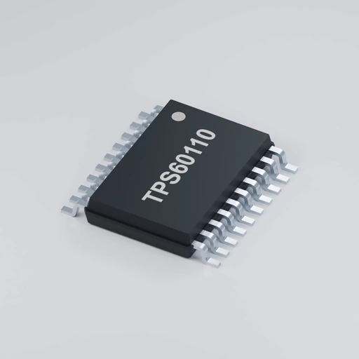

# IC TPS60110PWPR HTSSOP 20 EP

`electronic_ic_power_management_charge_pump_regulated_converter_htssop_20_ep_texas_instruments_tps60110pwpr`

IC TPS60110PWPR HTSSOP 20 EP is an OOMP electronic ic definition. It uses the htssop 20 ep package or form factor. Its nominal drawing size is 10.0 &#x00D7; 5.0 mm.

KiCad HTSSOP-20 model has 6.4 x 6.6 x 1.2 mm overall bounds. Its 3.4 x 6.6 mm thermal pad is display-corrected to 2.0 x 2.7 mm and the underside is filled; the pad remains approximate. Catalogue 10 x 5 mm dimensions are generic and footprint is missing. A catalogue note says 3.3 V, while manufacturer and source ratings indicate 5 V. Not a verified mechanical model or footprint. TI specifies TPS60110 for TPS60110PWPR; variable production characters are omitted. Typeface, orientation, placement and variable lot/date details are illustrative.

[Render recipe and provenance](data/display_render/manifest.json) · [KiCad model](https://gitlab.com/kicad/libraries/kicad-packages3D/-/blob/master/Package_SO.3dshapes/HTSSOP-20-1EP_4.4x6.5mm_P0.65mm_EP3.4x6.5mm.step)

Model credit: 2025 KiCAD. CC-BY-SA-4.0 with KiCad library exception; see original STEP header.

## At a glance

| Detail | Value |
| --- | --- |
| OOMP ID | `electronic_ic_power_management_charge_pump_regulated_converter_htssop_20_ep_texas_instruments_tps60110pwpr` |
| Type | Ic |
| Package / style | htssop 20 ep |
| Nominal size | 10.0 &#x00D7; 5.0 mm |

## Classification

| Level | Value |
| --- | --- |
| 1 | `electronic` |
| 2 | `ic` |
| 3 | `power_management` |
| 4 | `charge_pump_regulated_converter` |
| 5 | `htssop_20_ep` |
| 14 | `texas_instruments` |
| 15 | `tps60110pwpr` |

## Nominal dimensions

| Measurement | Value |
| --- | ---: |
| Length | 10.0 mm |
| Width | 5.0 mm |

## Identifiers

| Identifier | Value |
| --- | --- |
| Manufacturer part number | `TPS60110PWPR` |
| LCSC | [`C7096`](https://www.lcsc.com/product-detail/C7096.html) |
| JLCPCB | [`C7096`](https://jlcpcb.com/partdetail/TexasInstruments-TPS60110PWPR/C7096) |

## Used in projects

[Browse confirmed project usage](https://oomlout.github.io/oomp_electronic_project_version_5/usage/index.html#electronic_ic_power_management_charge_pump_regulated_converter_htssop_20_ep_texas_instruments_tps60110pwpr)

## Files

<!-- oomp-part-file-table -->

| Image type | Image | Link |
| --- | :---: | --- |
| **Studio render** |  | [PNG](data/display_render/render.png) · [Preview](data/display_render/preview.webp) |
| **Studio render sources and recipe** | — | [JSON](data/display_render/manifest.json) |
| **Drawer label data** | — | [YAML](data/label_drawer.yaml) |
| **Small drawer label** |  | [SVG](label_drawer_1_5x1.svg) |
| **Large drawer label** |  | [SVG](label_drawer_3x2.svg) |
| **Web catalogue file index** | — | [YAML](web.yaml) |
| **Part definition and build recipe** | — | [YAML](working.yaml) |

<!-- /oomp-part-file-table -->

[View this part on GitHub](https://github.com/oomlout/oomp_electronic_version_5/tree/main/parts/electronic_ic_power_management_charge_pump_regulated_converter_htssop_20_ep_texas_instruments_tps60110pwpr)

[Browse this category](../../navigation/electronic/ic/power_management/charge_pump_regulated_converter/htssop_20_ep/texas_instruments/README.md)

---

This page is generated from the OOMP part definition by a Roboclick Jinja template. Edit the source taxonomy or template rather than this generated file.