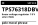
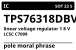

# IC TPS76318DBVR SOT 23 5

`electronic_ic_power_management_linear_voltage_regulator_1_8_volt_sot_23_5_texas_instruments_tps76318dbvr`

IC TPS76318DBVR SOT 23 5 is an OOMP electronic ic definition. It uses the sot 23 5 package or form factor. Its nominal drawing size is 2.9 &#x00D7; 1.6 mm.

## At a glance

| Detail | Value |
| --- | --- |
| OOMP ID | `electronic_ic_power_management_linear_voltage_regulator_1_8_volt_sot_23_5_texas_instruments_tps76318dbvr` |
| Type | Ic |
| Package / style | sot 23 5 |
| Nominal size | 2.9 &#x00D7; 1.6 mm |

## Classification

| Level | Value |
| --- | --- |
| 1 | `electronic` |
| 2 | `ic` |
| 3 | `power_management` |
| 4 | `linear_voltage_regulator_1_8_volt` |
| 5 | `sot_23_5` |
| 14 | `texas_instruments` |
| 15 | `tps76318dbvr` |

## Nominal dimensions

| Measurement | Value |
| --- | ---: |
| Length | 2.9 mm |
| Width | 1.6 mm |

## Identifiers

| Identifier | Value |
| --- | --- |
| Manufacturer part number | `TPS76318DBVR` |
| LCSC | [`C7099`](https://www.lcsc.com/product-detail/C7099.html) |
| JLCPCB | [`C7099`](https://jlcpcb.com/partdetail/TexasInstruments-TPS76318DBVR/C7099) |

## Used in projects

[Browse confirmed project usage](https://oomlout.github.io/oomp_electronic_project_version_5/usage/index.html#electronic_ic_power_management_linear_voltage_regulator_1_8_volt_sot_23_5_texas_instruments_tps76318dbvr)

## Files

<!-- oomp-part-file-table -->

| Image type | Image | Link |
| --- | :---: | --- |
| **Drawer label data** | — | [YAML](data/label_drawer.yaml) |
| **Small drawer label** |  | [SVG](label_drawer_1_5x1.svg) |
| **Large drawer label** |  | [SVG](label_drawer_3x2.svg) |
| **Part definition and build recipe** | — | [YAML](working.yaml) |

<!-- /oomp-part-file-table -->

[View this part on GitHub](https://github.com/oomlout/oomp_electronic_version_5/tree/main/parts/electronic_ic_power_management_linear_voltage_regulator_1_8_volt_sot_23_5_texas_instruments_tps76318dbvr)

[Browse this category](../../navigation/electronic/ic/power_management/linear_voltage_regulator_1_8_volt/sot_23_5/texas_instruments/README.md)

---

This page is generated from the OOMP part definition by a Roboclick Jinja template. Edit the source taxonomy or template rather than this generated file.