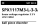
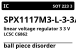

# IC SPX1117M3-L-3-3/TR SOT 223 3

`electronic_ic_power_management_linear_voltage_regulator_3_3_volt_sot_223_3_maxlinear_spx1117m3_l_3_3_tr`

IC SPX1117M3-L-3-3/TR SOT 223 3 is an OOMP electronic ic definition. It uses the sot 223 3 package or form factor. Its nominal drawing size is 10.0 &#x00D7; 5.0 mm.

## At a glance

| Detail | Value |
| --- | --- |
| OOMP ID | `electronic_ic_power_management_linear_voltage_regulator_3_3_volt_sot_223_3_maxlinear_spx1117m3_l_3_3_tr` |
| Type | Ic |
| Package / style | sot 223 3 |
| Nominal size | 10.0 &#x00D7; 5.0 mm |

## Classification

| Level | Value |
| --- | --- |
| 1 | `electronic` |
| 2 | `ic` |
| 3 | `power_management` |
| 4 | `linear_voltage_regulator_3_3_volt` |
| 5 | `sot_223_3` |
| 14 | `maxlinear` |
| 15 | `spx1117m3_l_3_3_tr` |

## Nominal dimensions

| Measurement | Value |
| --- | ---: |
| Length | 10.0 mm |
| Width | 5.0 mm |

## Identifiers

| Identifier | Value |
| --- | --- |
| Manufacturer part number | `SPX1117M3-L-3-3/TR` |
| LCSC | [`C6862`](https://www.lcsc.com/product-detail/C6862.html) |
| JLCPCB | [`C6862`](https://jlcpcb.com/partdetail/MaxLinear-SPX1117M3_L_3_3TR/C6862) |

## Used in projects

[Browse confirmed project usage](https://oomlout.github.io/oomp_electronic_project_version_5/usage/index.html#electronic_ic_power_management_linear_voltage_regulator_3_3_volt_sot_223_3_maxlinear_spx1117m3_l_3_3_tr)

## Files

<!-- oomp-part-file-table -->

| Image type | Image | Link |
| --- | :---: | --- |
| **Drawer label data** | — | [YAML](data/label_drawer.yaml) |
| **Small drawer label** |  | [SVG](label_drawer_1_5x1.svg) |
| **Large drawer label** |  | [SVG](label_drawer_3x2.svg) |
| **Part definition and build recipe** | — | [YAML](working.yaml) |

<!-- /oomp-part-file-table -->

[View this part on GitHub](https://github.com/oomlout/oomp_electronic_version_5/tree/main/parts/electronic_ic_power_management_linear_voltage_regulator_3_3_volt_sot_223_3_maxlinear_spx1117m3_l_3_3_tr)

[Browse this category](../../navigation/electronic/ic/power_management/linear_voltage_regulator_3_3_volt/sot_223_3/maxlinear/README.md)

---

This page is generated from the OOMP part definition by a Roboclick Jinja template. Edit the source taxonomy or template rather than this generated file.