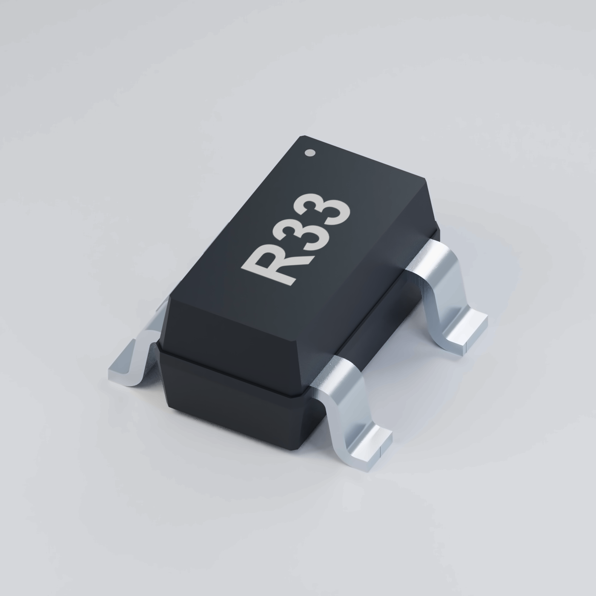
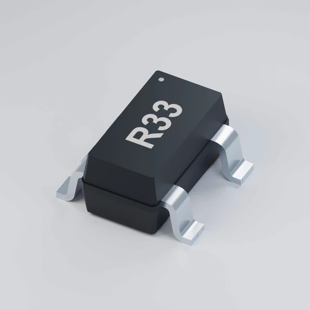
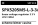
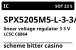

# IC SPX5205M5-L-3-3/TR SOT 23 5

`electronic_ic_power_management_linear_voltage_regulator_3_3_volt_sot_23_5_maxlinear_spx5205m5_l_3_3_tr`

IC SPX5205M5-L-3-3/TR SOT 23 5 is an OOMP electronic ic definition. It uses the sot 23 5 package or form factor. Its nominal drawing size is 2.9 &#x00D7; 1.6 mm.

Illustrative KiCad SOT-23-5 model vertically scaled from 1.55 mm to MaxLinear listed 1.45 mm package thickness. Catalogue source omits height; not a verified mechanical or PCB model. R33 is a historical MaxLinear marking; the 2014 change notification lists replacement RCWW with production-dependent fields. Typeface, orientation, placement and date/lot details are illustrative. Marking composited in linear light from shared path-traced material passes; indirect reflections are approximate.

[Render recipe and provenance](data/display_render/manifest.json) · [KiCad model](https://gitlab.com/kicad/libraries/kicad-packages3D/-/blob/master/Package_TO_SOT_SMD.3dshapes/SOT-23-5.step)

Model credit: 2025 KiCAD. CC-BY-SA-4.0 with KiCad library exception; see original STEP header.

## At a glance

| Detail | Value |
| --- | --- |
| OOMP ID | `electronic_ic_power_management_linear_voltage_regulator_3_3_volt_sot_23_5_maxlinear_spx5205m5_l_3_3_tr` |
| Type | Ic |
| Package / style | sot 23 5 |
| Nominal size | 2.9 &#x00D7; 1.6 mm |

## Classification

| Level | Value |
| --- | --- |
| 1 | `electronic` |
| 2 | `ic` |
| 3 | `power_management` |
| 4 | `linear_voltage_regulator_3_3_volt` |
| 5 | `sot_23_5` |
| 14 | `maxlinear` |
| 15 | `spx5205m5_l_3_3_tr` |

## Nominal dimensions

| Measurement | Value |
| --- | ---: |
| Length | 2.9 mm |
| Width | 1.6 mm |

## Identifiers

| Identifier | Value |
| --- | --- |
| Manufacturer part number | `SPX5205M5-L-3-3/TR` |
| LCSC | [`C6864`](https://www.lcsc.com/product-detail/C6864.html) |
| JLCPCB | [`C6864`](https://jlcpcb.com/partdetail/MaxLinear-SPX5205M5_L_3_3TR/C6864) |

## Used in projects

[Browse confirmed project usage](https://oomlout.github.io/oomp_electronic_project_version_5/usage/index.html#electronic_ic_power_management_linear_voltage_regulator_3_3_volt_sot_23_5_maxlinear_spx5205m5_l_3_3_tr)

## Files

<!-- oomp-part-file-table -->

| Image type | Image | Link |
| --- | :---: | --- |
| **Studio render** |  | [PNG](data/display_render/render.png) · [Preview](data/display_render/preview.webp) |
| **Studio render sources and recipe** | — | [JSON](data/display_render/manifest.json) |
| **Drawer label data** | — | [YAML](data/label_drawer.yaml) |
| **Small drawer label** |  | [SVG](label_drawer_1_5x1.svg) |
| **Large drawer label** |  | [SVG](label_drawer_3x2.svg) |
| **Web catalogue file index** | — | [YAML](web.yaml) |
| **Part definition and build recipe** | — | [YAML](working.yaml) |

<!-- /oomp-part-file-table -->

[View this part on GitHub](https://github.com/oomlout/oomp_electronic_version_5/tree/main/parts/electronic_ic_power_management_linear_voltage_regulator_3_3_volt_sot_23_5_maxlinear_spx5205m5_l_3_3_tr)

[Browse this category](../../navigation/electronic/ic/power_management/linear_voltage_regulator_3_3_volt/sot_23_5/maxlinear/README.md)

---

This page is generated from the OOMP part definition by a Roboclick Jinja template. Edit the source taxonomy or template rather than this generated file.