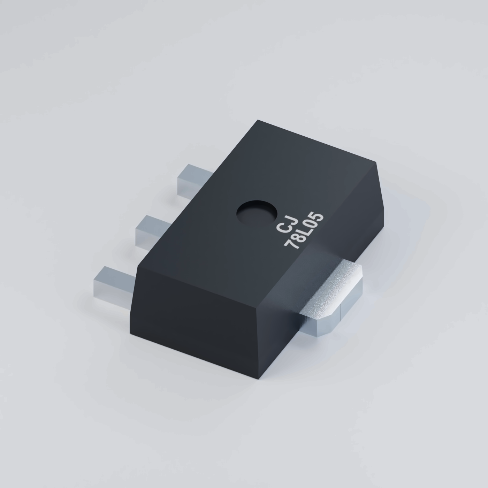
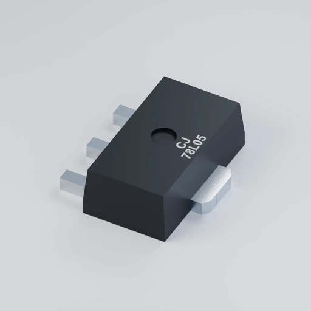
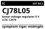

# IC CJ78L05 SOT 89 3

`electronic_ic_power_management_linear_voltage_regulator_5_volt_sot_89_3_jiangsu_changjing_electronics_technology_co_ltd_cj78l05`

IC CJ78L05 SOT 89 3 is an OOMP electronic ic definition. It uses the sot 89 3 package or form factor. Its nominal drawing size is 4.5 &#x00D7; 2.5 mm.

KiCad SOT-89 model has 4 x 4.5 x 1.52 mm overall bounds. The colourless source is assigned coating and metal roles by checked solid geometry; catalogue 4.5 x 2.5 mm dimensions do not specify their reference; the maker marking diagram was not visually confirmed. Not a verified mechanical model or footprint. JSCJ specifies CJ and 78L05 on separate lines; the optional green-material dot is omitted. Typeface, orientation, placement and variable lot/date details are illustrative.

[Render recipe and provenance](data/display_render/manifest.json) · [KiCad model](https://gitlab.com/kicad/libraries/kicad-packages3D/-/blob/master/Package_TO_SOT_SMD.3dshapes/SOT-89-3.step)

Model credit: 2025 KiCAD. CC-BY-SA-4.0 with KiCad library exception; see original STEP header.

## At a glance

| Detail | Value |
| --- | --- |
| OOMP ID | `electronic_ic_power_management_linear_voltage_regulator_5_volt_sot_89_3_jiangsu_changjing_electronics_technology_co_ltd_cj78l05` |
| Type | Ic |
| Package / style | sot 89 3 |
| Nominal size | 4.5 &#x00D7; 2.5 mm |

## Classification

| Level | Value |
| --- | --- |
| 1 | `electronic` |
| 2 | `ic` |
| 3 | `power_management` |
| 4 | `linear_voltage_regulator_5_volt` |
| 5 | `sot_89_3` |
| 14 | `jiangsu_changjing_electronics_technology_co_ltd` |
| 15 | `cj78l05` |

## Nominal dimensions

| Measurement | Value |
| --- | ---: |
| Length | 4.5 mm |
| Width | 2.5 mm |

## Identifiers

| Identifier | Value |
| --- | --- |
| Manufacturer part number | `CJ78L05` |
| LCSC | [`C2079`](https://www.lcsc.com/product-detail/C2079.html) |
| JLCPCB | [`C2079`](https://jlcpcb.com/partdetail/2436-CJ78L05/C2079) |

## Used in projects

[Browse confirmed project usage](https://oomlout.github.io/oomp_electronic_project_version_5/usage/index.html#electronic_ic_power_management_linear_voltage_regulator_5_volt_sot_89_3_jiangsu_changjing_electronics_technology_co_ltd_cj78l05)

## Files

<!-- oomp-part-file-table -->

| Image type | Image | Link |
| --- | :---: | --- |
| **Studio render** |  | [PNG](data/display_render/render.png) · [Preview](data/display_render/preview.webp) |
| **Studio render sources and recipe** | — | [JSON](data/display_render/manifest.json) |
| **Drawer label data** | — | [YAML](data/label_drawer.yaml) |
| **Small drawer label** |  | [SVG](label_drawer_1_5x1.svg) |
| **Large drawer label** |  | [SVG](label_drawer_3x2.svg) |
| **Web catalogue file index** | — | [YAML](web.yaml) |
| **Part definition and build recipe** | — | [YAML](working.yaml) |

<!-- /oomp-part-file-table -->

[View this part on GitHub](https://github.com/oomlout/oomp_electronic_version_5/tree/main/parts/electronic_ic_power_management_linear_voltage_regulator_5_volt_sot_89_3_jiangsu_changjing_electronics_technology_co_ltd_cj78l05)

[Browse this category](../../navigation/electronic/ic/power_management/linear_voltage_regulator_5_volt/sot_89_3/jiangsu_changjing_electronics_technology_co_ltd/README.md)

---

This page is generated from the OOMP part definition by a Roboclick Jinja template. Edit the source taxonomy or template rather than this generated file.