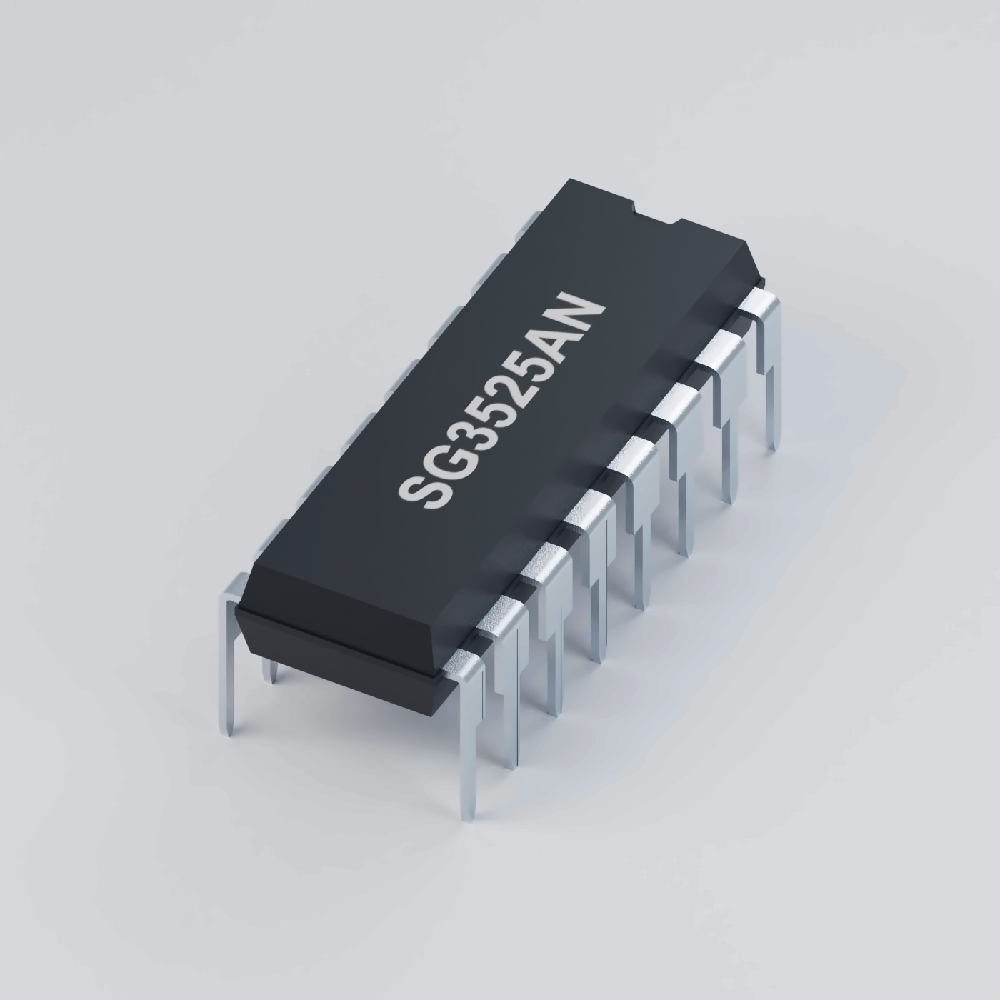
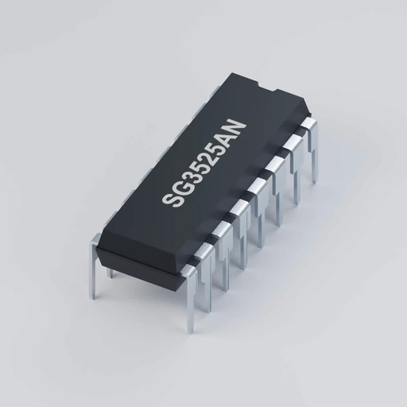
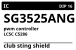

# IC SG3525ANG DIP 16

`electronic_ic_power_management_pwm_controller_dip_16_onsemi_sg3525ang`

IC SG3525ANG DIP 16 is an OOMP electronic ic definition. It uses the dip 16 package or form factor. Its nominal drawing size is 10.0 &#x00D7; 5.0 mm.

Generic KiCad DIP-16 model has 19.177 mm overall length and 6.98 mm overall height including projecting pins. Source 10 x 5 mm dimensions are generic and conflict with onsemi body range 18.80-19.55 x 6.35-6.85 mm. The manufacturer drawing was text-extracted but not visually confirmed. Display only, not a verified footprint or mechanical model. SG3525AN is the fixed marking shown in the manufacturer diagram. Typeface, orientation and placement are illustrative; variable assembly, lot and date codes are omitted. The diagram has not been visually confirmed.

[Render recipe and provenance](data/display_render/manifest.json) · [KiCad model](https://gitlab.com/kicad/libraries/kicad-packages3D/-/blob/master/Package_DIP.3dshapes/DIP-16_W7.62mm.step)

Model credit: 2025 KiCAD. CC-BY-SA-4.0 with KiCad library exception; see original STEP header.

## At a glance

| Detail | Value |
| --- | --- |
| OOMP ID | `electronic_ic_power_management_pwm_controller_dip_16_onsemi_sg3525ang` |
| Type | Ic |
| Package / style | dip 16 |
| Nominal size | 10.0 &#x00D7; 5.0 mm |

## Classification

| Level | Value |
| --- | --- |
| 1 | `electronic` |
| 2 | `ic` |
| 3 | `power_management` |
| 4 | `pwm_controller` |
| 5 | `dip_16` |
| 14 | `onsemi` |
| 15 | `sg3525ang` |

## Nominal dimensions

| Measurement | Value |
| --- | ---: |
| Length | 10.0 mm |
| Width | 5.0 mm |

## Identifiers

| Identifier | Value |
| --- | --- |
| Manufacturer part number | `SG3525ANG` |
| LCSC | [`C5286`](https://www.lcsc.com/product-detail/C5286.html) |
| JLCPCB | [`C5286`](https://jlcpcb.com/partdetail/onsemi-SG3525ANG/C5286) |

## Used in projects

[Browse confirmed project usage](https://oomlout.github.io/oomp_electronic_project_version_5/usage/index.html#electronic_ic_power_management_pwm_controller_dip_16_onsemi_sg3525ang)

## Files

<!-- oomp-part-file-table -->

| Image type | Image | Link |
| --- | :---: | --- |
| **Studio render** |  | [PNG](data/display_render/render.png) · [Preview](data/display_render/preview.webp) |
| **Studio render sources and recipe** | — | [JSON](data/display_render/manifest.json) |
| **Drawer label data** | — | [YAML](data/label_drawer.yaml) |
| **Small drawer label** |  | [SVG](label_drawer_1_5x1.svg) |
| **Large drawer label** |  | [SVG](label_drawer_3x2.svg) |
| **Web catalogue file index** | — | [YAML](web.yaml) |
| **Part definition and build recipe** | — | [YAML](working.yaml) |

<!-- /oomp-part-file-table -->

[View this part on GitHub](https://github.com/oomlout/oomp_electronic_version_5/tree/main/parts/electronic_ic_power_management_pwm_controller_dip_16_onsemi_sg3525ang)

[Browse this category](../../navigation/electronic/ic/power_management/pwm_controller/dip_16/onsemi/README.md)

---

This page is generated from the OOMP part definition by a Roboclick Jinja template. Edit the source taxonomy or template rather than this generated file.