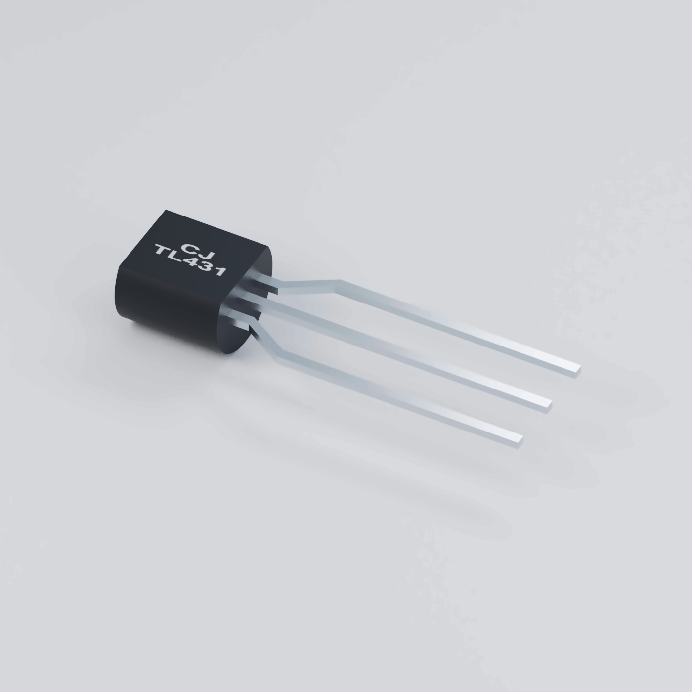
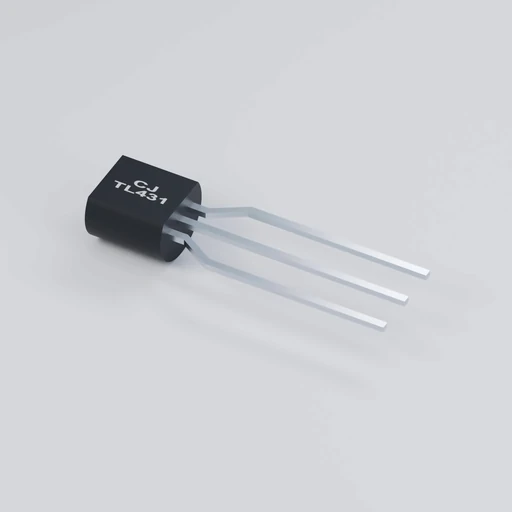
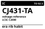

# IC CJ431-TA TO 92 3

`electronic_ic_power_management_voltage_reference_to_92_3_jiangsu_changjing_electronics_technology_co_ltd_cj431_ta`

IC CJ431-TA TO 92 3 is an OOMP electronic ic definition. It uses the to 92 3 package or form factor. Its nominal drawing size is 10.0 &#x00D7; 5.0 mm.

KiCad TO-92 body with representative formed leads: 1.27 mm at the body, 2.5 mm spread and 14.3 mm body-to-tip extent. Bend positions and taped lead length are approximate; body is slightly larger than the source drawing. Source 10 x 5 mm dimensions are generic. Display is not a verified footprint or mechanical model. CJ and TL431 are fixed family marking portions; line layout, typeface, placement and omitted production code are illustrative. Optional green-material dot is omitted.

[Render recipe and provenance](data/display_render/manifest.json) · [KiCad model](https://gitlab.com/kicad/libraries/kicad-packages3D/-/blob/master/Package_TO_SOT_THT.3dshapes/TO-92_Inline.step)

Model credit: 2025 KiCAD. CC-BY-SA-4.0 with KiCad library exception; see original STEP header.

## At a glance

| Detail | Value |
| --- | --- |
| OOMP ID | `electronic_ic_power_management_voltage_reference_to_92_3_jiangsu_changjing_electronics_technology_co_ltd_cj431_ta` |
| Type | Ic |
| Package / style | to 92 3 |
| Nominal size | 10.0 &#x00D7; 5.0 mm |

## Classification

| Level | Value |
| --- | --- |
| 1 | `electronic` |
| 2 | `ic` |
| 3 | `power_management` |
| 4 | `voltage_reference` |
| 5 | `to_92_3` |
| 14 | `jiangsu_changjing_electronics_technology_co_ltd` |
| 15 | `cj431_ta` |

## Nominal dimensions

| Measurement | Value |
| --- | ---: |
| Length | 10.0 mm |
| Width | 5.0 mm |

## Identifiers

| Identifier | Value |
| --- | --- |
| Manufacturer part number | `CJ431-TA` |
| LCSC | [`C2080`](https://www.lcsc.com/product-detail/C2080.html) |
| JLCPCB | [`C2080`](https://jlcpcb.com/partdetail/2437-CJ431TA/C2080) |

## Used in projects

[Browse confirmed project usage](https://oomlout.github.io/oomp_electronic_project_version_5/usage/index.html#electronic_ic_power_management_voltage_reference_to_92_3_jiangsu_changjing_electronics_technology_co_ltd_cj431_ta)

## Files

<!-- oomp-part-file-table -->

| Image type | Image | Link |
| --- | :---: | --- |
| **Studio render** |  | [PNG](data/display_render/render.png) · [Preview](data/display_render/preview.webp) |
| **Studio render sources and recipe** | — | [JSON](data/display_render/manifest.json) |
| **Drawer label data** | — | [YAML](data/label_drawer.yaml) |
| **Small drawer label** |  | [SVG](label_drawer_1_5x1.svg) |
| **Large drawer label** |  | [SVG](label_drawer_3x2.svg) |
| **Web catalogue file index** | — | [YAML](web.yaml) |
| **Part definition and build recipe** | — | [YAML](working.yaml) |

<!-- /oomp-part-file-table -->

[View this part on GitHub](https://github.com/oomlout/oomp_electronic_version_5/tree/main/parts/electronic_ic_power_management_voltage_reference_to_92_3_jiangsu_changjing_electronics_technology_co_ltd_cj431_ta)

[Browse this category](../../navigation/electronic/ic/power_management/voltage_reference/to_92_3/jiangsu_changjing_electronics_technology_co_ltd/README.md)

---

This page is generated from the OOMP part definition by a Roboclick Jinja template. Edit the source taxonomy or template rather than this generated file.