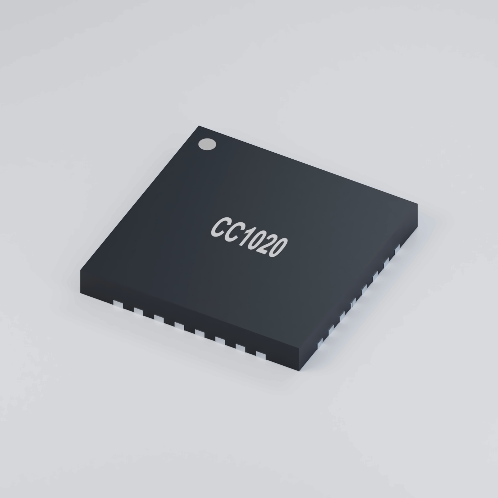
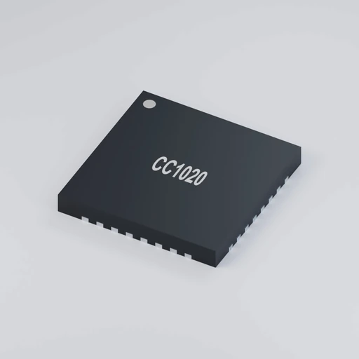
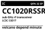

# IC CC1020RSSR QFN 32 EP

`electronic_ic_rf_sub_ghz_rf_transceiver_qfn_32_ep_texas_instruments_cc1020rssr`

IC CC1020RSSR QFN 32 EP is an OOMP electronic ic definition. It uses the qfn 32 ep package or form factor. Its nominal drawing size is 10.0 &#x00D7; 5.0 mm.

KiCad QFN-32 display has 7 x 7 x 0.87 mm bounds; source 10 x 5 mm dimensions are generic. Its measured 4.70 mm thermal pad is resized to 4.28 mm by a guarded display adapter; the scaled chamfer is approximate. The TI drawing was not visually confirmed. Display is not a verified footprint or mechanical model. TI lists CC1020 as the device marking. Typeface, orientation, placement and omitted logo and production codes are illustrative.

[Render recipe and provenance](data/display_render/manifest.json) · [KiCad model](https://gitlab.com/kicad/libraries/kicad-packages3D/-/blob/master/Package_DFN_QFN.3dshapes/QFN-32-1EP_7x7mm_P0.65mm_EP5.46x5.46mm.step)

Model credit: 2025 KiCAD. CC-BY-SA-4.0 with KiCad library exception; see original STEP header.

## At a glance

| Detail | Value |
| --- | --- |
| OOMP ID | `electronic_ic_rf_sub_ghz_rf_transceiver_qfn_32_ep_texas_instruments_cc1020rssr` |
| Type | Ic |
| Package / style | qfn 32 ep |
| Nominal size | 10.0 &#x00D7; 5.0 mm |

## Classification

| Level | Value |
| --- | --- |
| 1 | `electronic` |
| 2 | `ic` |
| 3 | `rf` |
| 4 | `sub_ghz_rf_transceiver` |
| 5 | `qfn_32_ep` |
| 14 | `texas_instruments` |
| 15 | `cc1020rssr` |

## Nominal dimensions

| Measurement | Value |
| --- | ---: |
| Length | 10.0 mm |
| Width | 5.0 mm |

## Identifiers

| Identifier | Value |
| --- | --- |
| Manufacturer part number | `CC1020RSSR` |
| LCSC | [`C6517`](https://www.lcsc.com/product-detail/C6517.html) |
| JLCPCB | [`C6517`](https://jlcpcb.com/partdetail/TexasInstruments-CC1020RSSR/C6517) |

## Used in projects

[Browse confirmed project usage](https://oomlout.github.io/oomp_electronic_project_version_5/usage/index.html#electronic_ic_rf_sub_ghz_rf_transceiver_qfn_32_ep_texas_instruments_cc1020rssr)

## Files

<!-- oomp-part-file-table -->

| Image type | Image | Link |
| --- | :---: | --- |
| **Studio render** |  | [PNG](data/display_render/render.png) · [Preview](data/display_render/preview.webp) |
| **Studio render sources and recipe** | — | [JSON](data/display_render/manifest.json) |
| **Drawer label data** | — | [YAML](data/label_drawer.yaml) |
| **Small drawer label** |  | [SVG](label_drawer_1_5x1.svg) |
| **Large drawer label** |  | [SVG](label_drawer_3x2.svg) |
| **Web catalogue file index** | — | [YAML](web.yaml) |
| **Part definition and build recipe** | — | [YAML](working.yaml) |

<!-- /oomp-part-file-table -->

[View this part on GitHub](https://github.com/oomlout/oomp_electronic_version_5/tree/main/parts/electronic_ic_rf_sub_ghz_rf_transceiver_qfn_32_ep_texas_instruments_cc1020rssr)

[Browse this category](../../navigation/electronic/ic/rf/sub_ghz_rf_transceiver/qfn_32_ep/texas_instruments/README.md)

---

This page is generated from the OOMP part definition by a Roboclick Jinja template. Edit the source taxonomy or template rather than this generated file.