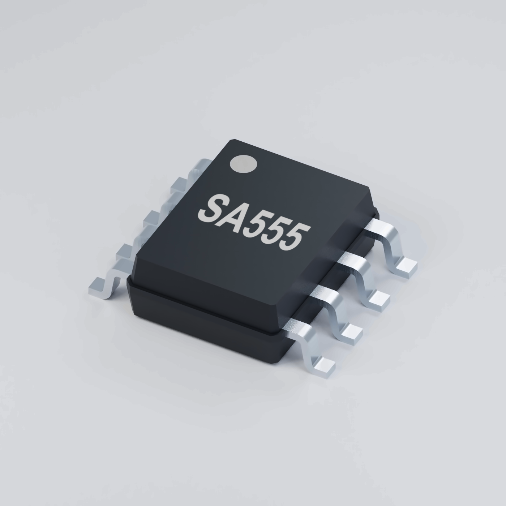
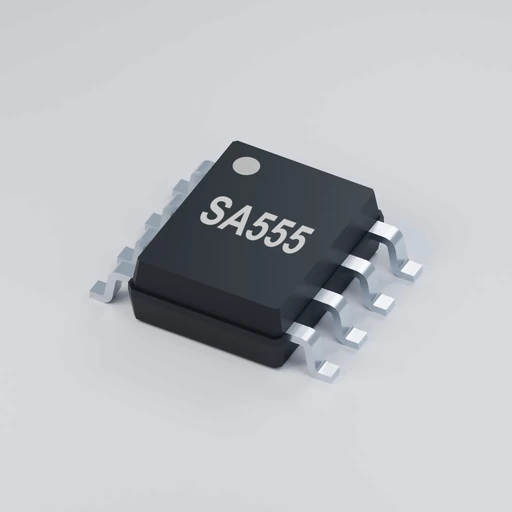
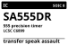

# IC SA555DR SOIC 8

`electronic_ic_timer_555_precision_timer_soic_8_texas_instruments_sa555dr`

IC SA555DR SOIC 8 is an OOMP electronic ic definition. It uses the soic 8 package or form factor. Its nominal drawing size is 4.9 &#x00D7; 3.9 mm.

Illustrative KiCad SOIC-8 model; TI D0008A drawing specifies 1.75 mm maximum height. Inspect pin-one and text orientation. Catalogue source does not specify height. TI lists SA555 as the package marking. Typeface, placement, logos and variable lot/date details are illustrative. Marking composited in linear light from shared path-traced material passes; indirect reflections are approximate.

[Render recipe and provenance](data/display_render/manifest.json) · [KiCad model](https://gitlab.com/kicad/libraries/kicad-packages3D/-/blob/master/Package_SO.3dshapes/SOIC-8_3.9x4.9mm_P1.27mm.step)

Model credit: 2025 KiCAD. CC-BY-SA-4.0 with KiCad library exception; see original STEP header.

## At a glance

| Detail | Value |
| --- | --- |
| OOMP ID | `electronic_ic_timer_555_precision_timer_soic_8_texas_instruments_sa555dr` |
| Type | Ic |
| Package / style | soic 8 |
| Nominal size | 4.9 &#x00D7; 3.9 mm |

## Classification

| Level | Value |
| --- | --- |
| 1 | `electronic` |
| 2 | `ic` |
| 3 | `timer` |
| 4 | `555_precision_timer` |
| 5 | `soic_8` |
| 14 | `texas_instruments` |
| 15 | `sa555dr` |

## Nominal dimensions

| Measurement | Value |
| --- | ---: |
| Length | 4.9 mm |
| Width | 3.9 mm |

## Identifiers

| Identifier | Value |
| --- | --- |
| Manufacturer part number | `SA555DR` |
| LCSC | [`C6899`](https://www.lcsc.com/product-detail/C6899.html) |
| JLCPCB | [`C6899`](https://jlcpcb.com/partdetail/TexasInstruments-SA555DR/C6899) |

## Used in projects

[Browse confirmed project usage](https://oomlout.github.io/oomp_electronic_project_version_5/usage/index.html#electronic_ic_timer_555_precision_timer_soic_8_texas_instruments_sa555dr)

## Files

<!-- oomp-part-file-table -->

| Image type | Image | Link |
| --- | :---: | --- |
| **Studio render** |  | [PNG](data/display_render/render.png) · [Preview](data/display_render/preview.webp) |
| **Studio render sources and recipe** | — | [JSON](data/display_render/manifest.json) |
| **Drawer label data** | — | [YAML](data/label_drawer.yaml) |
| **Small drawer label** |  | [SVG](label_drawer_1_5x1.svg) |
| **Large drawer label** |  | [SVG](label_drawer_3x2.svg) |
| **Web catalogue file index** | — | [YAML](web.yaml) |
| **Part definition and build recipe** | — | [YAML](working.yaml) |

<!-- /oomp-part-file-table -->

[View this part on GitHub](https://github.com/oomlout/oomp_electronic_version_5/tree/main/parts/electronic_ic_timer_555_precision_timer_soic_8_texas_instruments_sa555dr)

[Browse this category](../../navigation/electronic/ic/timer/555_precision_timer/soic_8/texas_instruments/README.md)

---

This page is generated from the OOMP part definition by a Roboclick Jinja template. Edit the source taxonomy or template rather than this generated file.