# IC Timer 555 Timer SOIC_8

`electronic_ic_timer_555_timer_soic_8_texas_instruments_ne555dr`

IC Timer 555 Timer SOIC_8 is an OOMP electronic ic definition. It uses the soic 8 package or form factor. Its nominal drawing size is 4.9 &#x00D7; 3.9 mm. The definition includes 8 documented pins.

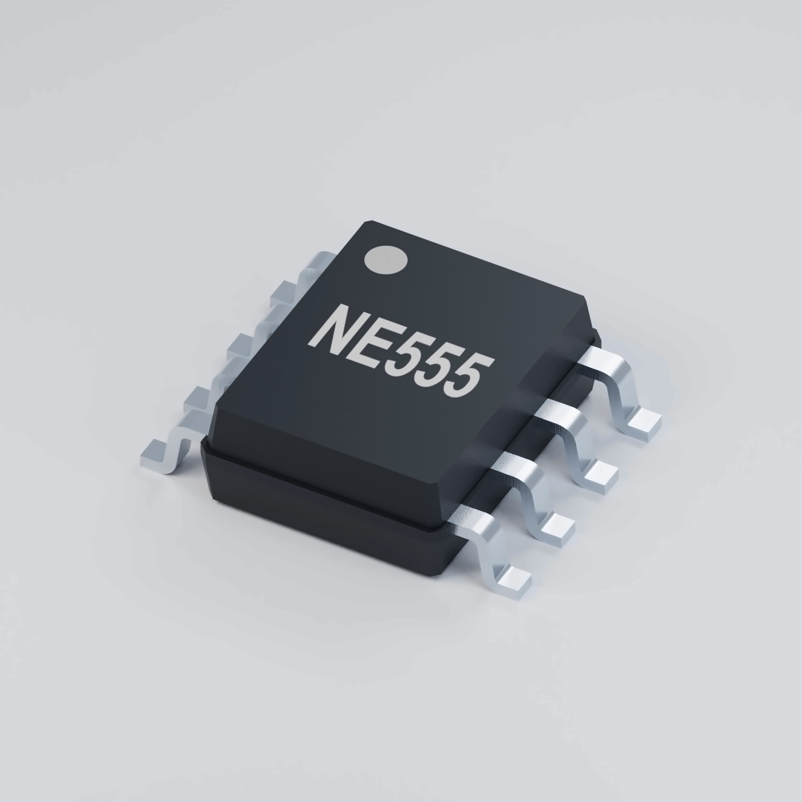

Generic KiCad nominal SOIC-8 geometry with illustrative moulded body and plated leads. TI documents NE555 as the device marking; typeface, placement and pin-one feature are illustrative, not an exact production-lot image.

[Render recipe and provenance](data/display_render/manifest.json) · [KiCad model](https://gitlab.com/kicad/libraries/kicad-packages3D/-/blob/master/Package_SO.3dshapes/SOIC-8_3.9x4.9mm_P1.27mm.step)

Model credit: 2025 KiCAD. CC-BY-SA-4.0 with KiCad library exception; see original STEP header.

## At a glance

| Detail | Value |
| --- | --- |
| OOMP ID | `electronic_ic_timer_555_timer_soic_8_texas_instruments_ne555dr` |
| Type | Ic |
| Package / style | soic 8 |
| Nominal size | 4.9 &#x00D7; 3.9 mm |
| Documented pins | 8 |

## Classification

| Level | Value |
| --- | --- |
| 1 | `electronic` |
| 2 | `ic` |
| 3 | `timer` |
| 4 | `555_timer` |
| 5 | `soic_8` |
| 14 | `texas_instruments` |
| 15 | `ne555dr` |

## Nominal dimensions

| Measurement | Value |
| --- | ---: |
| Height | 1.75 mm |
| Length | 4.9 mm |
| Width | 3.9 mm |

## Pins

| Pin | Name | Type |
| ---: | --- | --- |
| 1 | GND | gnd |
| 2 | TRIG | signal |
| 3 | OUT | signal |
| 4 | RESET | signal |
| 5 | CTRL | signal |
| 6 | THRESH | signal |
| 7 | DISCH | signal |
| 8 | VCC | power |

## Used in projects

[Browse confirmed project usage](https://oomlout.github.io/oomp_electronic_project_version_5/usage/index.html#electronic_ic_timer_555_timer_soic_8_texas_instruments_ne555dr)

## Files

[KiCad symbol, machine-solder and hand-solder footprints](data/kicad/README.md) · [Availability and source masters](data/kicad/manifest.yaml)

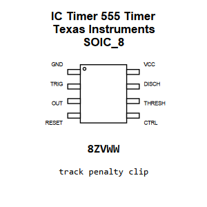

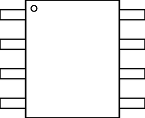

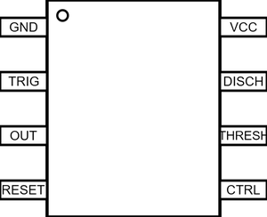

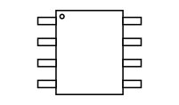

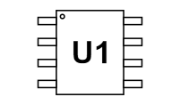

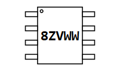

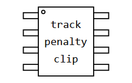

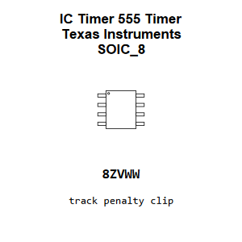

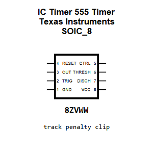

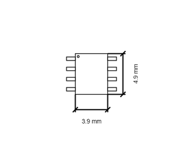

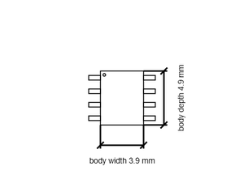

[View this part on GitHub](https://github.com/oomlout/oomp_electronic_version_5/tree/main/parts/electronic_ic_timer_555_timer_soic_8_texas_instruments_ne555dr)

[Browse this category](../../navigation/electronic/ic/timer/555_timer/soic_8/texas_instruments/README.md)

---

This page is generated from the OOMP part definition by a Roboclick Jinja template. Edit the source taxonomy or template rather than this generated file.