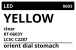

# LED KT-0603Y 0603

`electronic_led_0603_yellow_clear_hubei_kento_elec_kt_0603_y`

LED KT-0603Y 0603 is an OOMP electronic led definition. It uses the 0603 package or form factor. Its nominal drawing size is 1.6 &#x00D7; 0.8 mm.

## At a glance

| Detail | Value |
| --- | --- |
| OOMP ID | `electronic_led_0603_yellow_clear_hubei_kento_elec_kt_0603_y` |
| Type | Led |
| Package / style | 0603 |
| Nominal size | 1.6 &#x00D7; 0.8 mm |

## Classification

| Level | Value |
| --- | --- |
| 1 | `electronic` |
| 2 | `led` |
| 3 | `0603` |
| 4 | `yellow` |
| 5 | `clear` |
| 6 | `hubei_kento_elec` |
| 7 | `kt_0603_y` |

## Nominal dimensions

| Measurement | Value |
| --- | ---: |
| Length | 1.6 mm |
| Width | 0.8 mm |

## Identifiers

| Identifier | Value |
| --- | --- |
| Manufacturer part number | `KT-0603Y` |
| LCSC | [`C2287`](https://www.lcsc.com/product-detail/C2287.html) |
| JLCPCB | [`C2287`](https://jlcpcb.com/partdetail/Hubei_KENTOElec-KT0603Y/C2287) |

## Used in projects

[Browse confirmed project usage](https://oomlout.github.io/oomp_electronic_project_version_5/usage/index.html#electronic_led_0603_yellow_clear_hubei_kento_elec_kt_0603_y)

## Files

<!-- oomp-part-file-table -->

| Image type | Image | Link |
| --- | :---: | --- |
| **Drawer label data** | — | [YAML](data/label_drawer.yaml) |
| **Small drawer label** |  | [SVG](label_drawer_1_5x1.svg) |
| **Large drawer label** |  | [SVG](label_drawer_3x2.svg) |
| **Part definition and build recipe** | — | [YAML](working.yaml) |

<!-- /oomp-part-file-table -->

[View this part on GitHub](https://github.com/oomlout/oomp_electronic_version_5/tree/main/parts/electronic_led_0603_yellow_clear_hubei_kento_elec_kt_0603_y)

[Browse this category](../../navigation/electronic/led/0603/yellow/clear/hubei_kento_elec/README.md)

---

This page is generated from the OOMP part definition by a Roboclick Jinja template. Edit the source taxonomy or template rather than this generated file.