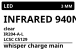

# LED IR204-A-L 3 MM

`electronic_led_3_mm_infrared_940nm_clear_everlight_ir204_a_l`

LED IR204-A-L 3 MM is an OOMP electronic led definition. It uses the 3 mm package or form factor. Its nominal drawing size is 3.0 &#x00D7; 3.0 mm.

## At a glance

| Detail | Value |
| --- | --- |
| OOMP ID | `electronic_led_3_mm_infrared_940nm_clear_everlight_ir204_a_l` |
| Type | Led |
| Package / style | 3 mm |
| Nominal size | 3.0 &#x00D7; 3.0 mm |

## Classification

| Level | Value |
| --- | --- |
| 1 | `electronic` |
| 2 | `led` |
| 3 | `3_mm` |
| 4 | `infrared_940nm` |
| 5 | `clear` |
| 14 | `everlight` |
| 15 | `ir204_a_l` |

## Nominal dimensions

| Measurement | Value |
| --- | ---: |
| Length | 3.0 mm |
| Width | 3.0 mm |

## Identifiers

| Identifier | Value |
| --- | --- |
| Manufacturer part number | `IR204-A-L` |
| LCSC | [`C5129`](https://www.lcsc.com/product-detail/C5129.html) |
| JLCPCB | [`C5129`](https://jlcpcb.com/partdetail/EverlightElec-IR204_AL/C5129) |

## Used in projects

[Browse confirmed project usage](https://oomlout.github.io/oomp_electronic_project_version_5/usage/index.html#electronic_led_3_mm_infrared_940nm_clear_everlight_ir204_a_l)

## Files

<!-- oomp-part-file-table -->

| Image type | Image | Link |
| --- | :---: | --- |
| **Drawer label data** | — | [YAML](data/label_drawer.yaml) |
| **Small drawer label** |  | [SVG](label_drawer_1_5x1.svg) |
| **Large drawer label** |  | [SVG](label_drawer_3x2.svg) |
| **Part definition and build recipe** | — | [YAML](working.yaml) |

<!-- /oomp-part-file-table -->

[View this part on GitHub](https://github.com/oomlout/oomp_electronic_version_5/tree/main/parts/electronic_led_3_mm_infrared_940nm_clear_everlight_ir204_a_l)

[Browse this category](../../navigation/electronic/led/3_mm/infrared_940nm/clear/everlight/README.md)

---

This page is generated from the OOMP part definition by a Roboclick Jinja template. Edit the source taxonomy or template rather than this generated file.