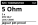

# Ntc Thermistor NTC 5D-7 THROUGH HOLE

`electronic_ntc_thermistor_through_hole_5_ohm_2_a_ruilon_ntc_5d_7`

Ntc Thermistor NTC 5D-7 THROUGH HOLE is an OOMP electronic ntc thermistor definition. It uses the through hole package or form factor. Its nominal drawing size is 10.0 &#x00D7; 5.0 mm.

## At a glance

| Detail | Value |
| --- | --- |
| OOMP ID | `electronic_ntc_thermistor_through_hole_5_ohm_2_a_ruilon_ntc_5d_7` |
| Type | Ntc Thermistor |
| Package / style | through hole |
| Nominal size | 10.0 &#x00D7; 5.0 mm |

## Classification

| Level | Value |
| --- | --- |
| 1 | `electronic` |
| 2 | `ntc_thermistor` |
| 3 | `through_hole` |
| 4 | `5_ohm` |
| 5 | `2_a` |
| 14 | `ruilon` |
| 15 | `ntc_5d_7` |

## Nominal dimensions

| Measurement | Value |
| --- | ---: |
| Length | 10.0 mm |
| Width | 5.0 mm |

## Identifiers

| Identifier | Value |
| --- | --- |
| Manufacturer part number | `NTC 5D-7` |
| LCSC | [`C5385`](https://www.lcsc.com/product-detail/C5385.html) |
| JLCPCB | [`C5385`](https://jlcpcb.com/partdetail/5821-NTC_5D7/C5385) |

## Used in projects

[Browse confirmed project usage](https://oomlout.github.io/oomp_electronic_project_version_5/usage/index.html#electronic_ntc_thermistor_through_hole_5_ohm_2_a_ruilon_ntc_5d_7)

## Files

<!-- oomp-part-file-table -->

| Image type | Image | Link |
| --- | :---: | --- |
| **Drawer label data** | — | [YAML](data/label_drawer.yaml) |
| **Small drawer label** |  | [SVG](label_drawer_1_5x1.svg) |
| **Large drawer label** |  | [SVG](label_drawer_3x2.svg) |
| **Part definition and build recipe** | — | [YAML](working.yaml) |

<!-- /oomp-part-file-table -->

[View this part on GitHub](https://github.com/oomlout/oomp_electronic_version_5/tree/main/parts/electronic_ntc_thermistor_through_hole_5_ohm_2_a_ruilon_ntc_5d_7)

[Browse this category](../../navigation/electronic/ntc_thermistor/through_hole/5_ohm/2_a/ruilon/README.md)

---

This page is generated from the OOMP part definition by a Roboclick Jinja template. Edit the source taxonomy or template rather than this generated file.