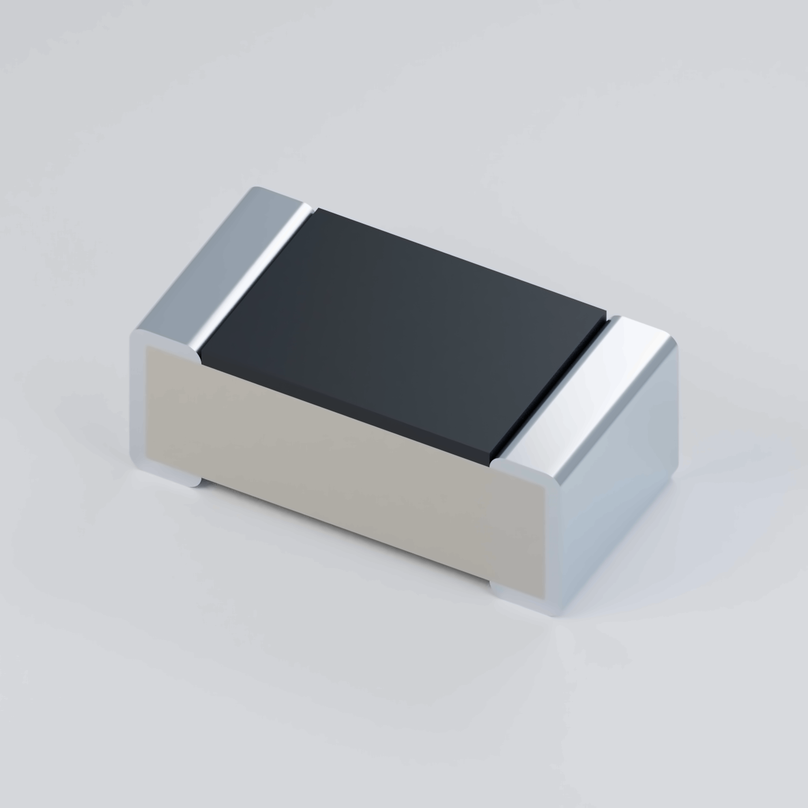
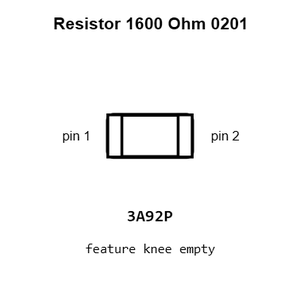
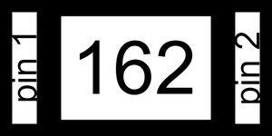
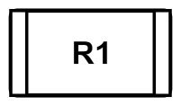
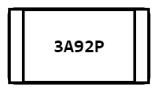
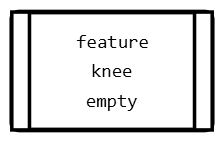
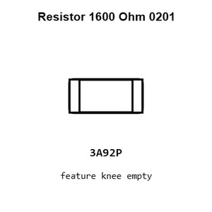
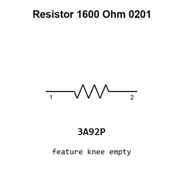
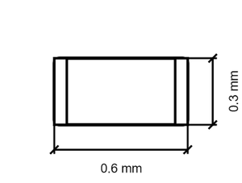
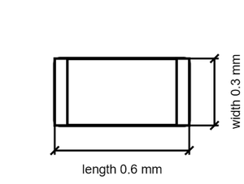

# Resistor 1600 Ohm 0201

`electronic_resistor_0201_1600_ohm`

Resistor 1600 Ohm 0201 is an OOMP electronic resistor definition. It uses the 0201 package or form factor. Its nominal drawing size is 0.6 &#x00D7; 0.3 mm.

Illustrates Yageo RC0201FR-071K6L, a 1% example; this generic entry has no selected manufacturer or tolerance. KiCad geometry and materials are illustrative. Yageo RC0201 bodies are unmarked. Image reused from an identical unmarked package and material setup.

[Render recipe and provenance](data/display_render/manifest.json) · [KiCad model](https://gitlab.com/kicad/libraries/kicad-packages3D/-/blob/master/Resistor_SMD.3dshapes/R_0201_0603Metric.step)

Model credit: 2018 kicad StepUp. CC-BY-SA-4.0 with KiCad library exception; see original STEP header.

## At a glance

| Detail | Value |
| --- | --- |
| OOMP ID | `electronic_resistor_0201_1600_ohm` |
| Type | Resistor |
| Package / style | 0201 |
| Nominal size | 0.6 &#x00D7; 0.3 mm |

## Classification

| Level | Value |
| --- | --- |
| 1 | `electronic` |
| 2 | `resistor` |
| 3 | `0201` |
| 4 | `1600_ohm` |

## Nominal dimensions

| Measurement | Value |
| --- | ---: |
| Length | 0.6 mm |
| Width | 0.3 mm |

## Used in projects

[Browse confirmed project usage](https://oomlout.github.io/oomp_electronic_project_version_5/usage/index.html#electronic_resistor_0201_1600_ohm)

## Files

[KiCad symbol, machine-solder and hand-solder footprints](data/kicad/README.md) · [Availability and source masters](data/kicad/manifest.yaml)

[View this part on GitHub](https://github.com/oomlout/oomp_electronic_version_5/tree/main/parts/electronic_resistor_0201_1600_ohm)

[Browse this category](../../navigation/electronic/resistor/0201/README.md)

---

This page is generated from the OOMP part definition by a Roboclick Jinja template. Edit the source taxonomy or template rather than this generated file.