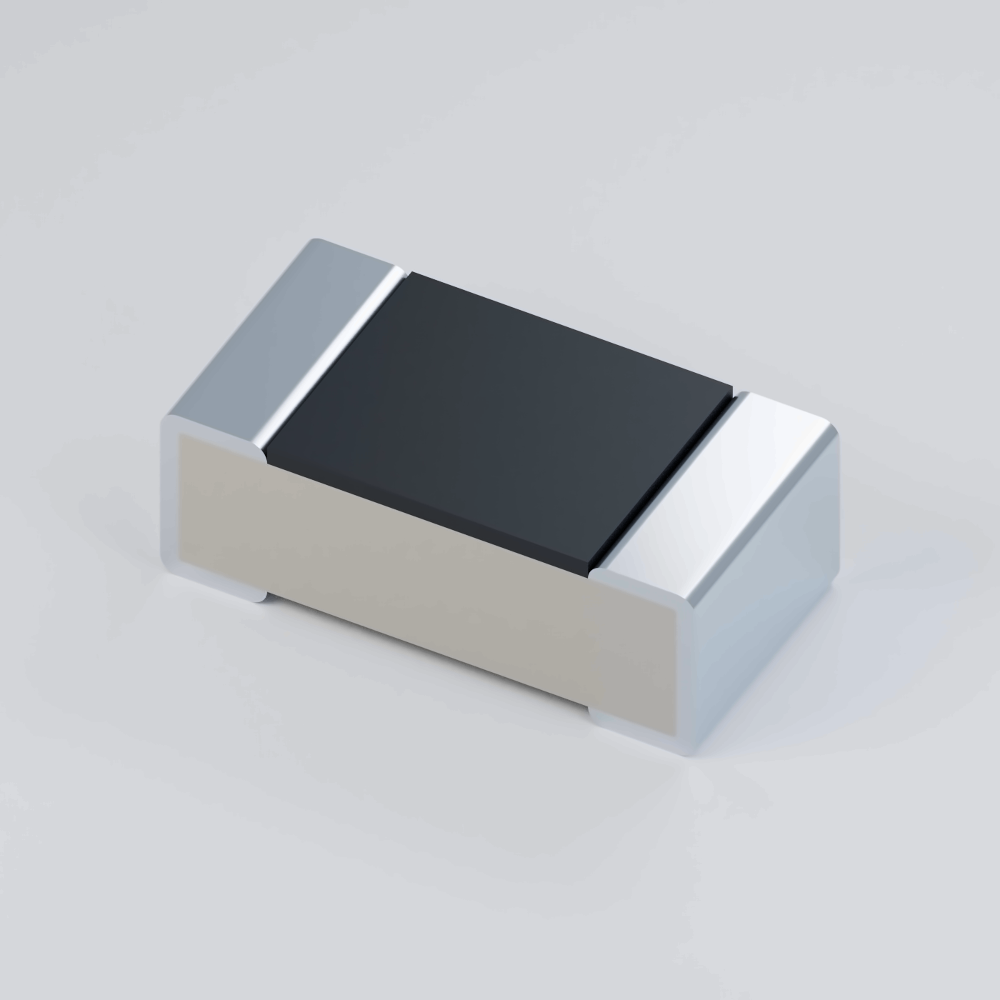
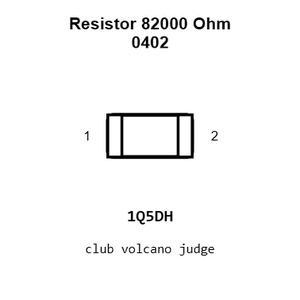
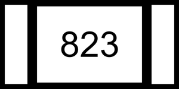
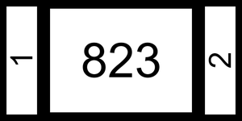
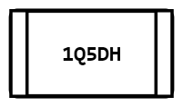
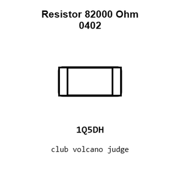
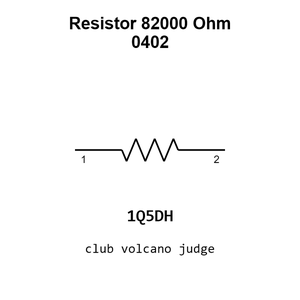
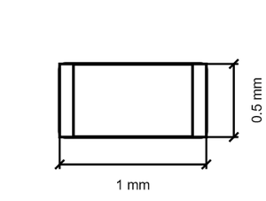
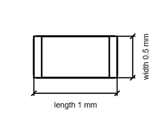

# Resistor 82000 Ohm 0402

`electronic_resistor_0402_82000_ohm_5_percent`

Resistor 82000 Ohm 0402 is an OOMP electronic resistor definition. It uses the 0402 package or form factor. Its nominal drawing size is 1.0 &#x00D7; 0.5 mm. The definition includes 2 documented pins.

Generic KiCad nominal package geometry with illustrative materials; represents one supplier choice. Fenghua documents RC-02 0402 bodies as unmarked. Image reused from an identical unmarked package and material setup.

[Render recipe and provenance](data/display_render/manifest.json) · [KiCad model](https://gitlab.com/kicad/libraries/kicad-packages3D/-/blob/master/Resistor_SMD.3dshapes/R_0402_1005Metric.step)

Model credit: 2018 kicad StepUp. CC-BY-SA-4.0 with KiCad library exception; see original STEP header.

## At a glance

| Detail | Value |
| --- | --- |
| OOMP ID | `electronic_resistor_0402_82000_ohm_5_percent` |
| Type | Resistor |
| Package / style | 0402 |
| Nominal size | 1.0 &#x00D7; 0.5 mm |
| Documented pins | 2 |

## Classification

| Level | Value |
| --- | --- |
| 1 | `electronic` |
| 2 | `resistor` |
| 3 | `0402` |
| 4 | `82000_ohm` |
| 5 | `5_percent` |

## Nominal dimensions

| Measurement | Value |
| --- | ---: |
| Height | 0.35 mm |
| Length | 1.0 mm |
| Width | 0.5 mm |

## Identifiers

| Identifier | Value |
| --- | --- |
| Manufacturer part number | `RC-02K823JT` |
| LCSC | [`C1160`](https://www.lcsc.com/product-detail/C1160.html) |
| JLCPCB | [`C1160`](https://jlcpcb.com/partdetail/1512-RC02K823JT/C1160) |

## Pins

| Pin | Name | Type |
| ---: | --- | --- |
| 1 | 1 | passive |
| 2 | 2 | passive |

## Datasheet

[Manufacturer drawing](https://datasheet.lcsc.com/datasheet/pdf/8d58778925076bf80f4c3e6ed51a56f5.pdf?productCode=C115306) · [Manufacturer product page](https://jlcpcb.com/partdetail/1512-RC02K823JT/C1160)

A local PDF has not been captured. The linked source is not an offline datasheet.

## Used in projects

[Browse confirmed project usage](https://oomlout.github.io/oomp_electronic_project_version_5/usage/index.html#electronic_resistor_0402_82000_ohm_5_percent)

## Files

[KiCad symbol, machine-solder and hand-solder footprints](data/kicad/README.md) · [Availability and source masters](data/kicad/manifest.yaml)

[View this part on GitHub](https://github.com/oomlout/oomp_electronic_version_5/tree/main/parts/electronic_resistor_0402_82000_ohm_5_percent)

[Browse this category](../../navigation/electronic/resistor/0402/82000_ohm/README.md)

---

This page is generated from the OOMP part definition by a Roboclick Jinja template. Edit the source taxonomy or template rather than this generated file.