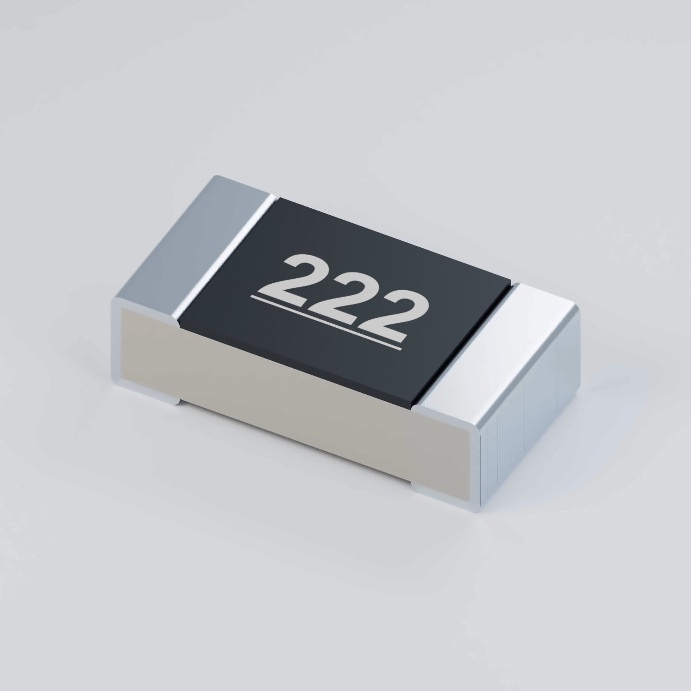
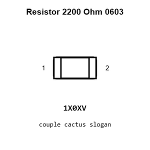
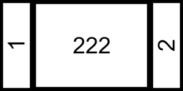
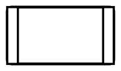
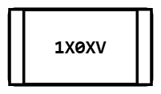
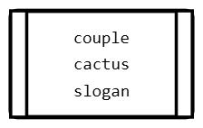
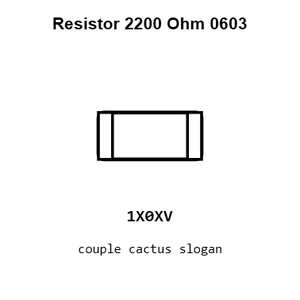
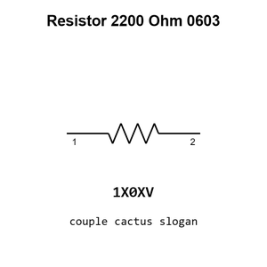
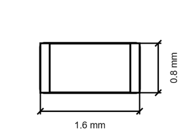
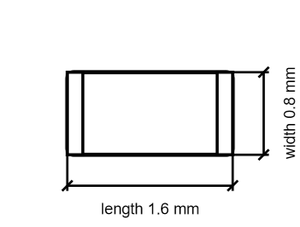

# Resistor 2200 Ohm 0603

`electronic_resistor_0603_2200_ohm`

Resistor 2200 Ohm 0603 is an OOMP electronic resistor definition. It uses the 0603 package or form factor. Its nominal drawing size is 1.6 &#x00D7; 0.8 mm. The definition includes 2 documented pins.

Generic KiCad nominal package geometry with illustrative ceramic, protective coating and tin-plated terminations. Represents one supplier choice for this generic catalogue part. Documented underlined code; approximate ink, typeface and placement, not a photograph or exact production-lot reproduction. Marking composited in linear light from shared path-traced material passes; indirect reflections are approximate.

[Render recipe and provenance](data/display_render/manifest.json) · [KiCad model](https://gitlab.com/kicad/libraries/kicad-packages3D/-/blob/master/Resistor_SMD.3dshapes/R_0603_1608Metric.step)

Model credit: 2018 kicad StepUp. CC-BY-SA-4.0 with KiCad library exception; see original STEP header.

## At a glance

| Detail | Value |
| --- | --- |
| OOMP ID | `electronic_resistor_0603_2200_ohm` |
| Type | Resistor |
| Package / style | 0603 |
| Nominal size | 1.6 &#x00D7; 0.8 mm |
| Documented pins | 2 |

## Classification

| Level | Value |
| --- | --- |
| 1 | `electronic` |
| 2 | `resistor` |
| 3 | `0603` |
| 4 | `2200_ohm` |

## Nominal dimensions

| Measurement | Value |
| --- | ---: |
| Height | 0.45 mm |
| Length | 1.6 mm |
| Width | 0.8 mm |

## Identifiers

| Identifier | Value |
| --- | --- |
| Manufacturer part number | `0603WAF2201T5E` |
| LCSC | [`C4190`](https://www.lcsc.com/product-detail/C4190.html) |
| LCSC | [`C2907005`](https://www.lcsc.com/product-detail/C2907005.html) |
| LCSC | [`C25992`](https://www.lcsc.com/product-detail/C25992.html) |
| JLCPCB | [`C4190`](https://jlcpcb.com/partdetail/4597-0603WAF2201T5E/C4190) |

## Pins

| Pin | Name | Type |
| ---: | --- | --- |
| 1 | 1 | passive |
| 2 | 2 | passive |

## Datasheet

[View the datasheet](data/datasheet.pdf)

## Used in projects

[Browse confirmed project usage](https://oomlout.github.io/oomp_electronic_project_version_5/usage/index.html#electronic_resistor_0603_2200_ohm)

## Files

[KiCad symbol, machine-solder and hand-solder footprints](data/kicad/README.md) · [Availability and source masters](data/kicad/manifest.yaml)

[View this part on GitHub](https://github.com/oomlout/oomp_electronic_version_5/tree/main/parts/electronic_resistor_0603_2200_ohm)

[Browse this category](../../navigation/electronic/resistor/0603/README.md)

---

This page is generated from the OOMP part definition by a Roboclick Jinja template. Edit the source taxonomy or template rather than this generated file.