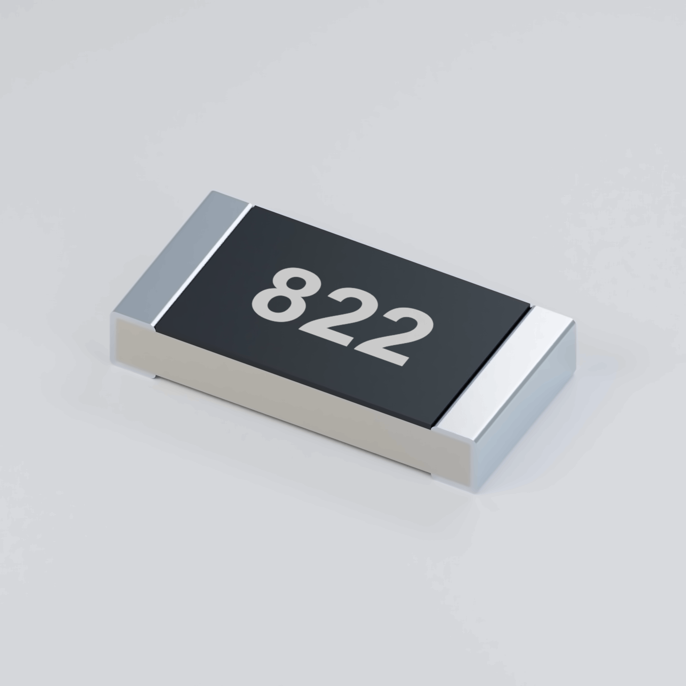
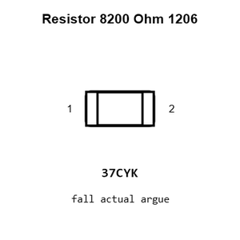
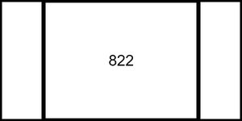
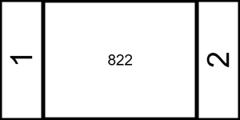
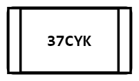
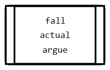
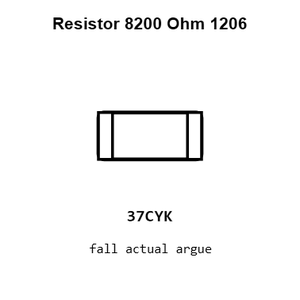
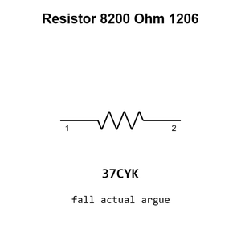
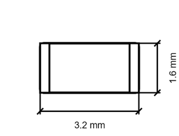
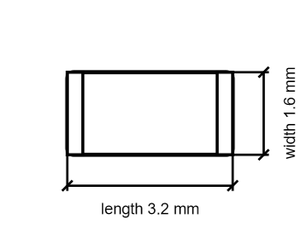

# Resistor 8200 Ohm 1206

`electronic_resistor_1206_8200_ohm`

Resistor 8200 Ohm 1206 is an OOMP electronic resistor definition. It uses the 1206 package or form factor. Its nominal drawing size is 3.2 &#x00D7; 1.6 mm. The definition includes 2 documented pins.

Generic KiCad nominal package geometry with illustrative materials; represents one supplier choice. Documented Fenghua value code; ink, typeface and placement are illustrative. Marking composited in linear light from shared path-traced material passes; indirect reflections are approximate.

[Render recipe and provenance](data/display_render/manifest.json) · [KiCad model](https://gitlab.com/kicad/libraries/kicad-packages3D/-/blob/master/Resistor_SMD.3dshapes/R_1206_3216Metric.step)

Model credit: 2018 kicad StepUp. CC-BY-SA-4.0 with KiCad library exception; see original STEP header.

## At a glance

| Detail | Value |
| --- | --- |
| OOMP ID | `electronic_resistor_1206_8200_ohm` |
| Type | Resistor |
| Package / style | 1206 |
| Nominal size | 3.2 &#x00D7; 1.6 mm |
| Documented pins | 2 |

## Classification

| Level | Value |
| --- | --- |
| 1 | `electronic` |
| 2 | `resistor` |
| 3 | `1206` |
| 4 | `8200_ohm` |

## Nominal dimensions

| Measurement | Value |
| --- | ---: |
| Height | 0.55 mm |
| Length | 3.2 mm |
| Width | 1.6 mm |

## Identifiers

| Identifier | Value |
| --- | --- |
| Manufacturer part number | `RS-06K822JT` |
| LCSC | [`C1488`](https://www.lcsc.com/product-detail/C1488.html) |
| JLCPCB | [`C1488`](https://jlcpcb.com/partdetail/1840-RS06K822JT/C1488) |

## Pins

| Pin | Name | Type |
| ---: | --- | --- |
| 1 | 1 | passive |
| 2 | 2 | passive |

## Datasheet

[Manufacturer drawing](https://datasheet.lcsc.com/lcsc/Guangdong-Fenghua-Advanced-Tech-RS-06000JT_C115323.pdf) · [Manufacturer product page](https://jlcpcb.com/partdetail/1840-RS06K822JT/C1488)

A local PDF has not been captured. The linked source is not an offline datasheet.

## Used in projects

[Browse confirmed project usage](https://oomlout.github.io/oomp_electronic_project_version_5/usage/index.html#electronic_resistor_1206_8200_ohm)

## Files

[KiCad symbol, machine-solder and hand-solder footprints](data/kicad/README.md) · [Availability and source masters](data/kicad/manifest.yaml)

[View this part on GitHub](https://github.com/oomlout/oomp_electronic_version_5/tree/main/parts/electronic_resistor_1206_8200_ohm)

[Browse this category](../../navigation/electronic/resistor/1206/README.md)

---

This page is generated from the OOMP part definition by a Roboclick Jinja template. Edit the source taxonomy or template rather than this generated file.