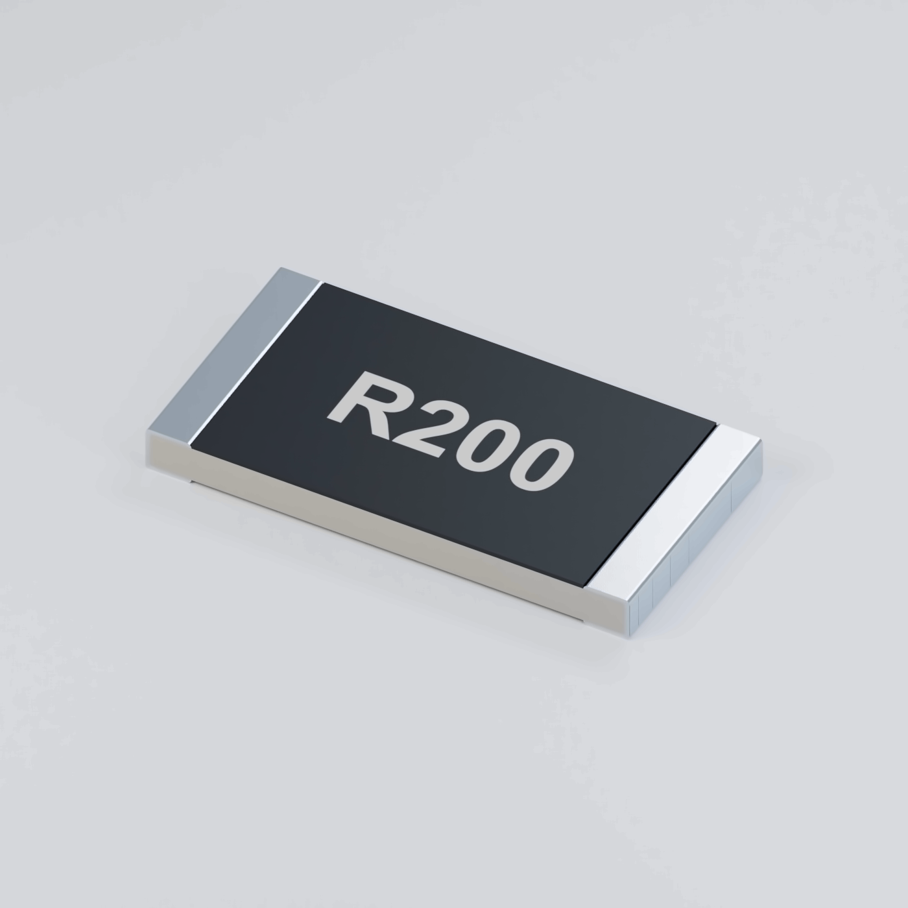
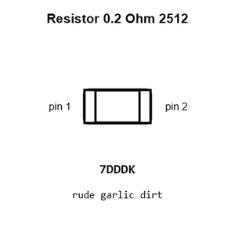
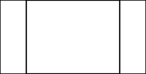
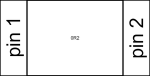
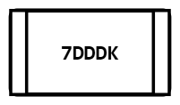
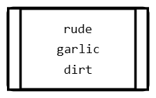
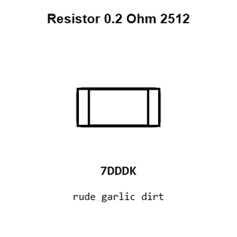
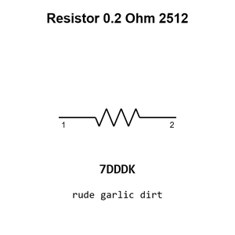
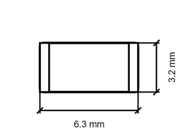
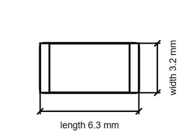

# Resistor 0.2 Ohm 2512

`electronic_resistor_2512_0_2_ohm`

Resistor 0.2 Ohm 2512 is an OOMP electronic resistor definition. It uses the 2512 package or form factor. Its nominal drawing size is 6.3 &#x00D7; 3.2 mm.

Generic KiCad 2512 geometry with illustrative materials. Represents Yageo PT current-sense part; other characteristics must be checked for the intended design. Documented PT value code; ink, typeface and placement are illustrative.

[Render recipe and provenance](data/display_render/manifest.json) · [KiCad model](https://gitlab.com/kicad/libraries/kicad-packages3D/-/blob/master/Resistor_SMD.3dshapes/R_2512_6332Metric.step)

Model credit: 2018 kicad StepUp. CC-BY-SA-4.0 with KiCad library exception; see original STEP header.

## At a glance

| Detail | Value |
| --- | --- |
| OOMP ID | `electronic_resistor_2512_0_2_ohm` |
| Type | Resistor |
| Package / style | 2512 |
| Nominal size | 6.3 &#x00D7; 3.2 mm |

## Classification

| Level | Value |
| --- | --- |
| 1 | `electronic` |
| 2 | `resistor` |
| 3 | `2512` |
| 4 | `0_2_ohm` |

## Nominal dimensions

| Measurement | Value |
| --- | ---: |
| Length | 6.3 mm |
| Width | 3.2 mm |

## Identifiers

| Identifier | Value |
| --- | --- |
| Manufacturer part number | `PT2512FK-7W0R2L` |
| LCSC | [`C309535`](https://www.lcsc.com/product-detail/C309535.html) |

## Used in projects

[Browse confirmed project usage](https://oomlout.github.io/oomp_electronic_project_version_5/usage/index.html#electronic_resistor_2512_0_2_ohm)

## Files

[KiCad symbol, machine-solder and hand-solder footprints](data/kicad/README.md) · [Availability and source masters](data/kicad/manifest.yaml)

[View this part on GitHub](https://github.com/oomlout/oomp_electronic_version_5/tree/main/parts/electronic_resistor_2512_0_2_ohm)

[Browse this category](../../navigation/electronic/resistor/2512/README.md)

---

This page is generated from the OOMP part definition by a Roboclick Jinja template. Edit the source taxonomy or template rather than this generated file.