# Resistor 1e+06 Ohm QUARTER_WATT_THROUGH_HOLE

`electronic_resistor_quarter_watt_through_hole_1000000_ohm`

Resistor 1e+06 Ohm QUARTER_WATT_THROUGH_HOLE is an OOMP electronic resistor definition. It uses the quarter watt through hole package or form factor. Its nominal drawing size is 6.5 &#x00D7; 2.5 mm.

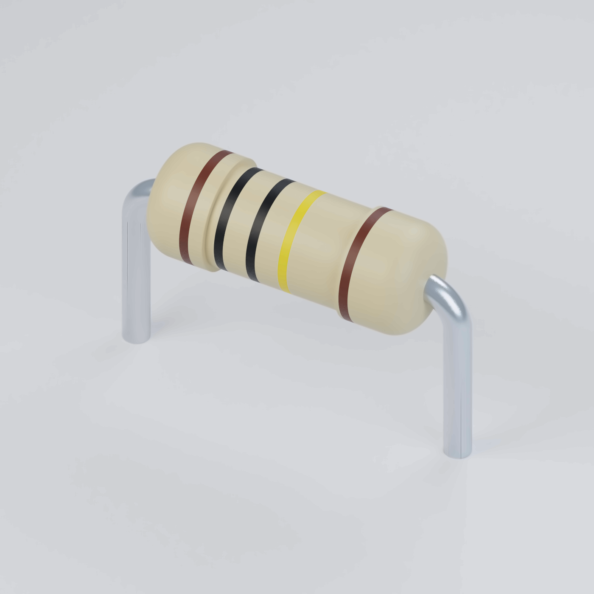

Generic KiCad axial geometry with bent leads at 7.62 mm pitch. Traditional beige finish and the standard five-band layout are illustrative. Standard five-band representation; the actual VO band count, spacing and shades are not verified. Marking composited in linear light from shared path-traced material passes; indirect reflections are approximate.

[Render recipe and provenance](data/display_render/manifest.json) · [KiCad model](https://gitlab.com/kicad/libraries/kicad-packages3D/-/blob/master/Resistor_THT.3dshapes/R_Axial_DIN0207_L6.3mm_D2.5mm_P7.62mm_Horizontal.step)

Model credit: 2017 kicad StepUp. CC-BY-SA-4.0 with exception in source STEP header.

## At a glance

| Detail | Value |
| --- | --- |
| OOMP ID | `electronic_resistor_quarter_watt_through_hole_1000000_ohm` |
| Type | Resistor |
| Package / style | quarter watt through hole |
| Nominal size | 6.5 &#x00D7; 2.5 mm |

## Classification

| Level | Value |
| --- | --- |
| 1 | `electronic` |
| 2 | `resistor` |
| 3 | `quarter_watt_through_hole` |
| 4 | `1000000_ohm` |

## Nominal dimensions

| Measurement | Value |
| --- | ---: |
| Length | 6.5 mm |
| Width | 2.5 mm |

## Identifiers

| Identifier | Value |
| --- | --- |
| Manufacturer part number | `MF1/4W-1M&#x00B1;1%-OT52` |
| LCSC | [`C2903250`](https://www.lcsc.com/product-detail/C2903250.html) |

## Used in projects

[Browse confirmed project usage](https://oomlout.github.io/oomp_electronic_project_version_5/usage/index.html#electronic_resistor_quarter_watt_through_hole_1000000_ohm)

## Files

[KiCad symbol, machine-solder and hand-solder footprints](data/kicad/README.md) · [Availability and source masters](data/kicad/manifest.yaml)

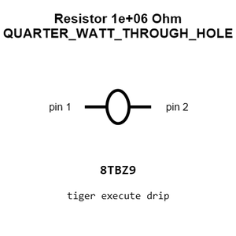

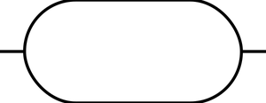

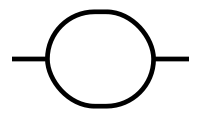

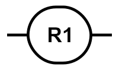

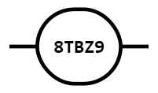

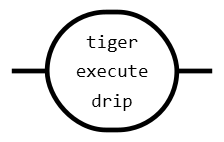

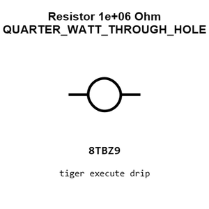

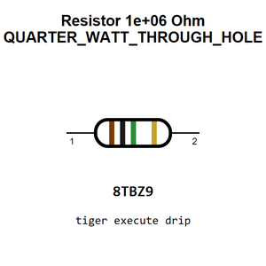

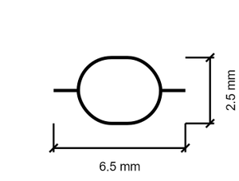

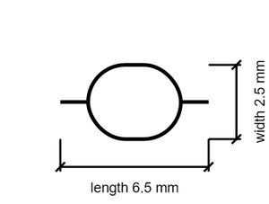

[View this part on GitHub](https://github.com/oomlout/oomp_electronic_version_5/tree/main/parts/electronic_resistor_quarter_watt_through_hole_1000000_ohm)

[Browse this category](../../navigation/electronic/resistor/quarter_watt_through_hole/README.md)

---

This page is generated from the OOMP part definition by a Roboclick Jinja template. Edit the source taxonomy or template rather than this generated file.