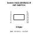
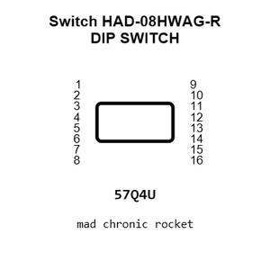
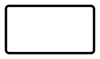
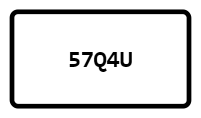
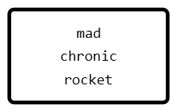
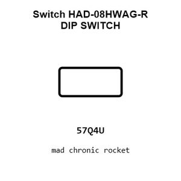
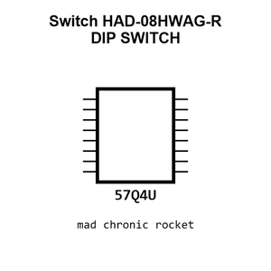
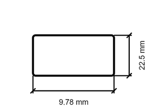
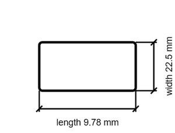

# Switch HAD-08HWAG-R DIP SWITCH

`electronic_switch_dip_switch_surface_mount_spst_8_position_raised_actuator_cixi_tonver_had_08hwag_r`

Switch HAD-08HWAG-R DIP SWITCH is an OOMP electronic switch definition. It uses the dip switch package or form factor. Its nominal drawing size is 9.78 &#x00D7; 22.5 mm. The definition includes 16 documented pins.

## At a glance

| Detail | Value |
| --- | --- |
| OOMP ID | `electronic_switch_dip_switch_surface_mount_spst_8_position_raised_actuator_cixi_tonver_had_08hwag_r` |
| Type | Switch |
| Package / style | dip switch |
| Nominal size | 9.78 &#x00D7; 22.5 mm |
| Documented pins | 16 |

## Classification

| Level | Value |
| --- | --- |
| 1 | `electronic` |
| 2 | `switch` |
| 3 | `dip_switch` |
| 4 | `surface_mount` |
| 5 | `spst_8_position` |
| 6 | `raised_actuator` |
| 14 | `cixi_tonver` |
| 15 | `had_08hwag_r` |

## Nominal dimensions

| Measurement | Value |
| --- | ---: |
| Height | 5.6 mm |
| Length | 9.78 mm |
| Width | 22.5 mm |

## Identifiers

| Identifier | Value |
| --- | --- |
| Manufacturer part number | `HAD-08HWAG-R` |
| LCSC | [`C4682`](https://www.lcsc.com/product-detail/C4682.html) |
| JLCPCB | [`C4682`](https://jlcpcb.com/partdetail/Cixi_TonverElec-HAD_08HWAGR/C4682) |

## Pins

| Pin | Name | Type |
| ---: | --- | --- |
| 1 | 1 | passive |
| 2 | 2 | passive |
| 3 | 3 | passive |
| 4 | 4 | passive |
| 5 | 5 | passive |
| 6 | 6 | passive |
| 7 | 7 | passive |
| 8 | 8 | passive |
| 9 | 9 | passive |
| 10 | 10 | passive |
| 11 | 11 | passive |
| 12 | 12 | passive |
| 13 | 13 | passive |
| 14 | 14 | passive |
| 15 | 15 | passive |
| 16 | 16 | passive |

## Datasheet

[View the datasheet](data/datasheet.pdf)

## Files

[KiCad symbol, machine-solder and hand-solder footprints](data/kicad/README.md) · [Availability and source masters](data/kicad/manifest.yaml)

[View this part on GitHub](https://github.com/oomlout/oomp_electronic_version_5/tree/main/parts/electronic_switch_dip_switch_surface_mount_spst_8_position_raised_actuator_cixi_tonver_had_08hwag_r)

[Browse this category](../../navigation/electronic/switch/dip_switch/surface_mount/spst_8_position/raised_actuator/cixi_tonver/README.md)

---

This page is generated from the OOMP part definition by a Roboclick Jinja template. Edit the source taxonomy or template rather than this generated file.