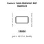
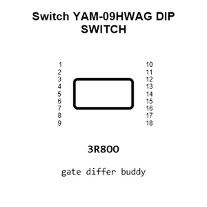
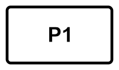
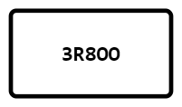
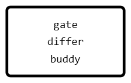
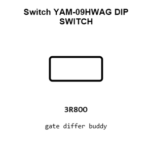
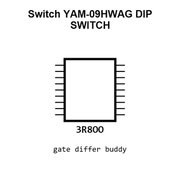
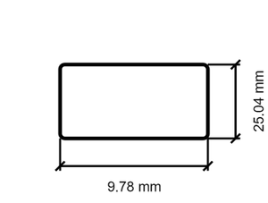
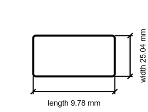

# Switch YAM-09HWAG DIP SWITCH

`electronic_switch_dip_switch_through_hole_spst_9_position_raised_actuator_cixi_tonver_yam_09hwag`

Switch YAM-09HWAG DIP SWITCH is an OOMP electronic switch definition. It uses the dip switch package or form factor. Its nominal drawing size is 9.78 &#x00D7; 25.04 mm. The definition includes 18 documented pins.

## At a glance

| Detail | Value |
| --- | --- |
| OOMP ID | `electronic_switch_dip_switch_through_hole_spst_9_position_raised_actuator_cixi_tonver_yam_09hwag` |
| Type | Switch |
| Package / style | dip switch |
| Nominal size | 9.78 &#x00D7; 25.04 mm |
| Documented pins | 18 |

## Classification

| Level | Value |
| --- | --- |
| 1 | `electronic` |
| 2 | `switch` |
| 3 | `dip_switch` |
| 4 | `through_hole` |
| 5 | `spst_9_position` |
| 6 | `raised_actuator` |
| 14 | `cixi_tonver` |
| 15 | `yam_09hwag` |

## Nominal dimensions

| Measurement | Value |
| --- | ---: |
| Height | 5.6 mm |
| Length | 9.78 mm |
| Width | 25.04 mm |

## Identifiers

| Identifier | Value |
| --- | --- |
| Manufacturer part number | `YAM-09HWAG` |
| LCSC | [`C4681`](https://www.lcsc.com/product-detail/C4681.html) |
| JLCPCB | [`C4681`](https://jlcpcb.com/partdetail/Cixi_TonverElec-YAM09HWAG/C4681) |

## Pins

| Pin | Name | Type |
| ---: | --- | --- |
| 1 | 1 | passive |
| 2 | 2 | passive |
| 3 | 3 | passive |
| 4 | 4 | passive |
| 5 | 5 | passive |
| 6 | 6 | passive |
| 7 | 7 | passive |
| 8 | 8 | passive |
| 9 | 9 | passive |
| 10 | 10 | passive |
| 11 | 11 | passive |
| 12 | 12 | passive |
| 13 | 13 | passive |
| 14 | 14 | passive |
| 15 | 15 | passive |
| 16 | 16 | passive |
| 17 | 17 | passive |
| 18 | 18 | passive |

## Datasheet

[View the datasheet](data/datasheet.pdf)

## Files

[KiCad symbol, machine-solder and hand-solder footprints](data/kicad/README.md) · [Availability and source masters](data/kicad/manifest.yaml)

[View this part on GitHub](https://github.com/oomlout/oomp_electronic_version_5/tree/main/parts/electronic_switch_dip_switch_through_hole_spst_9_position_raised_actuator_cixi_tonver_yam_09hwag)

[Browse this category](../../navigation/electronic/switch/dip_switch/through_hole/spst_9_position/raised_actuator/cixi_tonver/README.md)

---

This page is generated from the OOMP part definition by a Roboclick Jinja template. Edit the source taxonomy or template rather than this generated file.