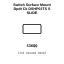
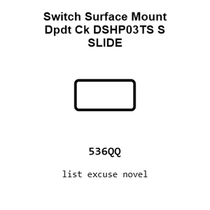
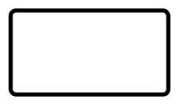
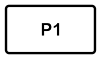
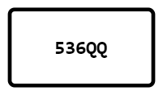
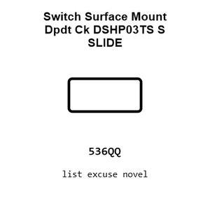
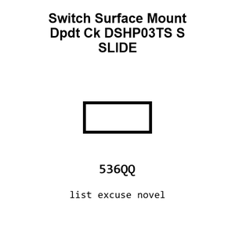
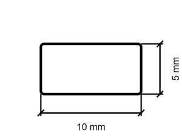
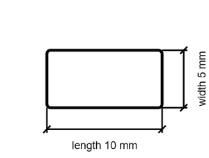

# Switch Surface Mount Dpdt Ck DSHP03TS S SLIDE

`electronic_switch_slide_surface_mount_dpdt_ck_dshp03ts_s`

Switch Surface Mount Dpdt Ck DSHP03TS S SLIDE is an OOMP electronic switch definition. It uses the slide package or form factor. Its nominal drawing size is 10.0 &#x00D7; 5.0 mm.

## At a glance

| Detail | Value |
| --- | --- |
| OOMP ID | `electronic_switch_slide_surface_mount_dpdt_ck_dshp03ts_s` |
| Type | Switch |
| Package / style | slide |
| Nominal size | 10.0 &#x00D7; 5.0 mm |

## Classification

| Level | Value |
| --- | --- |
| 1 | `electronic` |
| 2 | `switch` |
| 3 | `slide` |
| 4 | `surface_mount` |
| 5 | `dpdt` |
| 14 | `ck` |
| 15 | `dshp03ts_s` |

## Nominal dimensions

| Measurement | Value |
| --- | ---: |
| Length | 10.0 mm |
| Width | 5.0 mm |

## Used in projects

[Browse confirmed project usage](https://oomlout.github.io/oomp_electronic_project_version_5/usage/index.html#electronic_switch_slide_surface_mount_dpdt_ck_dshp03ts_s)

## Files

[KiCad symbol, machine-solder and hand-solder footprints](data/kicad/README.md) · [Availability and source masters](data/kicad/manifest.yaml)

[View this part on GitHub](https://github.com/oomlout/oomp_electronic_version_5/tree/main/parts/electronic_switch_slide_surface_mount_dpdt_ck_dshp03ts_s)

[Browse this category](../../navigation/electronic/switch/slide/surface_mount/dpdt/ck/README.md)

---

This page is generated from the OOMP part definition by a Roboclick Jinja template. Edit the source taxonomy or template rather than this generated file.