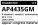

# Transistor AP4435GM SO 8

`electronic_transistor_so_8_mosfet_p_channel_enhancement_mode_30_volt_9_amp_apec_advanced_power_elec_ap4435gm`

Transistor AP4435GM SO 8 is an OOMP electronic transistor definition. It uses the so 8 package or form factor. Its nominal drawing size is 10.0 &#x00D7; 5.0 mm.

## At a glance

| Detail | Value |
| --- | --- |
| OOMP ID | `electronic_transistor_so_8_mosfet_p_channel_enhancement_mode_30_volt_9_amp_apec_advanced_power_elec_ap4435gm` |
| Type | Transistor |
| Package / style | so 8 |
| Nominal size | 10.0 &#x00D7; 5.0 mm |

## Classification

| Level | Value |
| --- | --- |
| 1 | `electronic` |
| 2 | `transistor` |
| 3 | `so_8` |
| 4 | `mosfet` |
| 5 | `p_channel` |
| 6 | `enhancement_mode` |
| 7 | `30_volt` |
| 8 | `9_amp` |
| 14 | `apec_advanced_power_elec` |
| 15 | `ap4435gm` |

## Nominal dimensions

| Measurement | Value |
| --- | ---: |
| Length | 10.0 mm |
| Width | 5.0 mm |

## Identifiers

| Identifier | Value |
| --- | --- |
| Manufacturer part number | `AP4435GM` |
| LCSC | [`C6192`](https://www.lcsc.com/product-detail/C6192.html) |
| JLCPCB | [`C6192`](https://jlcpcb.com/partdetail/APEC_Advanced_Power_Elec-AP4435GM/C6192) |

## Used in projects

[Browse confirmed project usage](https://oomlout.github.io/oomp_electronic_project_version_5/usage/index.html#electronic_transistor_so_8_mosfet_p_channel_enhancement_mode_30_volt_9_amp_apec_advanced_power_elec_ap4435gm)

## Files

<!-- oomp-part-file-table -->

| Image type | Image | Link |
| --- | :---: | --- |
| **Drawer label data** | — | [YAML](data/label_drawer.yaml) |
| **Small drawer label** |  | [SVG](label_drawer_1_5x1.svg) |
| **Large drawer label** |  | [SVG](label_drawer_3x2.svg) |
| **Part definition and build recipe** | — | [YAML](working.yaml) |

<!-- /oomp-part-file-table -->

[View this part on GitHub](https://github.com/oomlout/oomp_electronic_version_5/tree/main/parts/electronic_transistor_so_8_mosfet_p_channel_enhancement_mode_30_volt_9_amp_apec_advanced_power_elec_ap4435gm)

[Browse this category](../../navigation/electronic/transistor/so_8/mosfet/p_channel/enhancement_mode/30_volt/9_amp/apec_advanced_power_elec/README.md)

---

This page is generated from the OOMP part definition by a Roboclick Jinja template. Edit the source taxonomy or template rather than this generated file.