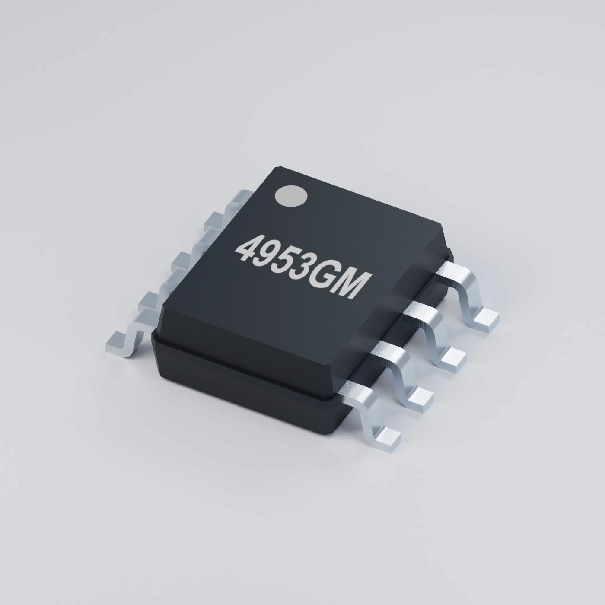
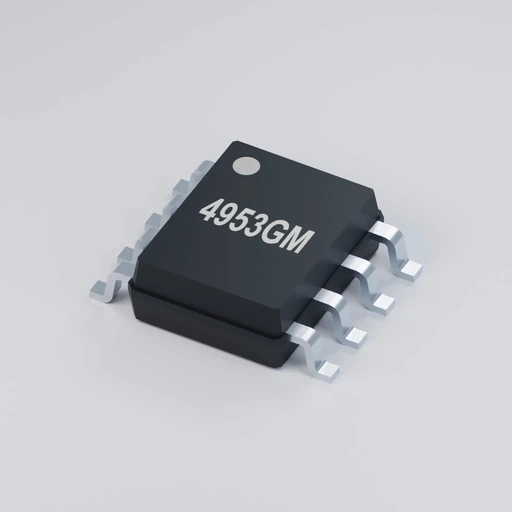
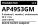
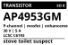

# Transistor AP4953GM SO 8

`electronic_transistor_so_8_mosfet_p_channel_enhancement_mode_dual_30_volt_5_amp_apec_advanced_power_elec_ap4953gm`

Transistor AP4953GM SO 8 is an OOMP electronic transistor definition. It uses the so 8 package or form factor. Its nominal drawing size is 10.0 &#x00D7; 5.0 mm.

KiCad SOIC-8 6.0 x 4.9 x 1.75 mm overall model approximates the manufacturer SO-8 package. The catalogue 10 x 5 mm dimensions differ from the package. This part has no separate local PDF. Finish and details are illustrative; not manufacturing CAD or a footprint. 4953GM is the manufacturer-documented fixed code; typeface, logo, placement and omitted production details are illustrative. Marking composited in linear light from shared path-traced material passes; indirect reflections are approximate.

[Render recipe and provenance](data/display_render/manifest.json) · [KiCad model](https://gitlab.com/kicad/libraries/kicad-packages3D/-/blob/master/Package_SO.3dshapes/SOIC-8_3.9x4.9mm_P1.27mm.step)

Model credit: 2025 KiCAD. CC-BY-SA-4.0 with KiCad library exception; see original STEP header.

## At a glance

| Detail | Value |
| --- | --- |
| OOMP ID | `electronic_transistor_so_8_mosfet_p_channel_enhancement_mode_dual_30_volt_5_amp_apec_advanced_power_elec_ap4953gm` |
| Type | Transistor |
| Package / style | so 8 |
| Nominal size | 10.0 &#x00D7; 5.0 mm |

## Classification

| Level | Value |
| --- | --- |
| 1 | `electronic` |
| 2 | `transistor` |
| 3 | `so_8` |
| 4 | `mosfet` |
| 5 | `p_channel` |
| 6 | `enhancement_mode` |
| 7 | `dual` |
| 8 | `30_volt` |
| 9 | `5_amp` |
| 14 | `apec_advanced_power_elec` |
| 15 | `ap4953gm` |

## Nominal dimensions

| Measurement | Value |
| --- | ---: |
| Length | 10.0 mm |
| Width | 5.0 mm |

## Identifiers

| Identifier | Value |
| --- | --- |
| Manufacturer part number | `AP4953GM` |
| LCSC | [`C6193`](https://www.lcsc.com/product-detail/C6193.html) |
| JLCPCB | [`C6193`](https://jlcpcb.com/partdetail/APEC_Advanced_Power_Elec-AP4953GM/C6193) |

## Used in projects

[Browse confirmed project usage](https://oomlout.github.io/oomp_electronic_project_version_5/usage/index.html#electronic_transistor_so_8_mosfet_p_channel_enhancement_mode_dual_30_volt_5_amp_apec_advanced_power_elec_ap4953gm)

## Files

<!-- oomp-part-file-table -->

| Image type | Image | Link |
| --- | :---: | --- |
| **Studio render** |  | [PNG](data/display_render/render.png) · [Preview](data/display_render/preview.webp) |
| **Studio render sources and recipe** | — | [JSON](data/display_render/manifest.json) |
| **Drawer label data** | — | [YAML](data/label_drawer.yaml) |
| **Small drawer label** |  | [SVG](label_drawer_1_5x1.svg) |
| **Large drawer label** |  | [SVG](label_drawer_3x2.svg) |
| **Web catalogue file index** | — | [YAML](web.yaml) |
| **Part definition and build recipe** | — | [YAML](working.yaml) |

<!-- /oomp-part-file-table -->

[View this part on GitHub](https://github.com/oomlout/oomp_electronic_version_5/tree/main/parts/electronic_transistor_so_8_mosfet_p_channel_enhancement_mode_dual_30_volt_5_amp_apec_advanced_power_elec_ap4953gm)

[Browse this category](../../navigation/electronic/transistor/so_8/mosfet/p_channel/enhancement_mode/dual/30_volt/5_amp/apec_advanced_power_elec/README.md)

---

This page is generated from the OOMP part definition by a Roboclick Jinja template. Edit the source taxonomy or template rather than this generated file.