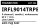

# Transistor IRFL9014TRPBF SOT 223

`electronic_transistor_sot_223_mosfet_p_channel_enhancement_mode_60_volt_1_8_amp_vishay_intertech_irfl9014trpbf`

Transistor IRFL9014TRPBF SOT 223 is an OOMP electronic transistor definition. It uses the sot 223 package or form factor. Its nominal drawing size is 10.0 &#x00D7; 5.0 mm.

## At a glance

| Detail | Value |
| --- | --- |
| OOMP ID | `electronic_transistor_sot_223_mosfet_p_channel_enhancement_mode_60_volt_1_8_amp_vishay_intertech_irfl9014trpbf` |
| Type | Transistor |
| Package / style | sot 223 |
| Nominal size | 10.0 &#x00D7; 5.0 mm |

## Classification

| Level | Value |
| --- | --- |
| 1 | `electronic` |
| 2 | `transistor` |
| 3 | `sot_223` |
| 4 | `mosfet` |
| 5 | `p_channel` |
| 6 | `enhancement_mode` |
| 7 | `60_volt` |
| 8 | `1_8_amp` |
| 14 | `vishay_intertech` |
| 15 | `irfl9014trpbf` |

## Nominal dimensions

| Measurement | Value |
| --- | ---: |
| Length | 10.0 mm |
| Width | 5.0 mm |

## Identifiers

| Identifier | Value |
| --- | --- |
| Manufacturer part number | `IRFL9014TRPBF` |
| LCSC | [`C3054`](https://www.lcsc.com/product-detail/C3054.html) |
| JLCPCB | [`C3054`](https://jlcpcb.com/partdetail/VishayIntertech-IRFL9014TRPBF/C3054) |

## Used in projects

[Browse confirmed project usage](https://oomlout.github.io/oomp_electronic_project_version_5/usage/index.html#electronic_transistor_sot_223_mosfet_p_channel_enhancement_mode_60_volt_1_8_amp_vishay_intertech_irfl9014trpbf)

## Files

<!-- oomp-part-file-table -->

| Image type | Image | Link |
| --- | :---: | --- |
| **Drawer label data** | — | [YAML](data/label_drawer.yaml) |
| **Small drawer label** |  | [SVG](label_drawer_1_5x1.svg) |
| **Large drawer label** |  | [SVG](label_drawer_3x2.svg) |
| **Part definition and build recipe** | — | [YAML](working.yaml) |

<!-- /oomp-part-file-table -->

[View this part on GitHub](https://github.com/oomlout/oomp_electronic_version_5/tree/main/parts/electronic_transistor_sot_223_mosfet_p_channel_enhancement_mode_60_volt_1_8_amp_vishay_intertech_irfl9014trpbf)

[Browse this category](../../navigation/electronic/transistor/sot_223/mosfet/p_channel/enhancement_mode/60_volt/1_8_amp/vishay_intertech/README.md)

---

This page is generated from the OOMP part definition by a Roboclick Jinja template. Edit the source taxonomy or template rather than this generated file.