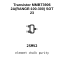
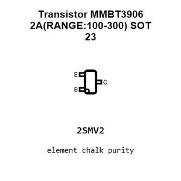
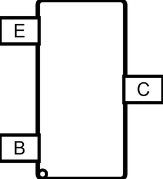
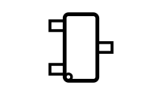
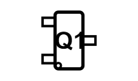
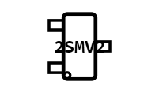
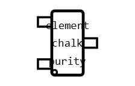
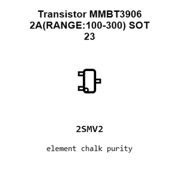
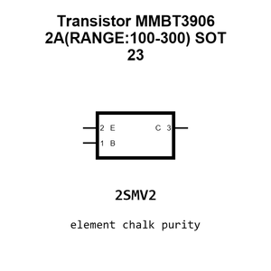
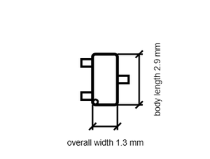

# Transistor MMBT3906 2A(RANGE:100-300) SOT 23

`electronic_transistor_sot_23_bipolar_pnp_40_volt_200_milliamp_jiangsu_changjing_electronics_technology_co_ltd_mmbt3906_2a_range_100_300`

Transistor MMBT3906 2A(RANGE:100-300) SOT 23 is an OOMP electronic transistor definition. It uses the sot 23 package or form factor. Its nominal drawing size is 2.9 &#x00D7; 1.3 mm. The definition includes 3 documented pins.

## At a glance

| Detail | Value |
| --- | --- |
| OOMP ID | `electronic_transistor_sot_23_bipolar_pnp_40_volt_200_milliamp_jiangsu_changjing_electronics_technology_co_ltd_mmbt3906_2a_range_100_300` |
| Type | Transistor |
| Package / style | sot 23 |
| Nominal size | 2.9 &#x00D7; 1.3 mm |
| Documented pins | 3 |

## Classification

| Level | Value |
| --- | --- |
| 1 | `electronic` |
| 2 | `transistor` |
| 3 | `sot_23` |
| 4 | `bipolar` |
| 5 | `pnp` |
| 6 | `40_volt` |
| 7 | `200_milliamp` |
| 14 | `jiangsu_changjing_electronics_technology_co_ltd` |
| 15 | `mmbt3906_2a_range_100_300` |

## Nominal dimensions

| Measurement | Value |
| --- | ---: |
| Height | 1.1 mm |
| Length | 2.9 mm |
| Width | 1.3 mm |

## Identifiers

| Identifier | Value |
| --- | --- |
| Manufacturer part number | `MMBT3906 2A(RANGE:100-300)` |
| LCSC | [`C2143`](https://www.lcsc.com/product-detail/C2143.html) |
| JLCPCB | [`C2143`](https://jlcpcb.com/partdetail/2500-MMBT3906_2A_RANGE_100_300/C2143) |

## Pins

| Pin | Name | Type |
| ---: | --- | --- |
| 1 | B | input |
| 2 | E | passive |
| 3 | C | passive |

## Datasheet

[View the datasheet](data/datasheet.pdf)

## Files

[KiCad symbol, machine-solder and hand-solder footprints](data/kicad/README.md) · [Availability and source masters](data/kicad/manifest.yaml)

[View this part on GitHub](https://github.com/oomlout/oomp_electronic_version_5/tree/main/parts/electronic_transistor_sot_23_bipolar_pnp_40_volt_200_milliamp_jiangsu_changjing_electronics_technology_co_ltd_mmbt3906_2a_range_100_300)

[Browse this category](../../navigation/electronic/transistor/sot_23/bipolar/pnp/40_volt/200_milliamp/jiangsu_changjing_electronics_technology_co_ltd/README.md)

---

This page is generated from the OOMP part definition by a Roboclick Jinja template. Edit the source taxonomy or template rather than this generated file.