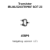
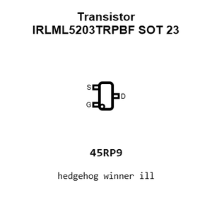
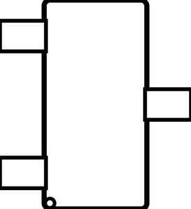
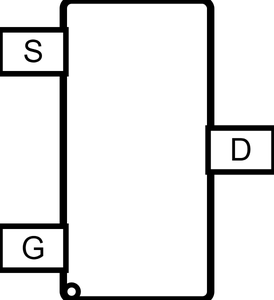
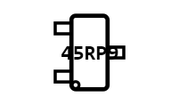
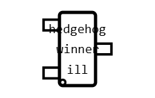
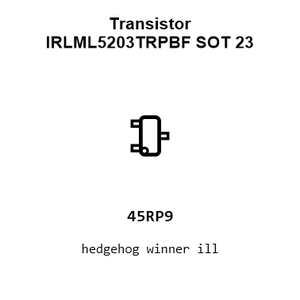
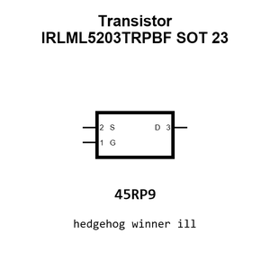
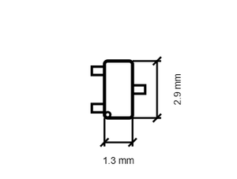

# Transistor IRLML5203TRPBF SOT 23

`electronic_transistor_sot_23_mosfet_p_channel_enhancement_mode_30_volt_3_amp_infineon_technologies_irlml5203trpbf`

Transistor IRLML5203TRPBF SOT 23 is an OOMP electronic transistor definition. It uses the sot 23 package or form factor. Its nominal drawing size is 2.9 &#x00D7; 1.3 mm. The definition includes 3 documented pins.

## At a glance

| Detail | Value |
| --- | --- |
| OOMP ID | `electronic_transistor_sot_23_mosfet_p_channel_enhancement_mode_30_volt_3_amp_infineon_technologies_irlml5203trpbf` |
| Type | Transistor |
| Package / style | sot 23 |
| Nominal size | 2.9 &#x00D7; 1.3 mm |
| Documented pins | 3 |

## Classification

| Level | Value |
| --- | --- |
| 1 | `electronic` |
| 2 | `transistor` |
| 3 | `sot_23` |
| 4 | `mosfet` |
| 5 | `p_channel` |
| 6 | `enhancement_mode` |
| 7 | `30_volt` |
| 8 | `3_amp` |
| 14 | `infineon_technologies` |
| 15 | `irlml5203trpbf` |

## Nominal dimensions

| Measurement | Value |
| --- | ---: |
| Height | 1.1 mm |
| Length | 2.9 mm |
| Width | 1.3 mm |

## Identifiers

| Identifier | Value |
| --- | --- |
| Manufacturer part number | `IRLML5203TRPBF` |
| LCSC | [`C2592`](https://www.lcsc.com/product-detail/C2592.html) |
| JLCPCB | [`C2592`](https://jlcpcb.com/partdetail/InfineonTechnologies-IRLML5203TRPBF/C2592) |

## Pins

| Pin | Name | Type |
| ---: | --- | --- |
| 1 | G | input |
| 2 | S | passive |
| 3 | D | passive |

## Datasheet

[View the datasheet](data/datasheet.pdf)

## Files

[KiCad symbol, machine-solder and hand-solder footprints](data/kicad/README.md) · [Availability and source masters](data/kicad/manifest.yaml)

[View this part on GitHub](https://github.com/oomlout/oomp_electronic_version_5/tree/main/parts/electronic_transistor_sot_23_mosfet_p_channel_enhancement_mode_30_volt_3_amp_infineon_technologies_irlml5203trpbf)

[Browse this category](../../navigation/electronic/transistor/sot_23/mosfet/p_channel/enhancement_mode/30_volt/3_amp/infineon_technologies/README.md)

---

This page is generated from the OOMP part definition by a Roboclick Jinja template. Edit the source taxonomy or template rather than this generated file.