# Transistor Mosfet N Channel Dual SOT 363 6

`electronic_transistor_sot_363_6_mosfet_n_channel_dual`

Transistor Mosfet N Channel Dual SOT 363 6 is an OOMP electronic transistor definition. It uses the sot 363 6 package or form factor. Its nominal drawing size is 2.0 &#x00D7; 1.25 mm.

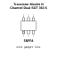

## At a glance

| Detail | Value |
| --- | --- |
| OOMP ID | `electronic_transistor_sot_363_6_mosfet_n_channel_dual` |
| Type | Transistor |
| Package / style | sot 363 6 |
| Nominal size | 2.0 &#x00D7; 1.25 mm |

## Classification

| Level | Value |
| --- | --- |
| 1 | `electronic` |
| 2 | `transistor` |
| 3 | `sot_363_6` |
| 4 | `mosfet` |
| 5 | `n_channel` |
| 6 | `dual` |

## Nominal dimensions

| Measurement | Value |
| --- | ---: |
| Height | 0.95 mm |
| Length | 2.0 mm |
| Width | 1.25 mm |

## Used in projects

[Browse confirmed project usage](https://oomlout.github.io/oomp_electronic_project_version_5/usage/index.html#electronic_transistor_sot_363_6_mosfet_n_channel_dual)

## Files

[KiCad symbol, machine-solder and hand-solder footprints](data/kicad/README.md) · [Availability and source masters](data/kicad/manifest.yaml)

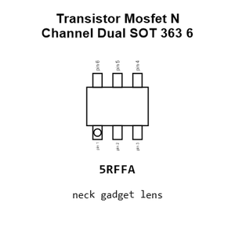

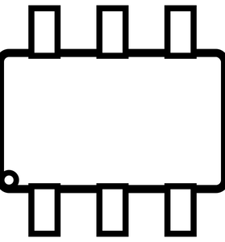

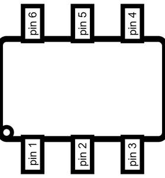

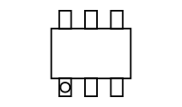

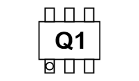

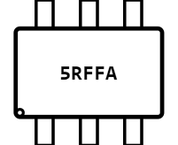

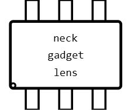

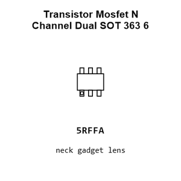

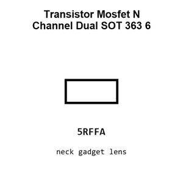

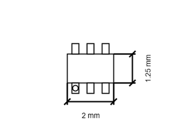

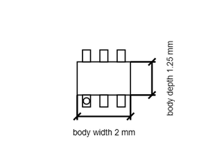

[View this part on GitHub](https://github.com/oomlout/oomp_electronic_version_5/tree/main/parts/electronic_transistor_sot_363_6_mosfet_n_channel_dual)

[Browse this category](../../navigation/electronic/transistor/sot_363_6/mosfet/n_channel/README.md)

---

This page is generated from the OOMP part definition by a Roboclick Jinja template. Edit the source taxonomy or template rather than this generated file.