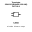
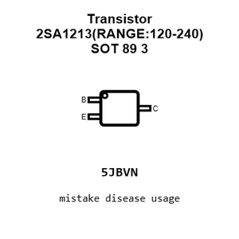
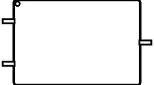
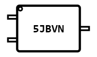
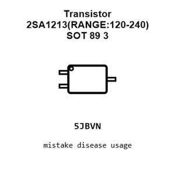
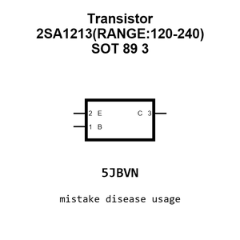
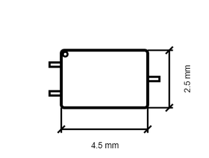
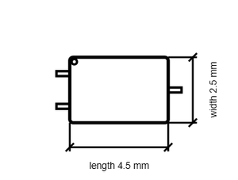

# Transistor 2SA1213(RANGE:120-240) SOT 89 3

`electronic_transistor_sot_89_3_bipolar_pnp_50_volt_2_amp_jiangsu_changjing_electronics_technology_co_ltd_2sa1213_range_120_240`

Transistor 2SA1213(RANGE:120-240) SOT 89 3 is an OOMP electronic transistor definition. It uses the sot 89 3 package or form factor. Its nominal drawing size is 4.5 &#x00D7; 2.5 mm. The definition includes 3 documented pins.

## At a glance

| Detail | Value |
| --- | --- |
| OOMP ID | `electronic_transistor_sot_89_3_bipolar_pnp_50_volt_2_amp_jiangsu_changjing_electronics_technology_co_ltd_2sa1213_range_120_240` |
| Type | Transistor |
| Package / style | sot 89 3 |
| Nominal size | 4.5 &#x00D7; 2.5 mm |
| Documented pins | 3 |

## Classification

| Level | Value |
| --- | --- |
| 1 | `electronic` |
| 2 | `transistor` |
| 3 | `sot_89_3` |
| 4 | `bipolar` |
| 5 | `pnp` |
| 6 | `50_volt` |
| 7 | `2_amp` |
| 14 | `jiangsu_changjing_electronics_technology_co_ltd` |
| 15 | `2sa1213_range_120_240` |

## Nominal dimensions

| Measurement | Value |
| --- | ---: |
| Height | 1.5 mm |
| Length | 4.5 mm |
| Width | 2.5 mm |

## Identifiers

| Identifier | Value |
| --- | --- |
| Manufacturer part number | `2SA1213(RANGE:120-240)` |
| LCSC | [`C2078`](https://www.lcsc.com/product-detail/C2078.html) |
| JLCPCB | [`C2078`](https://jlcpcb.com/partdetail/2435-2SA1213_RANGE_120_240/C2078) |

## Pins

| Pin | Name | Type |
| ---: | --- | --- |
| 1 | B | input |
| 2 | E | passive |
| 3 | C | passive |

## Datasheet

[View the datasheet](data/datasheet.pdf)

## Files

[KiCad symbol, machine-solder and hand-solder footprints](data/kicad/README.md) · [Availability and source masters](data/kicad/manifest.yaml)

[View this part on GitHub](https://github.com/oomlout/oomp_electronic_version_5/tree/main/parts/electronic_transistor_sot_89_3_bipolar_pnp_50_volt_2_amp_jiangsu_changjing_electronics_technology_co_ltd_2sa1213_range_120_240)

[Browse this category](../../navigation/electronic/transistor/sot_89_3/bipolar/pnp/50_volt/2_amp/jiangsu_changjing_electronics_technology_co_ltd/README.md)

---

This page is generated from the OOMP part definition by a Roboclick Jinja template. Edit the source taxonomy or template rather than this generated file.