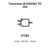
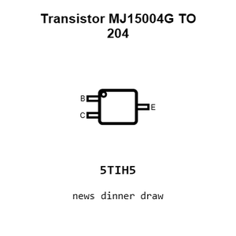
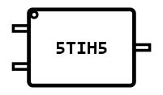
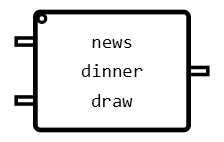
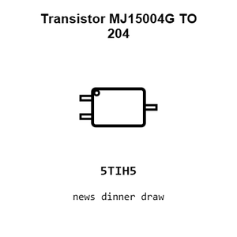
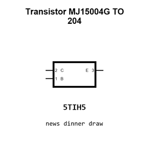
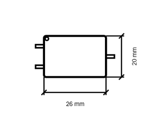
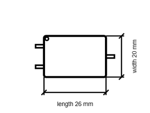

# Transistor MJ15004G TO 204

`electronic_transistor_to_204_bipolar_pnp_140_volt_20_amp_onsemi_mj15004g`

Transistor MJ15004G TO 204 is an OOMP electronic transistor definition. It uses the to 204 package or form factor. Its nominal drawing size is 26.0 &#x00D7; 20.0 mm. The definition includes 3 documented pins.

## At a glance

| Detail | Value |
| --- | --- |
| OOMP ID | `electronic_transistor_to_204_bipolar_pnp_140_volt_20_amp_onsemi_mj15004g` |
| Type | Transistor |
| Package / style | to 204 |
| Nominal size | 26.0 &#x00D7; 20.0 mm |
| Documented pins | 3 |

## Classification

| Level | Value |
| --- | --- |
| 1 | `electronic` |
| 2 | `transistor` |
| 3 | `to_204` |
| 4 | `bipolar` |
| 5 | `pnp` |
| 6 | `140_volt` |
| 7 | `20_amp` |
| 14 | `onsemi` |
| 15 | `mj15004g` |

## Nominal dimensions

| Measurement | Value |
| --- | ---: |
| Height | 10.5 mm |
| Length | 26.0 mm |
| Width | 20.0 mm |

## Identifiers

| Identifier | Value |
| --- | --- |
| Manufacturer part number | `MJ15004G` |
| LCSC | [`C2729`](https://www.lcsc.com/product-detail/C2729.html) |
| JLCPCB | [`C2729`](https://jlcpcb.com/partdetail/onsemi-MJ15004G/C2729) |

## Pins

| Pin | Name | Type |
| ---: | --- | --- |
| 1 | B | input |
| 2 | C | passive |
| 3 | E | passive |

## Datasheet

[View the datasheet](data/datasheet.pdf)

## Files

[KiCad symbol, machine-solder and hand-solder footprints](data/kicad/README.md) · [Availability and source masters](data/kicad/manifest.yaml)

[View this part on GitHub](https://github.com/oomlout/oomp_electronic_version_5/tree/main/parts/electronic_transistor_to_204_bipolar_pnp_140_volt_20_amp_onsemi_mj15004g)

[Browse this category](../../navigation/electronic/transistor/to_204/bipolar/pnp/140_volt/20_amp/onsemi/README.md)

---

This page is generated from the OOMP part definition by a Roboclick Jinja template. Edit the source taxonomy or template rather than this generated file.