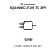
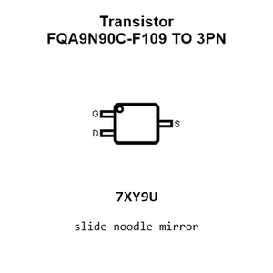
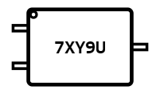
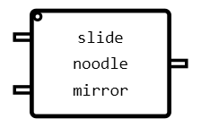
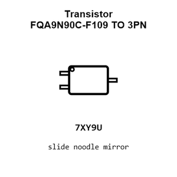
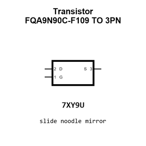
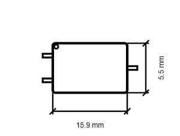

# Transistor FQA9N90C-F109 TO 3PN

`electronic_transistor_to_3pn_mosfet_n_channel_enhancement_mode_900_volt_9_amp_onsemi_fqa9n90c_f109`

Transistor FQA9N90C-F109 TO 3PN is an OOMP electronic transistor definition. It uses the to 3pn package or form factor. Its nominal drawing size is 15.9 &#x00D7; 5.5 mm. The definition includes 3 documented pins.

## At a glance

| Detail | Value |
| --- | --- |
| OOMP ID | `electronic_transistor_to_3pn_mosfet_n_channel_enhancement_mode_900_volt_9_amp_onsemi_fqa9n90c_f109` |
| Type | Transistor |
| Package / style | to 3pn |
| Nominal size | 15.9 &#x00D7; 5.5 mm |
| Documented pins | 3 |

## Classification

| Level | Value |
| --- | --- |
| 1 | `electronic` |
| 2 | `transistor` |
| 3 | `to_3pn` |
| 4 | `mosfet` |
| 5 | `n_channel` |
| 6 | `enhancement_mode` |
| 7 | `900_volt` |
| 8 | `9_amp` |
| 14 | `onsemi` |
| 15 | `fqa9n90c_f109` |

## Nominal dimensions

| Measurement | Value |
| --- | ---: |
| Height | 15.6 mm |
| Length | 15.9 mm |
| Width | 5.5 mm |

## Identifiers

| Identifier | Value |
| --- | --- |
| Manufacturer part number | `FQA9N90C-F109` |
| LCSC | [`C2711`](https://www.lcsc.com/product-detail/C2711.html) |
| JLCPCB | [`C2711`](https://jlcpcb.com/partdetail/onsemi-FQA9N90CF109/C2711) |

## Pins

| Pin | Name | Type |
| ---: | --- | --- |
| 1 | G | input |
| 2 | D | passive |
| 3 | S | passive |

## Datasheet

[View the datasheet](data/datasheet.pdf)

## Files

[KiCad symbol, machine-solder and hand-solder footprints](data/kicad/README.md) · [Availability and source masters](data/kicad/manifest.yaml)

[View this part on GitHub](https://github.com/oomlout/oomp_electronic_version_5/tree/main/parts/electronic_transistor_to_3pn_mosfet_n_channel_enhancement_mode_900_volt_9_amp_onsemi_fqa9n90c_f109)

[Browse this category](../../navigation/electronic/transistor/to_3pn/mosfet/n_channel/enhancement_mode/900_volt/9_amp/onsemi/README.md)

---

This page is generated from the OOMP part definition by a Roboclick Jinja template. Edit the source taxonomy or template rather than this generated file.