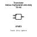
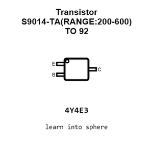
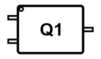
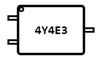
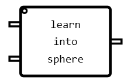
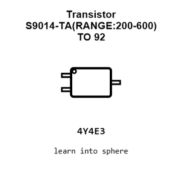
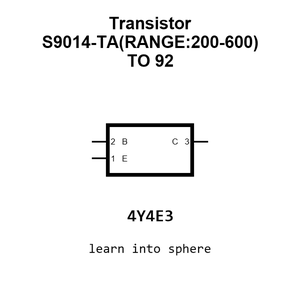
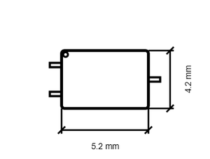
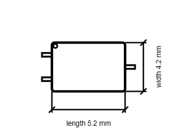

# Transistor S9014-TA(RANGE:200-600) TO 92

`electronic_transistor_to_92_bipolar_npn_45_volt_100_milliamp_jiangsu_changjing_electronics_technology_co_ltd_s9014_ta_range_200_600`

Transistor S9014-TA(RANGE:200-600) TO 92 is an OOMP electronic transistor definition. It uses the to 92 package or form factor. Its nominal drawing size is 5.2 &#x00D7; 4.2 mm. The definition includes 3 documented pins.

## At a glance

| Detail | Value |
| --- | --- |
| OOMP ID | `electronic_transistor_to_92_bipolar_npn_45_volt_100_milliamp_jiangsu_changjing_electronics_technology_co_ltd_s9014_ta_range_200_600` |
| Type | Transistor |
| Package / style | to 92 |
| Nominal size | 5.2 &#x00D7; 4.2 mm |
| Documented pins | 3 |

## Classification

| Level | Value |
| --- | --- |
| 1 | `electronic` |
| 2 | `transistor` |
| 3 | `to_92` |
| 4 | `bipolar` |
| 5 | `npn` |
| 6 | `45_volt` |
| 7 | `100_milliamp` |
| 14 | `jiangsu_changjing_electronics_technology_co_ltd` |
| 15 | `s9014_ta_range_200_600` |

## Nominal dimensions

| Measurement | Value |
| --- | ---: |
| Height | 5.2 mm |
| Length | 5.2 mm |
| Width | 4.2 mm |

## Identifiers

| Identifier | Value |
| --- | --- |
| Manufacturer part number | `S9014-TA(RANGE:200-600)` |
| LCSC | [`C2097`](https://www.lcsc.com/product-detail/C2097.html) |
| JLCPCB | [`C2097`](https://jlcpcb.com/partdetail/2454-S9014_TA_RANGE_200_600/C2097) |

## Pins

| Pin | Name | Type |
| ---: | --- | --- |
| 1 | E | passive |
| 2 | B | input |
| 3 | C | passive |

## Datasheet

[View the datasheet](data/datasheet.pdf)

## Files

[KiCad symbol, machine-solder and hand-solder footprints](data/kicad/README.md) · [Availability and source masters](data/kicad/manifest.yaml)

[View this part on GitHub](https://github.com/oomlout/oomp_electronic_version_5/tree/main/parts/electronic_transistor_to_92_bipolar_npn_45_volt_100_milliamp_jiangsu_changjing_electronics_technology_co_ltd_s9014_ta_range_200_600)

[Browse this category](../../navigation/electronic/transistor/to_92/bipolar/npn/45_volt/100_milliamp/jiangsu_changjing_electronics_technology_co_ltd/README.md)

---

This page is generated from the OOMP part definition by a Roboclick Jinja template. Edit the source taxonomy or template rather than this generated file.